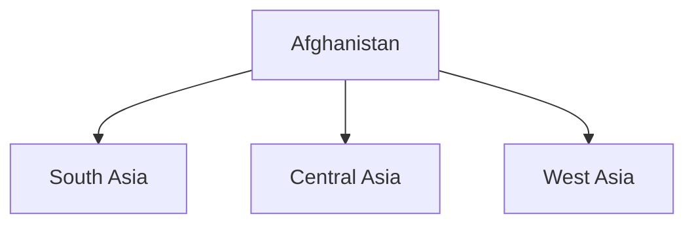

# Afghanistan

## Overview

Afghanistan is an important country in India's extended neighbourhood and occupies a strategic position connecting South Asia, Central Asia, and West Asia.

India and Afghanistan have historically shared civilizational, cultural, economic, and political ties.

Afghanistan is significant for India's regional connectivity, security interests, and diplomatic engagement in the broader Asian region.

## Basic Facts

| Topic | Details |
|----------|----------|
| Capital | Kabul |
| Official Languages | Dari, Pashto |
| Currency | Afghani |
| Region | South-Central Asia |
| Independence | 1919 |
| Government | Varies with Political Developments |

## Geography

Afghanistan is a landlocked country.

It shares borders with:

- Pakistan
- Iran
- Turkmenistan
- Uzbekistan
- Tajikistan
- China

## Historical Connections with India

India and Afghanistan have shared links through:

- Ancient trade routes
- Cultural exchanges
- Buddhist heritage
- Historical kingdoms and empires

The region historically served as an important gateway between the Indian subcontinent and Central Asia.

## India–Afghanistan Relations

India has traditionally supported a stable, peaceful, and prosperous Afghanistan.

The relationship has focused on:

- Development cooperation
- Infrastructure projects
- Education
- Capacity building
- Humanitarian assistance

## Development Partnership

India has contributed to major projects including:

- Parliament Building in Kabul
- Salma Dam (Afghan-India Friendship Dam)
- Road infrastructure projects
- Community development initiatives

## Connectivity Cooperation

Important initiatives include:

- Chabahar Port connectivity
- International transport corridors
- Trade facilitation projects

These initiatives aim to improve access between Afghanistan and regional markets.

## Humanitarian Assistance

India has provided assistance in:

- Food security
- Healthcare support
- Disaster relief
- Educational programmes

## Education and Capacity Building

India supports:

- Scholarships
- Professional training
- Academic exchanges
- Technical education programmes

## Security Importance

Afghanistan is important for:

- Regional stability
- Counter-terrorism efforts
- Security cooperation
- Prevention of extremist networks

## Regional Significance

Afghanistan occupies a strategic location connecting:

- South Asia
- Central Asia
- West Asia

Its stability has implications for the wider region.

## Challenges

Major challenges include:

- Political instability
- Security concerns
- Humanitarian issues
- Economic difficulties
- Terrorism-related threats

## Importance for India

Afghanistan is important because of:

- Regional connectivity goals
- Security considerations
- Historical ties
- Access to Central Asia
- Regional stability

## Significance

Afghanistan remains an important partner in India's extended neighbourhood and plays a significant role in regional geopolitics, connectivity, and security.

## Quick Revision

| Topic | Details |
|----------|----------|
| Capital | Kabul |
| Region | South-Central Asia |
| Major Project | Afghan-India Friendship Dam |
| Connectivity Initiative | Chabahar Route |
| Strategic Importance | Access to Central Asia |
| Major Concern | Regional Stability |

## Think & Recall

1. Why is Afghanistan strategically important for India?
2. What is the significance of the Afghan Parliament project?
3. How does Chabahar Port support connectivity with Afghanistan?
4. What are the major challenges facing Afghanistan?
5. How do India and Afghanistan cooperate in development and education?
