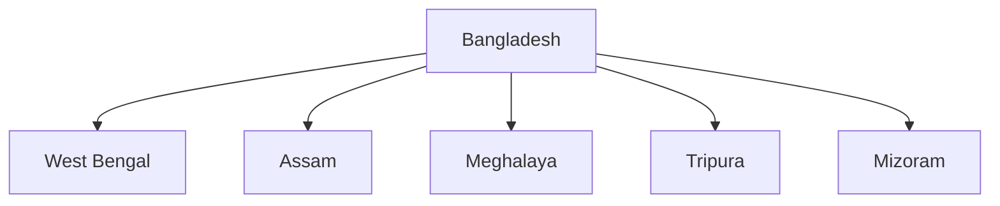

# Bangladesh

## Overview

Bangladesh is one of India's most important neighbours in South Asia.

The two countries share deep historical, cultural, linguistic, economic, and geographical connections.

India and Bangladesh cooperate in areas such as connectivity, trade, security, water sharing, energy, and regional development.

## Basic Facts

| Topic | Details |
|----------|----------|
| Capital | Dhaka |
| Independence | 1971 |
| Official Language | Bengali |
| Currency | Bangladeshi Taka |
| Region | South Asia |
| Border with India | Longest Land Border Shared by India |

## Geography

Bangladesh is surrounded by India on three sides and shares a small border with Myanmar.

Indian states sharing a border with Bangladesh include:

- West Bengal
- Assam
- Meghalaya
- Tripura
- Mizoram

## Historical Background

### Liberation War of 1971

Bangladesh emerged as an independent country in 1971.

India played an important role in supporting the Bangladesh Liberation War.

The conflict resulted in the creation of Bangladesh from former East Pakistan.

## Areas of Cooperation

### Trade

Bangladesh is one of India's largest trading partners in South Asia.

Major areas include:

- Textiles
- Petroleum products
- Machinery
- Agricultural goods

### Connectivity

Both countries cooperate in:

- Road connectivity
- Rail connectivity
- Inland waterways
- Coastal shipping

### Energy Cooperation

Areas include:

- Electricity trade
- Power transmission links
- Energy infrastructure projects

### Security Cooperation

Cooperation includes:

- Counter-terrorism
- Border management
- Anti-smuggling operations
- Intelligence sharing

## Water Sharing

Several rivers flow through both countries.

Important rivers include:

- Ganga
- Teesta
- Brahmaputra

Water-sharing arrangements remain an important aspect of bilateral relations.

## Border Management

Important issues include:

- Border security
- Illegal trafficking
- Cross-border crime
- Border infrastructure development

### Land Boundary Agreement

India and Bangladesh implemented the Land Boundary Agreement to resolve long-standing border issues.

## Regional Cooperation

India and Bangladesh cooperate through:

- BIMSTEC
- IORA
- Indian Ocean initiatives
- Regional connectivity projects

## Cultural Relations

Shared cultural links include:

- Bengali language and literature
- Historical connections
- Educational exchanges
- Cultural programmes

## Importance for India

Bangladesh contributes to:

- Neighbourhood First Policy
- Act East Policy connectivity
- Regional stability
- Economic integration
- North-East India connectivity

## Challenges

Major challenges include:

- Water-sharing issues
- Illegal migration concerns
- Border management challenges
- Trade imbalances

Despite these challenges, bilateral relations remain strong.

## Significance

Bangladesh is one of India's closest partners in South Asia and plays a major role in regional connectivity, economic cooperation, and neighbourhood diplomacy.

## Quick Revision

| Topic | Details |
|----------|----------|
| Capital | Dhaka |
| Independence | 1971 |
| Key Agreement | Land Boundary Agreement |
| Major River Issue | Teesta |
| Important Policy Link | Neighbourhood First |
| Strategic Importance | Connectivity to North-East India |

## Think & Recall

1. Which Indian states share a border with Bangladesh?
2. What was India's role in the 1971 Liberation War?
3. Why is the Teesta River important in bilateral relations?
4. What is the significance of the Land Boundary Agreement?
5. How does Bangladesh support India's connectivity goals?
