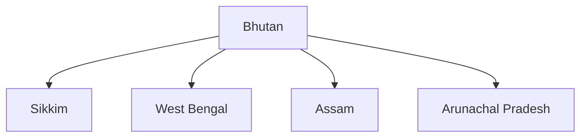

# Bhutan

## Overview

Bhutan is one of India's closest and most trusted neighbours in South Asia.

The relationship is characterized by friendship, mutual trust, economic cooperation, development partnership, and close people-to-people ties.

Bhutan occupies an important place in India's Neighbourhood First Policy and Himalayan security framework.

## Basic Facts

| Topic | Details |
|----------|----------|
| Capital | Thimphu |
| Official Language | Dzongkha |
| Currency | Ngultrum |
| Region | Eastern Himalayas |
| Government | Constitutional Monarchy |
| Border with India | Yes |

## Geography

Bhutan is a landlocked Himalayan country.

It shares borders with:

- India
- China

Indian states bordering Bhutan include:

- Sikkim
- West Bengal
- Assam
- Arunachal Pradesh

## Historical Background

India and Bhutan have maintained close relations since India's independence.

The relationship is based on mutual respect for sovereignty and shared security interests.

## Treaty of Friendship

### Original Treaty

- 1949

### Revised Treaty

- 2007

The revised treaty strengthened Bhutan's sovereignty while preserving close bilateral cooperation.

## Areas of Cooperation

### Hydropower Cooperation

Hydropower is the most important pillar of bilateral economic relations.

Benefits include:

- Clean energy generation
- Revenue for Bhutan
- Electricity imports for India

### Trade and Commerce

India is Bhutan's largest trading partner.

Major areas include:

- Energy trade
- Consumer goods
- Infrastructure materials
- Agricultural products

### Development Partnership

India supports Bhutan through:

- Infrastructure projects
- Education initiatives
- Healthcare cooperation
- Capacity building programmes

## Connectivity Cooperation

Important areas include:

- Road connectivity
- Border infrastructure
- Digital cooperation
- Transport links

## Security Cooperation

India and Bhutan cooperate in:

- Border security
- Counter-insurgency coordination
- Strategic consultations
- Regional stability initiatives

## Cultural Relations

Shared links include:

- Buddhist heritage
- Educational exchanges
- Tourism
- Cultural programmes

## Regional Cooperation

India and Bhutan cooperate through:

- BIMSTEC
- BBIN initiatives
- Regional connectivity projects

## Importance for India

Bhutan is important because of:

- Himalayan security
- Strategic location
- Hydropower cooperation
- Regional stability
- Neighbourhood First Policy

## Challenges

Major challenges include:

- Climate change impacts
- Mountain infrastructure constraints
- Economic diversification needs

Despite these challenges, bilateral relations remain exceptionally strong.

## Significance

Bhutan is among India's closest strategic and developmental partners and serves as a model of successful neighbourhood cooperation.

## Quick Revision

| Topic | Details |
|----------|----------|
| Capital | Thimphu |
| Treaty of Friendship | 1949 |
| Revised Treaty | 2007 |
| Major Cooperation Area | Hydropower |
| Region | Eastern Himalayas |
| Policy Link | Neighbourhood First |

## Think & Recall

1. Why is hydropower important in India–Bhutan relations?
2. What was the significance of the 2007 treaty revision?
3. Which Indian states border Bhutan?
4. Why is Bhutan strategically important for India?
5. How do India and Bhutan cooperate in development projects?
