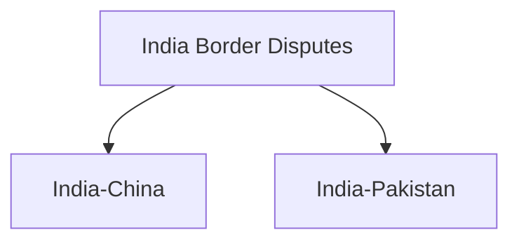

# India Border Disputes

## Overview

India shares land borders with several countries.

While most boundaries are settled and managed through agreements, some border disputes remain important issues in India's foreign policy and national security.

These disputes mainly involve:

- China
- Pakistan

## India's Land Borders

India shares land borders with:

- Pakistan
- China
- Nepal
- Bhutan
- Bangladesh
- Myanmar
- Afghanistan (claimed through the Union Territory of Ladakh)

## Major Border Disputes

## India–China Border Dispute

### Background

India and China have an unresolved boundary dispute along the Himalayan frontier.

The disputed boundary is divided into:

- Western Sector
- Middle Sector
- Eastern Sector

### Western Sector

Main disputed area:

- Aksai Chin

India considers Aksai Chin part of Ladakh, while China controls the region.

### Eastern Sector

Main disputed area:

- Arunachal Pradesh

China refers to parts of Arunachal Pradesh as South Tibet.

### Middle Sector

Includes smaller disputed areas in:

- Himachal Pradesh
- Uttarakhand

### Line of Actual Control (LAC)

The LAC serves as the de facto boundary between India and China in disputed sectors.

## India–Pakistan Border Dispute

### Background

The primary dispute between India and Pakistan relates to Jammu and Kashmir.

### Line of Control (LoC)

The LoC separates areas administered by India and Pakistan in the former princely state of Jammu and Kashmir.

### Siachen Glacier

The Siachen region remains a strategically important area.

It is one of the world's highest military deployment zones.

### Sir Creek Dispute

Sir Creek is a disputed tidal estuary located between:

- Gujarat (India)
- Sindh (Pakistan)

The dispute affects maritime boundary determination in the Arabian Sea.

## Border Management Mechanisms

India uses multiple mechanisms to manage border issues:

- Diplomatic dialogue
- Military talks
- Border agreements
- Confidence-building measures

## Importance of Border Security

Effective border management helps:

- Protect sovereignty
- Prevent illegal activities
- Enhance national security
- Promote regional stability

## Challenges

Major challenges include:

- Difficult terrain
- Cross-border terrorism
- Illegal trafficking
- Military tensions
- Infrastructure requirements

## Significance

Border disputes remain important aspects of India's foreign and security policy.

Their peaceful management is essential for regional stability and national security.

## Quick Revision

| Topic | Details |
|----------|----------|
| Major Disputes | China, Pakistan |
| China Dispute Area | Aksai Chin, Arunachal Pradesh |
| Pakistan Dispute Area | Jammu and Kashmir |
| De Facto India-China Boundary | LAC |
| India-Pakistan Boundary in Kashmir | LoC |
| Important Maritime Dispute | Sir Creek |

## Think & Recall

1. What are the major border disputes involving India?
2. What is the difference between the LAC and the LoC?
3. Why is Aksai Chin important?
4. What is the Sir Creek dispute?
5. Why is border management important for national security?
