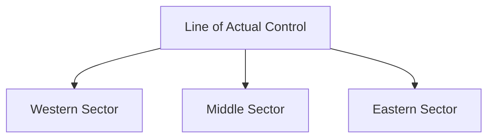

# Line of Actual Control (LAC)

## Overview

The Line of Actual Control (LAC) is the de facto boundary between India and China.

It separates areas under Indian control from areas under Chinese control along the disputed India–China border.

The LAC is not an internationally recognized boundary and remains a central issue in India–China relations.

## Background

The concept of the LAC emerged after the India–China War of 1962.

It represents the positions held by the two sides after the conflict.

Differences in the perception of the LAC by India and China have contributed to periodic tensions.

## Length

The Line of Actual Control extends for approximately:

- 3,488 km (Indian estimate)

It runs across the Himalayan region.

## Sectors of the LAC

The LAC is generally divided into three sectors.

### Western Sector

Located in:

- Ladakh

Important areas include:

- Aksai Chin
- Galwan Valley
- Pangong Tso
- Depsang Plains

### Middle Sector

Located in:

- Himachal Pradesh
- Uttarakhand

This sector experiences relatively fewer disputes.

### Eastern Sector

Located in:

- Arunachal Pradesh
- Sikkim

This sector includes areas associated with the McMahon Line.

## Importance

The LAC is important because it:

- Defines military deployment zones
- Influences border management
- Affects India–China relations
- Impacts regional security

## Border Management Mechanisms

India and China have established various mechanisms to manage tensions, including:

- Military commander-level talks
- Diplomatic consultations
- Confidence-building measures
- Border agreements

## Challenges

Major challenges include:

- Differing perceptions of the LAC
- Difficult terrain
- Infrastructure competition
- Military standoffs
- Strategic mistrust

## Recent Importance

The LAC has gained increased strategic importance because of:

- Border tensions
- Infrastructure development
- Military modernization
- Regional security concerns

## Difference Between LAC and LoC

| Feature | LAC | LoC |
|----------|----------|----------|
| Countries Involved | India and China | India and Pakistan |
| Nature | De Facto Boundary | De Facto Military Boundary |
| Region | Himalayan Frontier | Jammu and Kashmir |
| Origin | Post-1962 Situation | Post-1947–48 Conflict |

## Significance

The Line of Actual Control is one of India's most important strategic frontiers and plays a major role in national security and foreign policy.

## Quick Revision

| Topic | Details |
|----------|----------|
| Full Form | Line of Actual Control |
| Countries Involved | India and China |
| Major Sector | Western Sector (Ladakh) |
| Key Issue | Boundary Dispute |
| Related Boundary | McMahon Line |
| Importance | Border Security |

## Think & Recall

1. What is the Line of Actual Control?
2. How is the LAC different from the LoC?
3. What are the three sectors of the LAC?
4. Why does the LAC remain disputed?
5. Why is the LAC important for India's national security?
