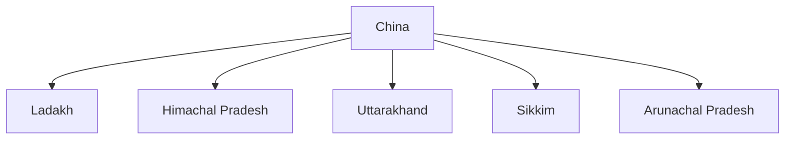

# China

## Overview

China is one of India's most important neighbours and a major factor in India's foreign policy, security strategy, economic planning, and regional diplomacy.

India and China are the world's two most populous countries and among the largest economies in Asia.

The relationship combines cooperation, competition, and strategic challenges.

## Basic Facts

| Topic | Details |
|----------|----------|
| Capital | Beijing |
| Official Language | Mandarin Chinese |
| Currency | Renminbi (Yuan) |
| Region | East Asia |
| Government | Socialist Republic |
| Border with India | Longest Disputed Land Border |

## Geography

China shares a border with India along the Himalayan region.

Indian states and union territories bordering China include:

- Ladakh
- Himachal Pradesh
- Uttarakhand
- Sikkim
- Arunachal Pradesh

## Historical Background

### Diplomatic Relations

- 1950

India was among the first countries to recognize the People's Republic of China.

### Panchsheel Agreement

- 1954

The agreement emphasized:

- Mutual respect for sovereignty
- Non-aggression
- Non-interference
- Equality and mutual benefit
- Peaceful coexistence

## Border Dispute

The India–China boundary dispute remains a major issue in bilateral relations.

### Western Sector

- Aksai Chin

### Eastern Sector

- Arunachal Pradesh

### Middle Sector

- Uttarakhand and Himachal Pradesh regions

## 1962 India–China War

### Year

- 1962

The conflict significantly affected bilateral relations and remains an important event in India's strategic history.

## Line of Actual Control (LAC)

The Line of Actual Control serves as the de facto boundary between India and China in disputed sectors.

Management of the LAC is a major aspect of bilateral engagement.

## Areas of Cooperation

### Trade

China is one of India's largest trading partners.

Major sectors include:

- Electronics
- Machinery
- Chemicals
- Pharmaceuticals
- Industrial products

### Multilateral Cooperation

India and China cooperate in:

- BRICS
- SCO
- G20
- Climate negotiations

### Cultural Exchanges

Areas include:

- Tourism
- Academic exchanges
- Buddhist heritage links

## Areas of Competition

Major areas include:

- Border issues
- Regional influence
- Infrastructure development
- Indian Ocean region
- Technology sectors

## Strategic Concerns

Important concerns include:

- Border tensions
- Military deployments
- Trade imbalance
- Regional security competition

## Importance for India

China is important because of:

- Border security
- Economic relations
- Regional stability
- Asian geopolitics
- Global governance issues

## Challenges

Major challenges include:

- Boundary dispute
- Strategic mistrust
- Trade imbalance
- Security concerns along the LAC

## Significance

India–China relations are among the most consequential bilateral relationships in Asia and have a major influence on regional and global politics.

## Quick Revision

| Topic | Details |
|----------|----------|
| Capital | Beijing |
| Diplomatic Relations | 1950 |
| Key Agreement | Panchsheel (1954) |
| Major Conflict | 1962 War |
| Boundary Term | LAC |
| Major Issue | Border Dispute |

## Think & Recall

1. What are the five principles of Panchsheel?
2. What is the Line of Actual Control?
3. Which Indian regions share a border with China?
4. Why is the boundary dispute important in India–China relations?
5. How do India and China cooperate in multilateral organizations?
