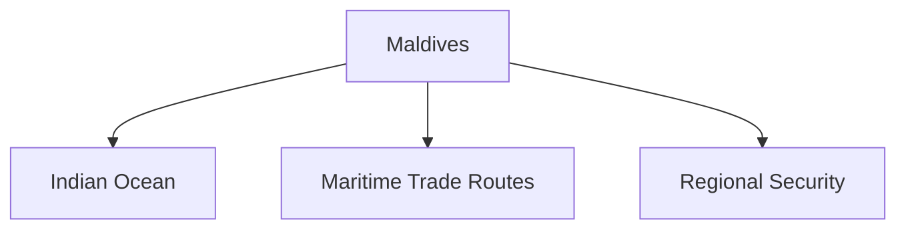

# Maldives

## Overview

The Maldives is an important maritime neighbour of India in the Indian Ocean.

The relationship is based on geographic proximity, maritime security, economic cooperation, development assistance, tourism, and people-to-people ties.

The Maldives occupies a significant position in India's Neighbourhood First Policy and maritime strategy.

## Basic Facts

| Topic | Details |
|----------|----------|
| Capital | Malé |
| Independence | 1965 |
| Official Language | Dhivehi |
| Currency | Maldivian Rufiyaa |
| Region | Indian Ocean |
| Government | Republic |

## Geography

The Maldives is an island nation consisting of numerous coral islands and atolls in the Indian Ocean.

Its location gives it strategic importance in major sea lanes of communication.

## Historical Background

India and the Maldives have traditionally maintained friendly relations.

The relationship strengthened after the Maldives gained independence.

## Areas of Cooperation

### Maritime Security

A major pillar of bilateral relations.

Areas include:

- Maritime surveillance
- Search and rescue operations
- Anti-piracy cooperation
- Coastal security

### Defence Cooperation

India assists the Maldives through:

- Training programmes
- Capacity building
- Defence cooperation
- Security assistance

### Economic Cooperation

Areas include:

- Trade
- Infrastructure development
- Financial assistance
- Investment cooperation

### Tourism

Tourism is a major sector of the Maldivian economy.

India is an important source of tourists and tourism-related cooperation.

## Development Partnership

India has supported projects related to:

- Infrastructure
- Healthcare
- Education
- Water and sanitation
- Community development

## Operation Cactus

### Year

- 1988

India conducted Operation Cactus to assist the Maldives in defeating an attempted coup.

The operation is regarded as an important milestone in bilateral relations.

## Regional Cooperation

India and the Maldives cooperate through:

- SAARC
- Colombo Security Conclave
- Indian Ocean initiatives

## Importance for India

The Maldives is important because of:

- Strategic location in the Indian Ocean
- Maritime security considerations
- Regional stability
- Sea lane security
- Neighbourhood First Policy

## Challenges

Major challenges include:

- Climate change impacts
- Political developments
- Strategic competition in the Indian Ocean
- Economic vulnerabilities

## Significance

The Maldives is a key maritime partner for India and plays an important role in India's Indian Ocean strategy and regional security framework.

## Quick Revision

| Topic | Details |
|----------|----------|
| Capital | Malé |
| Independence | 1965 |
| Key Operation | Operation Cactus |
| Region | Indian Ocean |
| Major Area | Maritime Security |
| Policy Link | Neighbourhood First |

## Think & Recall

1. Why is the Maldives strategically important for India?
2. What was Operation Cactus?
3. How do India and the Maldives cooperate in maritime security?
4. Why is the Indian Ocean important in bilateral relations?
5. What are the major challenges facing the Maldives?
