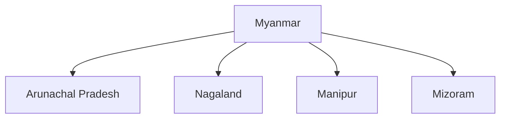

# Myanmar

## Overview

Myanmar is an important neighbour of India and serves as a strategic bridge between South Asia and Southeast Asia.

The relationship is significant for India's Act East Policy, connectivity initiatives, border management, security cooperation, and engagement with ASEAN.

Myanmar is the only ASEAN member that shares both a land and maritime boundary with India.

## Basic Facts

| Topic | Details |
|----------|----------|
| Capital | Naypyidaw |
| Largest City | Yangon |
| Official Language | Burmese |
| Currency | Kyat |
| Region | Southeast Asia |
| Organization | ASEAN Member |

## Geography

Myanmar shares borders with:

- India
- China
- Thailand
- Laos
- Bangladesh

Indian states sharing a border with Myanmar include:

- Arunachal Pradesh
- Nagaland
- Manipur
- Mizoram

## Historical Background

India and Myanmar share historical connections through:

- Buddhism
- Trade routes
- Cultural exchanges
- Colonial-era links

Myanmar was administered as part of British India until 1937.

## Areas of Cooperation

### Connectivity

Myanmar is central to India's connectivity strategy.

Major initiatives include:

- India–Myanmar–Thailand Trilateral Highway
- Kaladan Multi-Modal Transit Transport Project
- Border infrastructure projects

### Trade and Commerce

Major sectors include:

- Agriculture
- Pharmaceuticals
- Energy
- Consumer goods

### Energy Cooperation

Areas include:

- Natural gas
- Energy exploration
- Energy infrastructure

## Security Cooperation

India and Myanmar cooperate in:

- Border management
- Counter-insurgency operations
- Counter-terrorism efforts
- Prevention of illegal trafficking

Security cooperation is particularly important for India's North-East region.

## Act East Policy

Myanmar plays a central role in:

- Act East Policy
- ASEAN engagement
- Regional connectivity
- Economic integration with Southeast Asia

## Cultural Relations

Shared links include:

- Buddhist heritage
- Educational exchanges
- Cultural programmes
- Tourism

## Regional Cooperation

India and Myanmar cooperate through:

- ASEAN-related mechanisms
- BIMSTEC
- Mekong initiatives

## Importance for India

Myanmar is important because of:

- Gateway to Southeast Asia
- Connectivity to ASEAN
- North-East India development
- Border security
- Regional trade opportunities

## Challenges

Major challenges include:

- Political instability
- Border security concerns
- Insurgency-related issues
- Infrastructure constraints

## Significance

Myanmar is one of India's most strategically important neighbours and serves as the key link between India's neighbourhood policy and Act East Policy.

## Quick Revision

| Topic | Details |
|----------|----------|
| Capital | Naypyidaw |
| Region | Southeast Asia |
| ASEAN Member | Yes |
| Key Project | Kaladan Project |
| Key Policy Link | Act East Policy |
| Strategic Role | Gateway to ASEAN |

## Think & Recall

1. Why is Myanmar important for India's Act East Policy?
2. Which Indian states share a border with Myanmar?
3. What is the Kaladan Multi-Modal Transit Transport Project?
4. Why is security cooperation important in India–Myanmar relations?
5. How does Myanmar connect India with Southeast Asia?
