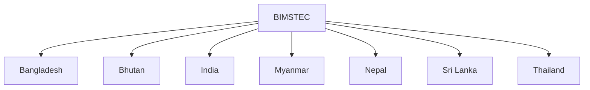

# Bay of Bengal Initiative for Multi-Sectoral Technical and Economic Cooperation (BIMSTEC)

## Overview

BIMSTEC is a regional organization that connects countries of South Asia and Southeast Asia through the Bay of Bengal region.

It serves as an important platform for economic cooperation, connectivity, security collaboration, and regional integration.

For India, BIMSTEC is a key component of the Neighbourhood First Policy and the Act East Policy.

## Establishment

### Established

- 1997

### Headquarters

- Dhaka, Bangladesh

## Member Countries

BIMSTEC consists of seven member states:

- Bangladesh
- Bhutan
- India
- Myanmar
- Nepal
- Sri Lanka
- Thailand

## Objectives

BIMSTEC aims to:

- Promote regional cooperation
- Strengthen economic integration
- Improve connectivity
- Enhance security cooperation
- Facilitate trade and investment
- Support sustainable development

## Importance of the Bay of Bengal

The Bay of Bengal is important because:

- It connects South Asia and Southeast Asia
- Major trade routes pass through the region
- It supports maritime commerce
- It has strategic significance in the Indo-Pacific

## Areas of Cooperation

Major sectors include:

- Trade and Investment
- Transport and Connectivity
- Energy Cooperation
- Security Cooperation
- Counter-Terrorism
- Technology
- Environment and Climate Change
- Disaster Management

## Connectivity Projects

Important initiatives include:

- India–Myanmar–Thailand Trilateral Highway
- Regional transport networks
- Port connectivity projects

## Security Cooperation

Areas include:

- Counter-terrorism
- Maritime security
- Cyber security
- Disaster response

## Importance for India

BIMSTEC supports India's:

- Neighbourhood First Policy
- Act East Policy
- North-East India development
- Bay of Bengal strategy
- Regional connectivity goals

## BIMSTEC vs SAARC

| Feature | BIMSTEC | SAARC |
|----------|----------|----------|
| Region | South Asia + Southeast Asia | South Asia |
| Members | 7 | 8 |
| Strategic Focus | Bay of Bengal | South Asia |
| Importance for India | Act East Link | Neighbourhood Cooperation |

## Challenges

Major challenges include:

- Connectivity gaps
- Infrastructure constraints
- Trade barriers
- Resource limitations
- Implementation delays

## Significance

BIMSTEC has emerged as one of the most important regional organizations for connecting South Asia and Southeast Asia and strengthening cooperation in the Bay of Bengal region.

## Quick Revision

| Topic | Details |
|----------|----------|
| Established | 1997 |
| Headquarters | Dhaka |
| Members | 7 |
| Key Region | Bay of Bengal |
| Important Policy Link | Act East Policy |
| Importance | South Asia–Southeast Asia Connectivity |

## Think & Recall

1. What is BIMSTEC?
2. Which countries are members of BIMSTEC?
3. Why is BIMSTEC important for India's Act East Policy?
4. How is BIMSTEC different from SAARC?
5. Why is the Bay of Bengal strategically important?
