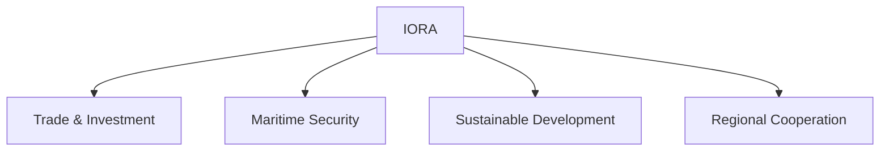

# Indian Ocean Rim Association (IORA)

## Overview

The Indian Ocean Rim Association (IORA) is a regional organization that promotes cooperation among countries bordering the Indian Ocean.

It focuses on economic cooperation, maritime security, trade, sustainable development, and regional connectivity.

IORA is an important platform for India's engagement in the Indian Ocean Region.

## Establishment

### Established

- 1997

### Headquarters

- Ebene, Mauritius

## Membership

IORA consists of countries located along the Indian Ocean rim.

Members include nations from:

- South Asia
- Southeast Asia
- West Asia
- Africa
- Oceania

## Objectives

IORA aims to:

- Promote economic cooperation
- Enhance maritime safety and security
- Facilitate trade and investment
- Support sustainable development
- Strengthen regional connectivity
- Encourage scientific and academic cooperation

## Priority Areas

Important areas of cooperation include:

- Maritime Safety and Security
- Trade and Investment Facilitation
- Fisheries Management
- Disaster Risk Management
- Academic and Scientific Cooperation
- Tourism and Cultural Exchanges
- Blue Economy

## Blue Economy

The Blue Economy is a major focus area of IORA.

It promotes:

- Sustainable use of marine resources
- Coastal development
- Marine conservation
- Ocean-based economic growth

## Importance for India

IORA supports India's interests in:

- SAGAR Vision
- Maritime security
- Indian Ocean cooperation
- Trade connectivity
- Energy security
- Blue Economy initiatives

## Maritime Significance

The Indian Ocean is important because:

- Major global trade routes pass through it
- Significant energy shipments transit the region
- It connects Asia, Africa, and Australia

## Challenges

Major challenges include:

- Piracy
- Illegal fishing
- Maritime crime
- Climate change
- Natural disasters
- Geopolitical competition

## Significance

IORA is one of the most important regional organizations in the Indian Ocean Region and contributes to economic growth, maritime cooperation, and regional stability.

## Quick Revision

| Topic | Details |
|----------|----------|
| Established | 1997 |
| Headquarters | Mauritius |
| Region | Indian Ocean |
| Major Focus | Maritime Cooperation |
| Key Theme | Blue Economy |
| Importance for India | SAGAR and Indian Ocean Strategy |

## Think & Recall

1. What is IORA?
2. When was IORA established?
3. What is meant by the Blue Economy?
4. Why is the Indian Ocean strategically important?
5. How does IORA support India's maritime interests?
