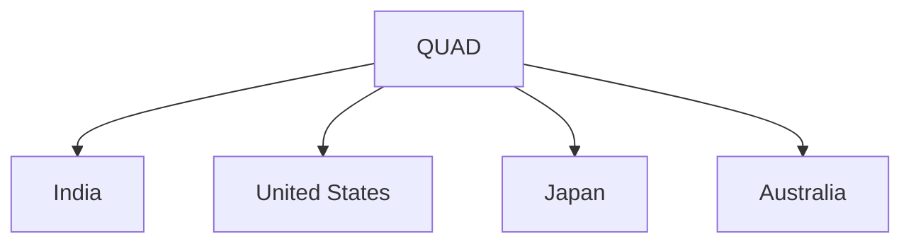

# Quadrilateral Security Dialogue (QUAD)

## Overview

The Quadrilateral Security Dialogue (QUAD) is an informal strategic grouping of four democratic countries in the Indo-Pacific region.

It promotes cooperation in areas such as maritime security, technology, supply chains, infrastructure, disaster response, and regional stability.

QUAD has become an important component of India's Indo-Pacific strategy.

## Members

The QUAD consists of:

- India
- United States
- Japan
- Australia

## Background

The idea of QUAD emerged after cooperation among the four countries during humanitarian assistance efforts following the 2004 Indian Ocean tsunami.

The grouping evolved into a platform for strategic consultation and practical cooperation.

## Objectives

QUAD aims to:

- Promote a free and open Indo-Pacific
- Support freedom of navigation
- Strengthen maritime security
- Enhance regional connectivity
- Build resilient supply chains
- Encourage technological cooperation

## Areas of Cooperation

### Maritime Security

Cooperation includes:

- Maritime domain awareness
- Naval coordination
- Protection of sea lanes

### Technology Cooperation

Important areas include:

- Semiconductors
- Artificial Intelligence
- Critical technologies
- Cyber security

### Supply Chain Resilience

The members work to strengthen secure and reliable supply chains.

### Climate and Disaster Response

Cooperation includes:

- Disaster relief
- Climate resilience
- Humanitarian assistance

### Health Cooperation

Areas include:

- Pandemic preparedness
- Health security initiatives

## Importance for India

QUAD supports India's interests in:

- Indo-Pacific engagement
- Maritime security
- Strategic partnerships
- Technology cooperation
- Regional stability

## QUAD and the Indo-Pacific

The Indo-Pacific region is important because:

- It contains major trade routes
- It is central to global economic activity
- It connects the Indian and Pacific Oceans

## Military Nature Debate

QUAD is not a military alliance.

It functions as a consultative and cooperative framework among its members.

## Challenges

Major challenges include:

- Regional geopolitical tensions
- Differing national priorities
- Strategic competition in the Indo-Pacific

## Significance

QUAD has emerged as an important platform for cooperation among major Indo-Pacific democracies and plays a growing role in regional governance and strategic coordination.

## Quick Revision

| Topic | Details |
|----------|----------|
| Members | India, USA, Japan, Australia |
| Region | Indo-Pacific |
| Key Focus | Maritime Security |
| Nature | Strategic Dialogue |
| Major Theme | Free and Open Indo-Pacific |
| Importance for India | Indo-Pacific Strategy |

## Think & Recall

1. Which countries are members of QUAD?
2. How did QUAD originate?
3. Why is the Indo-Pacific region important?
4. Is QUAD a military alliance?
5. How does QUAD support India's strategic interests?
