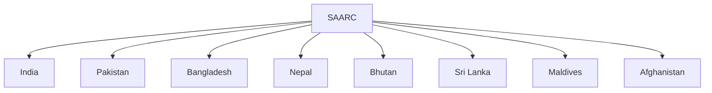

# South Asian Association for Regional Cooperation (SAARC)

## Overview

The South Asian Association for Regional Cooperation (SAARC) is a regional organization established to promote cooperation, economic development, and regional integration among South Asian countries.

It serves as an important platform for dialogue and collaboration on issues affecting the South Asian region.

## Establishment

### Established

- 1985

### Headquarters

- Kathmandu, Nepal

### Founding Summit

- Dhaka, Bangladesh

## Member Countries

SAARC consists of eight member states:

- Afghanistan
- Bangladesh
- Bhutan
- India
- Maldives
- Nepal
- Pakistan
- Sri Lanka

## Objectives

SAARC aims to:

- Promote regional cooperation
- Accelerate economic growth
- Improve social development
- Strengthen cultural exchanges
- Enhance mutual trust among member states

## Areas of Cooperation

Important areas include:

- Trade and commerce
- Agriculture
- Education
- Health
- Environment
- Poverty alleviation
- Science and technology

## SAFTA

### South Asian Free Trade Area

SAFTA was launched to promote trade liberalization among SAARC countries.

Its objectives include:

- Reducing trade barriers
- Increasing regional trade
- Supporting economic integration

## Importance for India

SAARC supports India's interests in:

- Neighbourhood First Policy
- Regional stability
- Economic cooperation
- Cultural connectivity
- Development partnerships

## Challenges

Major challenges include:

- Political tensions among member states
- Limited regional trade
- Security concerns
- Connectivity gaps
- Slow implementation of agreements

## Significance

SAARC remains the principal regional organization of South Asia and provides a framework for regional dialogue and cooperation.

## Quick Revision

| Topic | Details |
|----------|----------|
| Established | 1985 |
| Headquarters | Kathmandu |
| Members | 8 |
| Trade Initiative | SAFTA |
| Region | South Asia |
| Importance | Regional Cooperation |

## Think & Recall

1. When was SAARC established?
2. Where is the SAARC headquarters located?
3. Name the eight SAARC member countries.
4. What is SAFTA?
5. What are the major challenges facing SAARC today?
