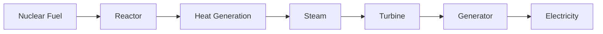

# Nuclear Power Plants in India

## Overview

Nuclear power plants generate electricity using heat produced through nuclear fission.

They form an important part of India's energy mix and contribute to energy security, clean electricity generation, and long-term development.

India operates a network of nuclear power stations across multiple states under the supervision of the Department of Atomic Energy.

## What is a Nuclear Power Plant?

A nuclear power plant is a facility that produces electricity using energy released from controlled nuclear reactions.

The heat generated is used to produce steam, which drives turbines connected to electricity generators.

## Importance

Nuclear power plants help:

- Generate large quantities of electricity
- Reduce dependence on fossil fuels
- Improve energy security
- Support industrial growth
- Reduce greenhouse gas emissions during operation

## How Nuclear Power Plants Work

## Major Nuclear Power Plants in India

### Tarapur Atomic Power Station

- Maharashtra
- India's first nuclear power station

### Rajasthan Atomic Power Station

- Rajasthan
- One of India's major PHWR facilities

### Madras Atomic Power Station

- Kalpakkam, Tamil Nadu

### Narora Atomic Power Station

- Uttar Pradesh

### Kakrapar Atomic Power Station

- Gujarat

### Kaiga Generating Station

- Karnataka

### Kudankulam Nuclear Power Plant

- Tamil Nadu
- India's largest nuclear power generating station

### Gorakhpur Haryana Anu Vidyut Pariyojana

- Haryana
- Under development

## Types of Reactors Used in India

### Pressurized Heavy Water Reactors (PHWRs)

The backbone of India's nuclear power programme.

### Light Water Reactors (LWRs)

Used at Kudankulam.

### Fast Breeder Reactors (FBRs)

Part of India's second-stage nuclear programme.

## Nuclear Power and India's Three-Stage Programme

India's nuclear plants support:

- Stage 1: PHWRs using natural uranium
- Stage 2: Fast Breeder Reactors using plutonium
- Stage 3: Future thorium-based reactors

## Institutions Involved

Important organizations include:

- Department of Atomic Energy (DAE)
- Nuclear Power Corporation of India Limited (NPCIL)
- Bhabha Atomic Research Centre (BARC)
- Bharatiya Nabhikiya Vidyut Nigam Limited (BHAVINI)

## Advantages

- Reliable baseload power
- Low carbon emissions during operation
- High energy density
- Reduced fossil fuel dependence
- Long-term energy security

## Challenges

Major challenges include:

- High capital costs
- Radioactive waste management
- Safety requirements
- Public concerns regarding nuclear accidents
- Long project construction timelines

## Safety Measures

Modern nuclear plants incorporate:

- Multiple safety barriers
- Emergency shutdown systems
- Radiation monitoring systems
- Containment structures
- Regulatory oversight

## Nuclear Energy and Climate Goals

Nuclear power contributes to:

- Clean energy generation
- Emission reduction efforts
- Energy transition strategies
- Sustainable development objectives

## Quick Revision

| Topic | Details |
|----------|----------|
| Purpose | Electricity Generation |
| Fuel | Uranium-Based Nuclear Fuel |
| Major Operator | NPCIL |
| Largest Station | Kudankulam |
| First Station | Tarapur |
| Key Benefit | Reliable Low-Carbon Power |

## Think & Recall

1. How does a nuclear power plant generate electricity?
2. Which is India's first nuclear power station?
3. Which is India's largest nuclear power plant?
4. What role do nuclear plants play in the three-stage programme?
5. What are the major advantages and challenges of nuclear power?