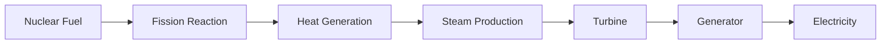

# Nuclear Reactors

## Overview

A nuclear reactor is a device that initiates, controls, and sustains a nuclear chain reaction to generate energy.

Nuclear reactors form the core of nuclear power plants and are used for electricity generation, scientific research, isotope production, and strategic applications.

India has developed multiple reactor technologies as part of its long-term nuclear energy programme.

## Purpose

Nuclear reactors are used to:

- Generate electricity
- Produce radioactive isotopes
- Support scientific research
- Train nuclear scientists and engineers
- Support India's nuclear programme

## Basic Principle

Nuclear reactors operate through nuclear fission.

In nuclear fission:

- Heavy atomic nuclei split into smaller nuclei
- Large amounts of energy are released
- Additional neutrons are produced
- A controlled chain reaction is maintained

## Major Components of a Nuclear Reactor

### Fuel

The fuel undergoes nuclear fission.

Common fuels include:

- Uranium-235
- Plutonium-239
- Uranium-233

### Moderator

The moderator slows down neutrons to sustain the chain reaction.

Examples:

- Heavy Water
- Light Water
- Graphite

### Control Rods

Control rods absorb excess neutrons and regulate reactor power.

Common materials include:

- Cadmium
- Boron
- Hafnium

### Coolant

The coolant removes heat from the reactor core.

Examples:

- Water
- Heavy Water
- Liquid Sodium
- Gas Coolants

### Containment Structure

Provides safety and prevents release of radioactive materials.

## Working of a Nuclear Reactor

## Types of Nuclear Reactors

### Pressurized Heavy Water Reactor (PHWR)

- Uses natural uranium
- Uses heavy water as moderator and coolant
- Backbone of India's nuclear power programme

### Boiling Water Reactor (BWR)

- Water boils directly inside the reactor vessel
- Used in some early nuclear stations

### Pressurized Water Reactor (PWR)

- Uses high-pressure water as coolant
- Widely used globally

### Light Water Reactor (LWR)

- Uses ordinary water
- Used at Kudankulam Nuclear Power Plant

### Fast Breeder Reactor (FBR)

- Produces more fissile material than it consumes
- Important for India's second-stage nuclear programme

## Nuclear Reactors in India's Three-Stage Programme

### Stage 1

- Pressurized Heavy Water Reactors (PHWRs)

### Stage 2

- Fast Breeder Reactors (FBRs)

### Stage 3

- Advanced Thorium-Based Reactors

## Important Reactor Technologies in India

### Prototype Fast Breeder Reactor (PFBR)

- Located at Kalpakkam
- Key project in Stage 2 of India's programme

### Advanced Heavy Water Reactor (AHWR)

- Designed to utilize thorium
- Important for future Stage 3 development

## Institutions Involved

Important organizations include:

- Department of Atomic Energy (DAE)
- Bhabha Atomic Research Centre (BARC)
- Nuclear Power Corporation of India Limited (NPCIL)
- Indira Gandhi Centre for Atomic Research (IGCAR)
- BHAVINI

## Advantages

- High energy output
- Reliable baseload electricity
- Low operational carbon emissions
- Efficient fuel utilization
- Supports energy security

## Challenges

Major challenges include:

- High construction costs
- Radioactive waste management
- Safety requirements
- Complex technology development
- Public concerns regarding nuclear accidents

## Quick Revision

| Topic | Details |
|----------|----------|
| Function | Controlled Nuclear Fission |
| Main Output | Heat and Electricity |
| Key Fuel | Uranium |
| Major Indian Reactor | PHWR |
| Stage 2 Reactor | Fast Breeder Reactor |
| Future Focus | Thorium-Based Reactors |

## Think & Recall

1. What is a nuclear reactor?
2. What are the major components of a reactor?
3. How does a reactor generate electricity?
4. What is the role of control rods?
5. Why are Fast Breeder Reactors important for India?
