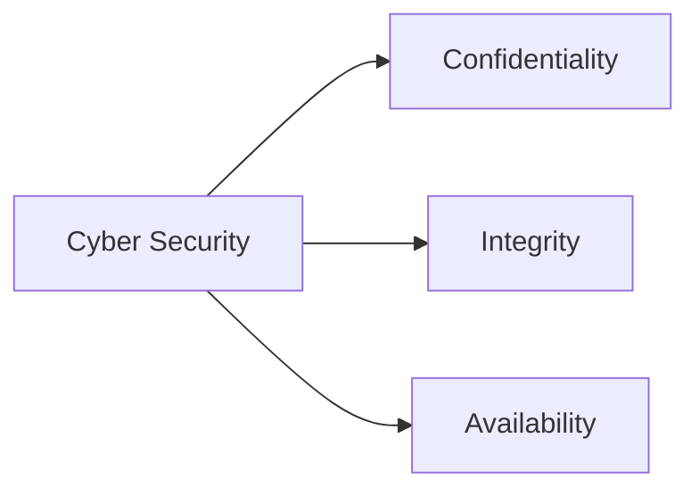

# Cyber Security

## Overview

Cyber Security refers to the protection of computers, networks, digital systems, applications, and data from unauthorized access, attacks, damage, or theft.

It has become a critical component of national security, economic stability, governance, and digital infrastructure.

As India expands its digital ecosystem, cyber security has emerged as a major strategic priority.

## Objectives

Cyber security aims to:

- Protect digital infrastructure
- Safeguard sensitive information
- Prevent cyber attacks
- Ensure data privacy
- Maintain business continuity
- Strengthen national security

## Importance

Cyber security is essential for:

- Government systems
- Banking and finance
- Defence networks
- Critical infrastructure
- Healthcare systems
- Digital services
- E-commerce platforms

## Types of Cyber Threats

### Malware

Malicious software designed to damage or disrupt systems.

Examples:

- Viruses
- Worms
- Trojans
- Ransomware

### Phishing

Fraudulent attempts to obtain sensitive information through deceptive emails, messages, or websites.

### Ransomware

A type of malware that encrypts data and demands payment for restoration.

### Denial of Service (DoS) Attacks

Attacks that overwhelm systems and make services unavailable.

### Data Breaches

Unauthorized access to confidential information.

### Identity Theft

Misuse of personal information for fraudulent purposes.

## Cyber Security Principles

### Confidentiality

Ensures information is accessible only to authorized individuals.

### Integrity

Ensures data remains accurate and unaltered.

### Availability

Ensures systems and information remain accessible when required.

These principles are commonly known as the CIA Triad.

## Cyber Security in India

India's cyber security framework includes:

- National Cyber Security Policy
- Digital India initiatives
- Sector-specific security mechanisms
- Critical infrastructure protection measures

## Important Institutions

### CERT-In

Indian Computer Emergency Response Team.

Responsible for responding to cyber security incidents.

### National Critical Information Infrastructure Protection Centre (NCIIPC)

Protects critical information infrastructure.

### Ministry of Electronics and Information Technology (MeitY)

Coordinates major digital governance and cyber initiatives.

### National Cyber Coordination Centre (NCCC)

Supports cyber threat monitoring and situational awareness.

## Critical Information Infrastructure

Critical sectors include:

- Power
- Banking
- Telecommunications
- Transportation
- Defence
- Government networks

Cyber attacks on these sectors can have serious national consequences.

## Cyber Security Measures

Important measures include:

- Strong passwords
- Multi-factor authentication
- Encryption
- Firewalls
- Antivirus software
- Regular software updates
- Security audits
- Cyber awareness training

## Challenges

Major challenges include:

- Increasing cyber attacks
- Rapid technological change
- Shortage of skilled professionals
- Cross-border cyber threats
- Protection of critical infrastructure
- Emerging AI-driven threats

## Emerging Areas

Important emerging domains include:

- Cloud Security
- AI Security
- Quantum-Safe Cryptography
- IoT Security
- Digital Forensics
- Cyber Warfare

## Significance

Cyber security supports:

- National security
- Economic growth
- Digital governance
- Citizen trust
- Secure digital transformation

## Quick Revision

| Topic | Details |
|----------|----------|
| Objective | Protection of Digital Systems |
| Core Principles | Confidentiality, Integrity, Availability |
| Incident Response Agency | CERT-In |
| Critical Area | Critical Information Infrastructure |
| Major Threats | Malware, Phishing, Ransomware |
| Importance | National and Digital Security |

## Think & Recall

1. What is cyber security?
2. What are the three principles of the CIA Triad?
3. What is the role of CERT-In?
4. Why is critical infrastructure protection important?
5. What are the major cyber security challenges facing India?
