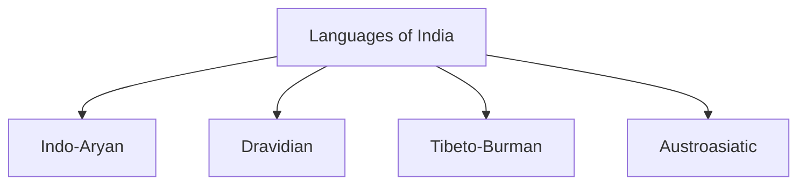

# Languages of India

## Overview

India is one of the most linguistically diverse countries in the world.

Hundreds of languages and dialects are spoken across different regions, reflecting the country's rich cultural and historical heritage.

Languages play an important role in communication, literature, education, administration, and cultural identity.

## Linguistic Diversity

India is home to:

- Hundreds of languages
- Thousands of dialects
- Multiple language families

This diversity developed through centuries of migration, cultural interaction, and regional evolution.

## Constitutional Status

### Official Language of the Union

- Hindi (Devanagari Script)

### Associate Official Language

- English

English continues to be used for many official and administrative purposes.

## Eighth Schedule of the Constitution

The Constitution recognizes:

- 22 Scheduled Languages

### Scheduled Languages

- Assamese
- Bengali
- Bodo
- Dogri
- Gujarati
- Hindi
- Kannada
- Kashmiri
- Konkani
- Maithili
- Malayalam
- Manipuri
- Marathi
- Nepali
- Odia
- Punjabi
- Sanskrit
- Santali
- Sindhi
- Tamil
- Telugu
- Urdu

## Major Language Families

### Indo-Aryan Languages

Spoken across much of northern, western, and eastern India.

Examples:

- Hindi
- Bengali
- Marathi
- Gujarati
- Punjabi
- Assamese
- Odia

### Dravidian Languages

Predominantly spoken in southern India.

Examples:

- Tamil
- Telugu
- Kannada
- Malayalam

### Tibeto-Burman Languages

Found mainly in the Himalayan and North-Eastern regions.

### Austroasiatic Languages

Spoken by several tribal communities.

Examples:

- Santali
- Khasi
- Mundari

## Classical Languages of India

The Government of India has granted Classical Language status to selected languages with ancient literary traditions.

Languages with Classical status include:

- Tamil
- Sanskrit
- Kannada
- Telugu
- Malayalam
- Odia
- Marathi
- Pali
- Prakrit

## Importance of Languages

Languages contribute to:

- Cultural identity
- Literature and knowledge systems
- Administrative communication
- Social integration
- Preservation of traditions

## Language and Education

Languages play an important role in:

- School education
- Higher education
- Research and scholarship
- Regional literature

## Challenges

Major challenges include:

- Preservation of endangered languages
- Decline of smaller dialects
- Language documentation
- Balancing linguistic diversity and administrative needs

## Significance

India's linguistic diversity is an important component of its cultural heritage and national identity.

The coexistence of multiple languages reflects the country's pluralistic character.

## Quick Revision

| Topic | Details |
|----------|----------|
| Scheduled Languages | 22 |
| Official Language of Union | Hindi |
| Associate Official Language | English |
| Largest Language Family | Indo-Aryan |
| Major Southern Family | Dravidian |
| Classical Languages | Multiple Recognized Languages |

## Think & Recall

1. How many languages are included in the Eighth Schedule?
2. What are the major language families of India?
3. Which language families dominate northern and southern India?
4. What is meant by a Classical Language?
5. Why is linguistic diversity important for India?
