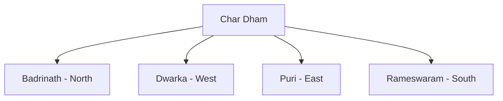

# Char Dham

## Overview

Char Dham refers to four sacred pilgrimage sites located in different directions of India.

The pilgrimage is considered one of the most important spiritual journeys in Hinduism.

The tradition is associated with Adi Shankaracharya, who is believed to have helped establish the importance of these sites as a unified pilgrimage circuit.

## Meaning

### Char

- Four

### Dham

- Sacred Abode

Thus, Char Dham means Four Sacred Abodes.

## The Four Char Dham Sites

### Badrinath

- Uttarakhand
- Dedicated to Lord Vishnu
- Located in the Himalayas

### Dwarka

- Gujarat
- Associated with Lord Krishna
- Located on the western coast of India

### Jagannath Puri

- Odisha
- Dedicated to Lord Jagannath
- Famous for the Rath Yatra festival

### Rameswaram

- Tamil Nadu
- Dedicated to Lord Shiva
- Associated with the Ramayana

## Historical Background

The Char Dham pilgrimage gained prominence through the efforts of Adi Shankaracharya.

The circuit symbolized spiritual unity across different regions of India.

## Religious Importance

The pilgrimage is believed to:

- Promote spiritual growth
- Encourage devotion
- Strengthen cultural unity
- Connect important religious traditions

Many devotees undertake the pilgrimage at least once in their lifetime.

## Char Dham and Chota Char Dham

The traditional Char Dham should not be confused with the Chota Char Dham pilgrimage in Uttarakhand.

### Traditional Char Dham

- Badrinath
- Dwarka
- Jagannath Puri
- Rameswaram

### Chota Char Dham

- Badrinath
- Kedarnath
- Gangotri
- Yamunotri

## Associated Deities

| Site | Associated Deity |
|----------|----------|
| Badrinath | Vishnu |
| Dwarka | Krishna |
| Jagannath Puri | Jagannath |
| Rameswaram | Shiva |

## Cultural Significance

The Char Dham pilgrimage contributes to:

- Religious tourism
- Cultural integration
- Preservation of traditions
- Regional economic activity

## Best Known Festivals

Important festivals associated with Char Dham sites include:

- Rath Yatra (Puri)
- Janmashtami (Dwarka)
- Badri-Kedar Festivals
- Maha Shivaratri (Rameswaram)

## Quick Revision

| Topic | Details |
|----------|----------|
| Meaning | Four Sacred Abodes |
| Associated Philosopher | Adi Shankaracharya |
| North | Badrinath |
| West | Dwarka |
| East | Jagannath Puri |
| South | Rameswaram |

## Think & Recall

1. What is meant by Char Dham?
2. Which four sites constitute the traditional Char Dham?
3. How is Char Dham different from Chota Char Dham?
4. Why is Adi Shankaracharya associated with Char Dham?
5. Which deities are worshipped at the four sites?
