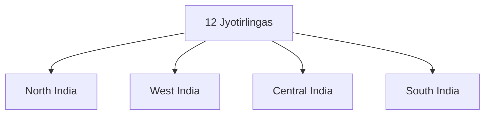

# Jyotirlingas

## Overview

Jyotirlingas are among the most sacred shrines dedicated to Lord Shiva in Hinduism.

The term Jyotirlinga refers to the manifestation of Shiva as an infinite pillar of divine light.

These shrines are important pilgrimage destinations and hold immense religious significance for Shaivite traditions.

## Meaning

### Jyoti

- Divine Light

### Linga

- Symbolic representation of Lord Shiva

Thus, Jyotirlinga means the Linga of Divine Light.

## Origin

According to Hindu tradition, Lord Shiva appeared as an infinite pillar of light before Lord Brahma and Lord Vishnu.

The Jyotirlingas commemorate this manifestation of Shiva.

## Number of Jyotirlingas

There are:

- 12 Traditionally Recognized Jyotirlingas

These are spread across different regions of India.

## The Twelve Jyotirlingas

| Jyotirlinga | State |
|----------|----------|
| Somnath | Gujarat |
| Mallikarjuna | Andhra Pradesh |
| Mahakaleshwar | Madhya Pradesh |
| Omkareshwar | Madhya Pradesh |
| Kedarnath | Uttarakhand |
| Bhimashankar | Maharashtra |
| Kashi Vishwanath | Uttar Pradesh |
| Trimbakeshwar | Maharashtra |
| Vaidyanath | Jharkhand |
| Nageshwar | Gujarat |
| Rameswaram | Tamil Nadu |
| Grishneshwar | Maharashtra |

## Religious Importance

Jyotirlingas are believed to:

- Grant spiritual merit
- Strengthen devotion to Shiva
- Promote pilgrimage traditions
- Symbolize divine presence

Many devotees undertake pilgrimages to multiple Jyotirlinga sites.

## Major Jyotirlingas

### Somnath

- Gujarat
- Traditionally regarded as the first Jyotirlinga

### Kashi Vishwanath

- Varanasi, Uttar Pradesh
- One of the most revered Shiva temples

### Kedarnath

- Uttarakhand
- Located in the Himalayas
- Part of the Chota Char Dham pilgrimage

### Mahakaleshwar

- Ujjain, Madhya Pradesh
- Famous for the Bhasma Aarti

### Rameswaram

- Tamil Nadu
- Associated with the Ramayana

## Jyotirlingas and Pilgrimage

The Jyotirlinga circuit is one of the most important pilgrimage traditions in Hinduism.

It attracts millions of devotees every year.

## Festivals

Important festivals associated with Jyotirlingas include:

- Maha Shivaratri
- Shravan Month Celebrations
- Local Temple Festivals

## Cultural Significance

Jyotirlingas contribute to:

- Religious tourism
- Temple architecture
- Cultural continuity
- Regional economies
- Preservation of Shaivite traditions

## Quick Revision

| Topic | Details |
|----------|----------|
| Deity | Lord Shiva |
| Total Jyotirlingas | 12 |
| Meaning | Linga of Divine Light |
| Famous Shrine | Kashi Vishwanath |
| Himalayan Jyotirlinga | Kedarnath |
| Important Festival | Maha Shivaratri |

## Think & Recall

1. What is a Jyotirlinga?
2. How many Jyotirlingas are traditionally recognized?
3. Which Jyotirlinga is located in Varanasi?
4. Why is Somnath significant?
5. How are Jyotirlingas connected to Shaivite traditions?
