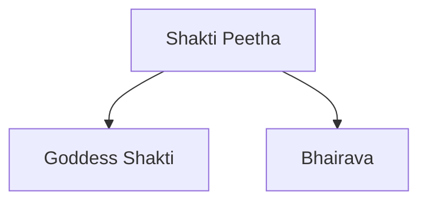

# Shakti Peethas

## Overview

Shakti Peethas are sacred pilgrimage sites associated with Goddess Shakti in Hinduism.

They are among the most important centers of goddess worship and hold immense religious significance for devotees across the Indian subcontinent.

The Shakti Peetha tradition is closely linked to the story of Goddess Sati and Lord Shiva.

## Origin

According to Hindu tradition:

- Goddess Sati was the daughter of King Daksha.
- She married Lord Shiva.
- Daksha insulted Shiva during a grand yajna.
- Unable to bear the insult, Sati immolated herself.

Grief-stricken, Shiva carried Sati's body across the universe.

To restore cosmic balance, Lord Vishnu used his Sudarshana Chakra to dismember Sati's body.

The places where her body parts, ornaments, or possessions fell became known as Shakti Peethas.

## Meaning

### Shakti

Represents divine feminine energy.

### Peetha

Means seat or sacred place.

Thus, Shakti Peetha means the sacred seat of the Goddess.

## Religious Importance

Shakti Peethas are important because they:

- Symbolize divine feminine power
- Serve as major pilgrimage centers
- Preserve ancient religious traditions
- Promote Shakta worship
- Hold cultural and historical significance

## Number of Shakti Peethas

Different traditions mention varying numbers.

Commonly accepted traditions refer to:

- 51 Shakti Peethas
- 52 Shakti Peethas
- 108 Shakti Peethas

The most widely recognized tradition refers to 51 Shakti Peethas.

## Structure of a Shakti Peetha

Each Shakti Peetha is generally associated with:

- A form of Goddess Shakti
- A corresponding form of Lord Shiva known as Bhairava

## Important Shakti Peethas in India

### Kamakhya Temple

- Assam
- One of the most important Shakti Peethas

### Kalighat Temple

- Kolkata, West Bengal

### Tarapith

- West Bengal

### Jwalamukhi Temple

- Himachal Pradesh

### Naina Devi Temple

- Himachal Pradesh

### Vishalakshi Temple

- Varanasi, Uttar Pradesh

### Kanchi Kamakshi Temple

- Tamil Nadu

### Mahalakshmi Temple

- Kolhapur, Maharashtra

## Shakti Peethas Outside India

Important Shakti Peethas are also located in:

- Bangladesh
- Nepal
- Pakistan
- Sri Lanka

These sites reflect the shared cultural heritage of the Indian subcontinent.

## Shakta Tradition

The Shakta tradition regards the Goddess as the supreme divine reality.

Major forms of worship include:

- Durga
- Kali
- Tara
- Kamakhya
- Lalita

## Festivals Associated with Shakti Worship

Important festivals include:

- Durga Puja
- Navaratri
- Kali Puja
- Ambubachi Mela

## Cultural Significance

Shakti Peethas contribute to:

- Pilgrimage traditions
- Temple architecture
- Regional cultural practices
- Religious tourism
- Preservation of Hindu heritage

## Quick Revision

| Topic | Details |
|----------|----------|
| Associated Deity | Goddess Shakti |
| Origin Story | Goddess Sati |
| Common Number | 51 Shakti Peethas |
| Major Site | Kamakhya Temple |
| Important State | West Bengal |
| Tradition | Shaktism |

## Think & Recall

1. What is the origin of the Shakti Peetha tradition?
2. Why are Shakti Peethas considered sacred?
3. What is the role of Bhairava at a Shakti Peetha?
4. Name three important Shakti Peethas in India.
5. How are Shakti Peethas connected to the story of Sati?
