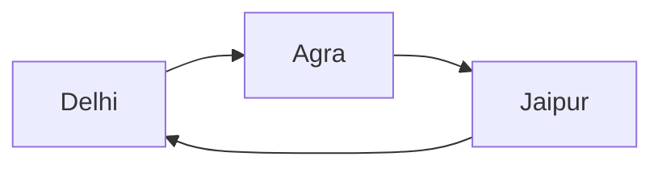

# Golden Triangle

## Overview

The Golden Triangle is one of India's most famous tourist circuits.

It connects three historically and culturally important cities:

- Delhi
- Agra
- Jaipur

The route forms a triangular shape on the map, giving rise to the name Golden Triangle.

It is one of the most popular tourism circuits for both domestic and international visitors.

## Components of the Golden Triangle

### Delhi

The national capital of India.

Major attractions include:

- Red Fort
- Qutub Minar
- India Gate
- Humayun's Tomb
- Lotus Temple
n
### Agra

Known for Mughal architecture and heritage.

Major attractions include:

- Taj Mahal
- Agra Fort
- Fatehpur Sikri

### Jaipur

Capital of Rajasthan and known as the Pink City.

Major attractions include:

- Amber Fort
- Hawa Mahal
- City Palace
- Jantar Mantar

## Historical Importance

The Golden Triangle showcases:

- Ancient Indian heritage
- Mughal architecture
- Rajput architecture
- Colonial-era landmarks
- UNESCO World Heritage Sites

## UNESCO World Heritage Sites

Important UNESCO sites on the circuit include:

- Taj Mahal
- Agra Fort
- Fatehpur Sikri
- Qutub Minar
- Humayun's Tomb
- Jantar Mantar (Jaipur)

## Tourism Significance

The circuit is popular because it offers:

- Historical monuments
- Cultural experiences
- Architectural heritage
- Traditional markets
- Cuisine and handicrafts

## Best Time to Visit

The most suitable period is:

- October to March

The weather during these months is generally favorable for sightseeing.

## Economic Importance

The Golden Triangle contributes to:

- Tourism revenue
- Employment generation
- Hospitality sector growth
- Handicraft and souvenir markets
- Cultural promotion

## Transportation

The cities are connected through:

- National highways
- Railways
- Domestic and international airports

The Delhi–Agra–Jaipur route is among the most developed tourism corridors in India.

## Cultural Highlights

Visitors experience:

- Mughal heritage
- Rajput traditions
- Indian cuisine
- Folk arts and crafts
- Festivals and cultural events

## Significance

The Golden Triangle serves as an introduction to India's history, architecture, culture, and tourism heritage.

It remains the country's most recognized tourism circuit.

## Quick Revision

| Topic | Details |
|----------|----------|
| Circuit | Delhi–Agra–Jaipur |
| Famous Monument | Taj Mahal |
| Jaipur Nickname | Pink City |
| Best Season | October–March |
| Tourism Type | Heritage and Cultural Tourism |
| International Importance | India's Most Popular Tourist Circuit |

## Think & Recall

1. Which three cities form the Golden Triangle?
2. Why is the circuit called the Golden Triangle?
3. Which UNESCO World Heritage Sites are located on the route?
4. Why is Jaipur known as the Pink City?
5. What makes the Golden Triangle important for Indian tourism?
