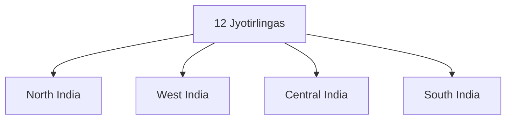

# Jyotirlingas

## Overview

Jyotirlingas are among the most sacred pilgrimage sites dedicated to Lord Shiva.

They are regarded as manifestations of Shiva in the form of divine light and occupy a central place in Shaivite traditions.

The twelve Jyotirlingas are spread across different regions of India and attract millions of pilgrims every year.

## Meaning

### Jyoti

- Divine Light

### Linga

- Symbolic representation of Lord Shiva

Thus, Jyotirlinga means the Linga of Divine Light.

## Origin

According to Hindu tradition, Lord Shiva appeared as an infinite pillar of light before Brahma and Vishnu.

The Jyotirlingas commemorate this manifestation.

## Twelve Jyotirlingas

| Jyotirlinga | State |
|----------|----------|
| Somnath | Gujarat |
| Mallikarjuna | Andhra Pradesh |
| Mahakaleshwar | Madhya Pradesh |
| Omkareshwar | Madhya Pradesh |
| Kedarnath | Uttarakhand |
| Bhimashankar | Maharashtra |
| Kashi Vishwanath | Uttar Pradesh |
| Trimbakeshwar | Maharashtra |
| Vaidyanath | Jharkhand |
| Nageshwar | Gujarat |
| Rameswaram | Tamil Nadu |
| Grishneshwar | Maharashtra |

## Major Pilgrimage Sites

### Somnath

Traditionally regarded as the first Jyotirlinga.

### Kashi Vishwanath

Located in Varanasi and among the most revered Shiva temples.

### Kedarnath

Situated in the Himalayas and part of the Char Dham pilgrimage circuit.

### Mahakaleshwar

Located in Ujjain and known for the Bhasma Aarti.

### Rameswaram

Associated with Lord Rama and the Ramayana.

## Religious Significance

Pilgrims believe that visiting Jyotirlingas:

- Strengthens devotion
- Brings spiritual merit
- Promotes inner purification
- Deepens connection with Shiva

## Tourism Importance

Jyotirlingas contribute significantly to:

- Religious tourism
- Local economies
- Heritage conservation
- Cultural continuity

## Festivals

Important festivals include:

- Maha Shivaratri
- Shravan Month Celebrations
- Temple-specific annual festivals

## Challenges

Major challenges include:

- Crowd management
- Environmental pressures
- Heritage conservation
- Infrastructure requirements

## Significance

The Jyotirlinga pilgrimage circuit represents one of the most important sacred travel traditions in India and remains a major component of religious tourism.

## Quick Revision

| Topic | Details |
|----------|----------|
| Deity | Lord Shiva |
| Total Jyotirlingas | 12 |
| Famous Site | Kashi Vishwanath |
| Himalayan Shrine | Kedarnath |
| Major Festival | Maha Shivaratri |
| Tourism Type | Religious Tourism |

## Think & Recall

1. What is the meaning of Jyotirlinga?
2. How many Jyotirlingas are traditionally recognized?
3. Which Jyotirlinga is located in Varanasi?
4. Why is Kedarnath significant?
5. How do Jyotirlingas contribute to religious tourism?
