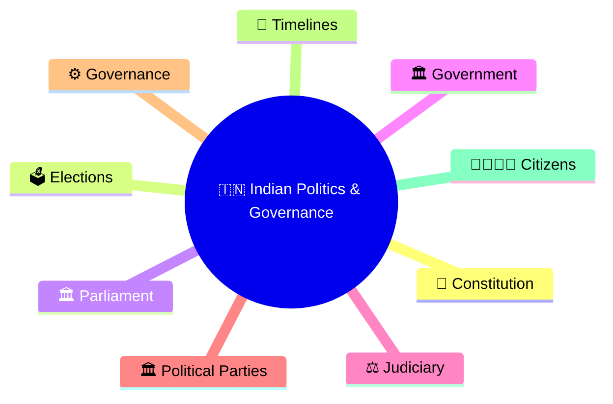
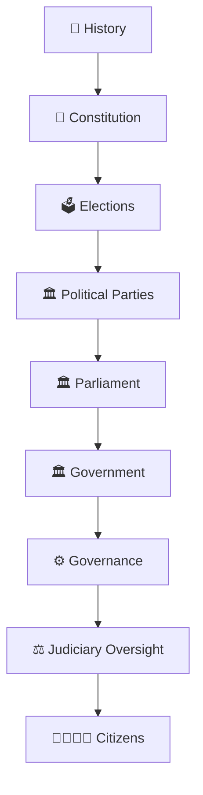
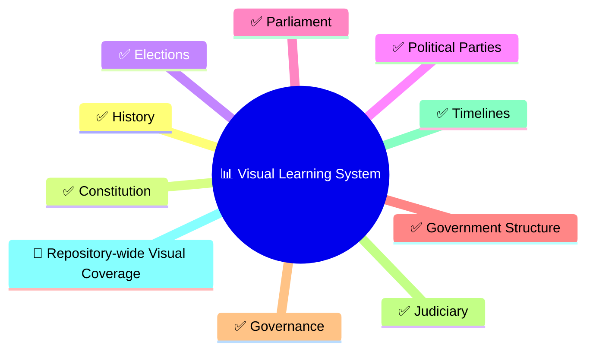

# Visual Guide to Indian Politics & Governance

## Overview

This section serves as the visual-learning hub of the repository.

Complex political, constitutional, governance, and institutional concepts are represented through diagrams, workflows, relationship maps, and timelines to improve understanding and long-term retention.

## Repository Structure

```text
20-diagrams/
├── history/
├── constitution/
├── elections/
├── political-parties/
├── parliament/
├── government-structure/
├── governance/
├── judiciary/
└── timelines/
```

## Importance

Indian politics and governance can appear complex because multiple institutions operate together.

This visual guide simplifies those relationships and helps citizens understand:

- How India is governed
- How governments are elected
- How laws are created
- How rights are protected
- How institutions interact
- How public policies affect daily life

This section contains visual diagrams that explain how India works as a constitutional democracy.

The goal is not to provide academic theory or exam-oriented notes. Instead, it aims to help every Indian citizen understand the institutions, processes, relationships, and decision-making mechanisms that shape everyday governance.

These diagrams are designed for:

- Citizens seeking civic awareness
- Students building foundational understanding
- Professionals wanting governance literacy
- Interview preparation and quick revision
- Long-term conceptual understanding of India



---

## How India Works



---

## Progress Status



---

## Importance Guide

| Priority | Area | Why Every Indian Should Know It | Importance |
|----------|------|----------------------------------|------------|
| P0 | Constitution | Defines rights, duties, institutions and governance | Must Know |
| P0 | Elections | Determines who governs the country and states | Must Know |
| P0 | Parliament | Creates laws and holds government accountable | Must Know |
| P0 | Government Structure | Explains PM, President, CM, Governor and administration | Must Know |
| P0 | Judiciary | Protects Constitution and citizens' rights | Must Know |
| P1 | Political Parties | Explains political competition and representation | Very High |
| P1 | Governance | Shows how policies become services and outcomes | Very High |
| P1 | History | Provides context for modern India | Very High |
| P2 | Timelines | Helps understand evolution and historical progression | High |

---

## Learning Order Recommendation

## Recommended Usage

### First Time Learners

Follow the learning order from Constitution → Elections → Parliament → Government → Judiciary.

### Revision Learners

Use diagrams as 5–10 minute visual refreshers before revisiting detailed topic files.

### Interview Preparation

Focus on workflows, institutional relationships, constitutional structures, and governance diagrams.

### Stage 1 — Every Citizen Must Know


### Stage 2 — Understand Governance


### Stage 3 — Understand India's Journey


---

## Diagram Categories

| Section | Focus Area |
|----------|------------|
| history | India's historical evolution and nation building |
| constitution | constitutional framework and foundational principles |
| elections | electoral systems and democratic processes |
| political-parties | political ecosystem and government formation |
| parliament | legislative process and parliamentary operations |
| government-structure | constitutional authorities and executive structure |
| governance | administration, policy and public-service delivery |
| judiciary | courts, judicial review and constitutional safeguards |
| timelines | chronological evolution of India and governance |

---

## Why Visual Learning Works

Visual models help learners:

- Understand relationships faster
- Retain information longer
- Connect multiple topics together
- Revise complex concepts quickly
- Build mental models of institutions and processes

---

## Repository Philosophy

This section follows a citizen-first approach.

The objective is not to memorize facts.

The objective is to understand:

- How power is distributed
- How governments are formed
- How laws are created
- How rights are protected
- How institutions interact
- How citizens influence governance

If a citizen understands the diagrams in this section, they should be able to explain the core structure of Indian politics and governance with confidence.

---

## Citizen Learning Outcome

After completing this section, a citizen should be able to explain:

- How India is governed
- How elections work
- How laws are created
- How Parliament functions
- How governments are formed
- How courts protect rights
- How governance reaches citizens
- How India evolved over time

---

## Diagram Coverage

Current visual coverage includes:

- Constitutional framework
- Elections and democratic processes
- Government formation
- Parliament and law making
- Governance and administration
- Judiciary and judicial review
- Political-party ecosystem
- Historical timelines
- Institutional relationships

---

## Quick Revision


