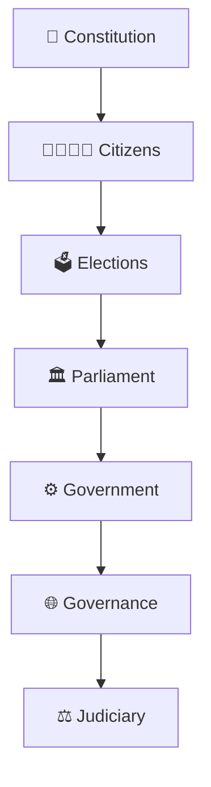
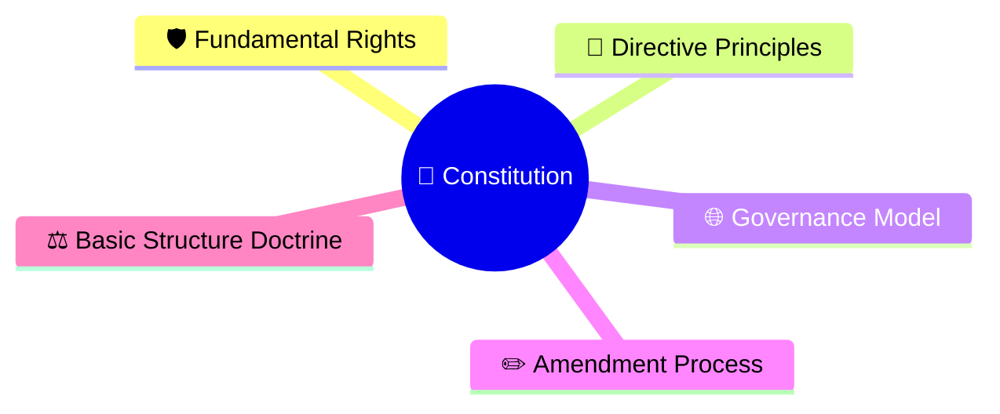
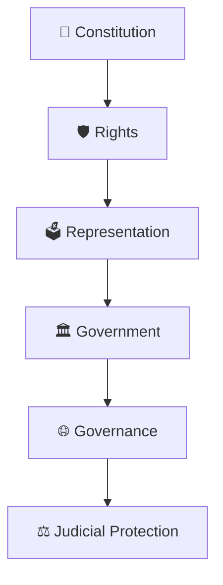

# Constitution Diagrams

## Overview

This section contains visual diagrams explaining the Constitution of India, constitutional principles, citizen rights, governance foundations, amendment mechanisms, and constitutional safeguards.

The objective is to help every citizen understand how the Constitution shapes India's democracy, institutions, governance, and rights.

---

## Importance

The Constitution is the foundation of modern India.

Every major institution operates within the constitutional framework:

Understanding the Constitution helps explain:

- How India is governed
- What rights citizens possess
- How institutions derive authority
- How power is limited and balanced
- How constitutional democracy is protected

---

## Learning Priority

### P0 (Must Know For Every Citizen)

- Fundamental Rights Framework ✓
- Constitutional Governance Model ✓
- Constitution Amendment Process ✓
- Basic Structure Doctrine ✓

### P1 (Important)

- Directive Principles Framework ✓

---

## Progress Status

---

## Citizen Learning Path

---

## Diagram Categories

### Citizen Rights

- Fundamental rights
- Constitutional remedies
- Equality and liberty
- Citizen protections

### Constitutional Governance

- Constitutional governance model
- Separation of powers
- Checks and balances
- Institutional accountability

### Constitutional Evolution

- Constitution amendment process
- Basic structure doctrine
- Constitutional continuity

### Public Policy & Development

- Directive principles
- Welfare state vision
- Governance goals

---

## Repository Philosophy

This section is designed for citizens first.

The goal is not to memorize constitutional articles.

The goal is to understand:

- Why the Constitution matters
- How institutions function
- How rights are protected
- How democratic governance works
- How constitutional stability is maintained

---

## Quick Revision

---

## Related Sections

- Parliament
- Judiciary
- Elections
- Governance
- Political Parties
- Constitutional Development Timeline
