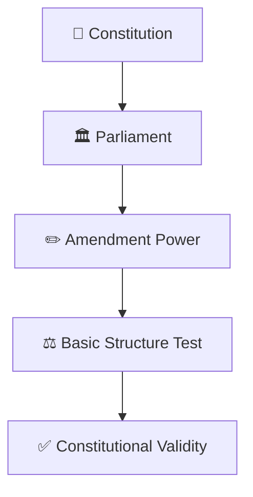
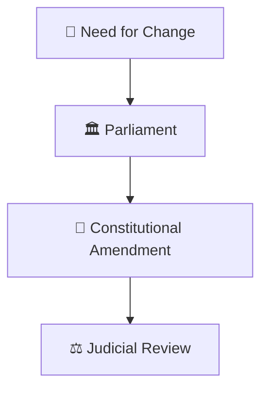
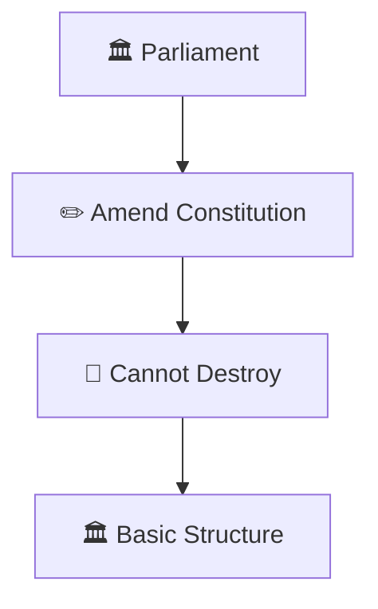
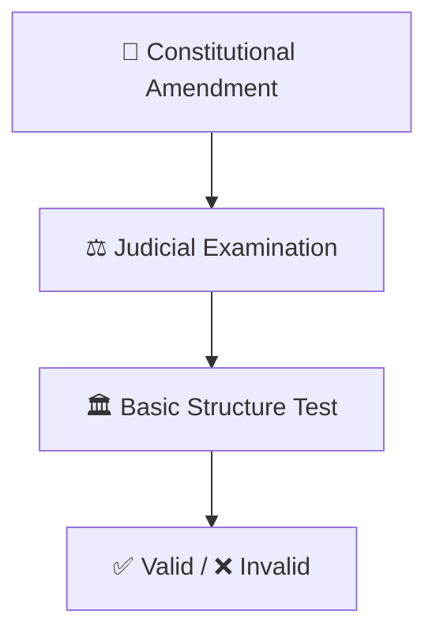
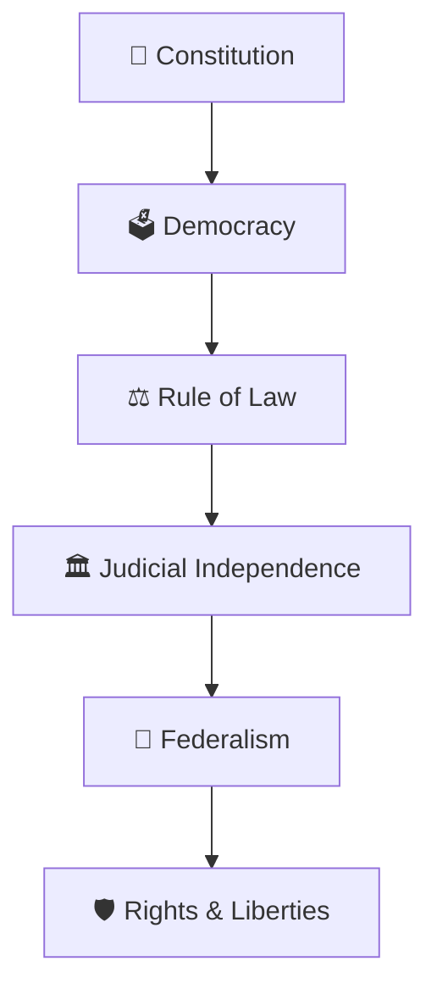
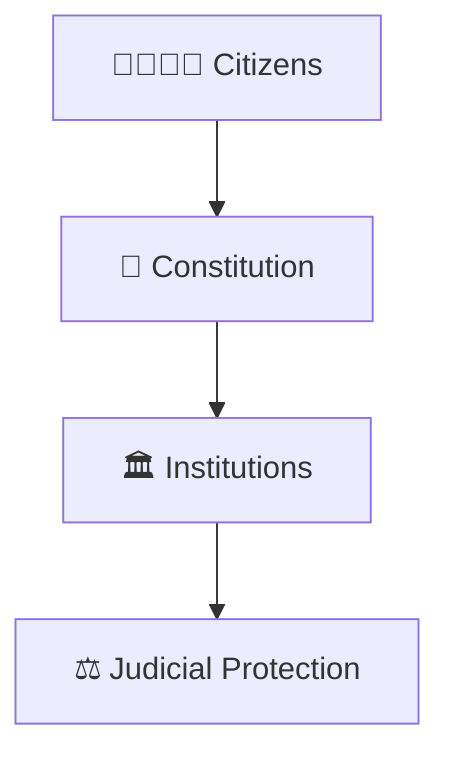

# Basic Structure Doctrine

## Overview

This diagram explains the Basic Structure Doctrine, one of the most important principles in Indian constitutional law.

It helps explain the balance between Parliament's power to amend the Constitution and the need to preserve the core identity of the Constitution.

---

## Diagram Purpose

Understanding the Basic Structure Doctrine helps explain:

- Why constitutional amendments have limits
- How constitutional values are protected
- How the judiciary safeguards the Constitution
- How institutional balance is maintained
- Why constitutional democracy remains stable

---

## Basic Structure Doctrine Framework

---

## Constitutional Amendment Process

### Purpose

- Adapt the Constitution to changing needs
- Preserve constitutional stability
- Maintain democratic legitimacy

---

## Balance of Powers Model

### Significance

- Prevents unlimited amendment power
- Protects constitutional identity
- Maintains institutional balance

---

## Judicial Safeguard Framework

### Purpose

- Protect constitutional foundations
- Preserve democratic principles
- Safeguard citizens' rights

---

## Core Constitutional Values

### Significance

- Maintains constitutional continuity
- Protects democratic governance
- Ensures institutional stability

---

## Constitutional Protection Model

---

## Quick Revision

---

- constitution-amendment-process.md
- constitutional-governance-model.md
- fundamental-rights-framework.md
- judicial-review-framework.md
- parliament-structure.md
- constitutional-development-timeline.md
