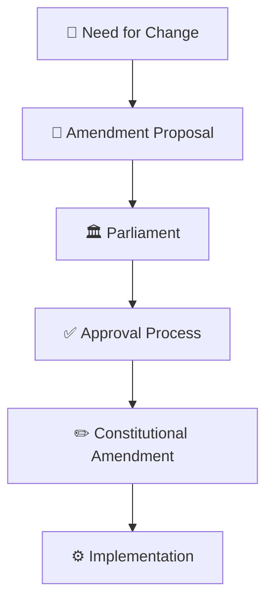
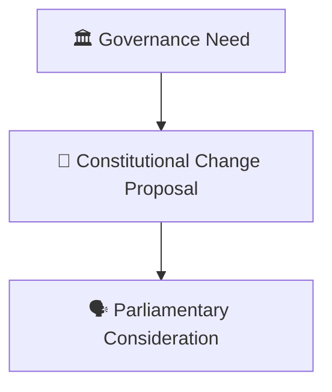
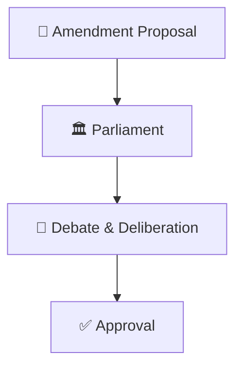
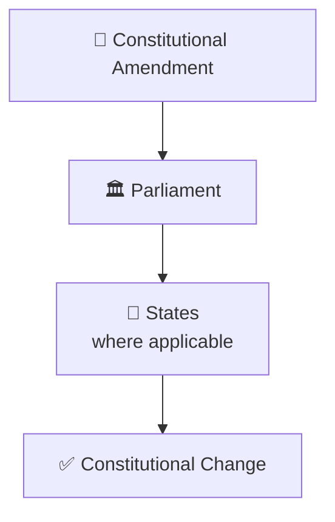
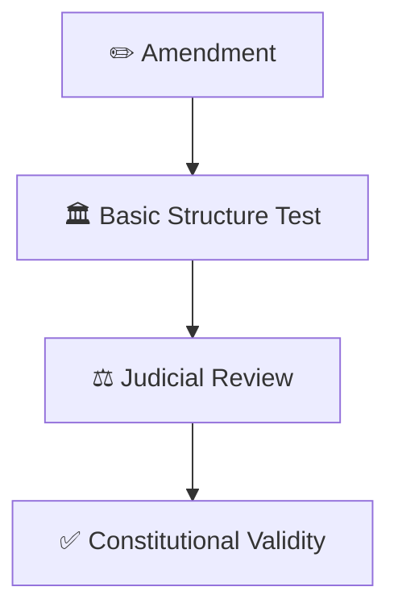

# Constitution Amendment Process

## Overview

This diagram explains how the Constitution of India can be amended and how constitutional changes are introduced while preserving constitutional stability.

It helps visualize the relationship between Parliament, constitutional change, federal participation, and judicial safeguards.

---

## Diagram Purpose

Understanding the amendment process helps explain:

- How the Constitution adapts over time
- How democratic institutions evolve
- How constitutional balance is maintained
- How Parliament exercises amendment powers
- How constitutional stability is protected

---

## Constitution Amendment Process

---

## Amendment Initiation Framework

### Purpose

- Address changing circumstances
- Improve governance mechanisms
- Adapt constitutional provisions

---

## Parliamentary Approval Model

### Significance

- Democratic decision making
- Legislative scrutiny
- Constitutional legitimacy

---

## Federal Participation Framework

### Significance

- Protects federal balance
- Ensures broader participation
- Preserves constitutional structure

---

## Constitutional Safeguard Model

### Purpose

- Protect constitutional identity
- Maintain democratic foundations
- Prevent destructive amendments

---

## Constitutional Evolution Framework

---

## Quick Revision

---

- basic-structure-doctrine.md
- constitutional-governance-model.md
- fundamental-rights-framework.md
- judicial-review-framework.md
- parliament-structure.md
- constitutional-development-timeline.md
