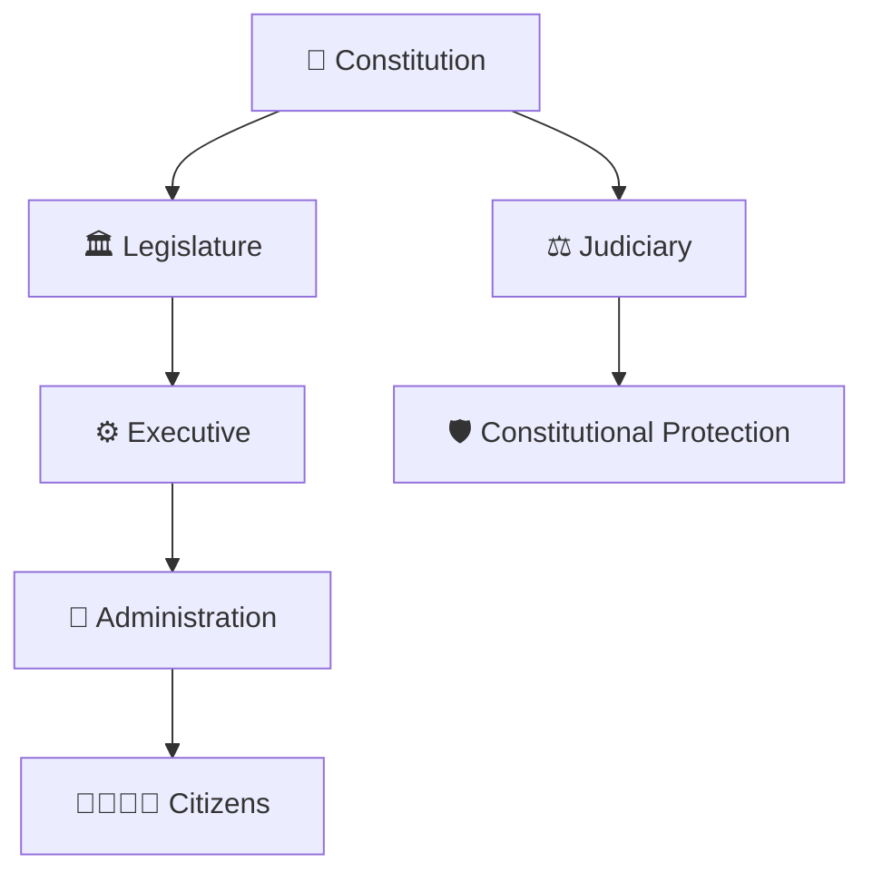
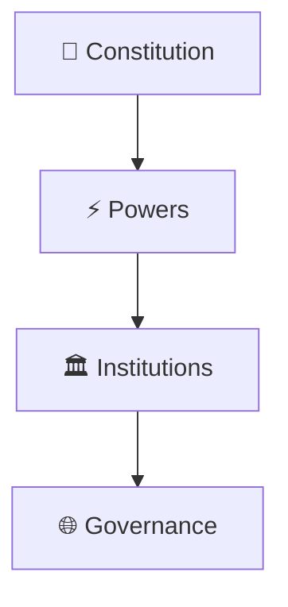
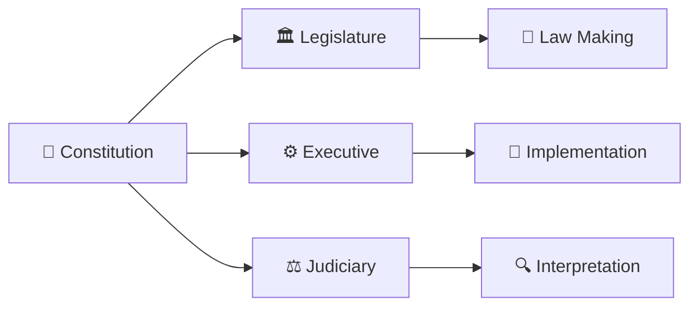
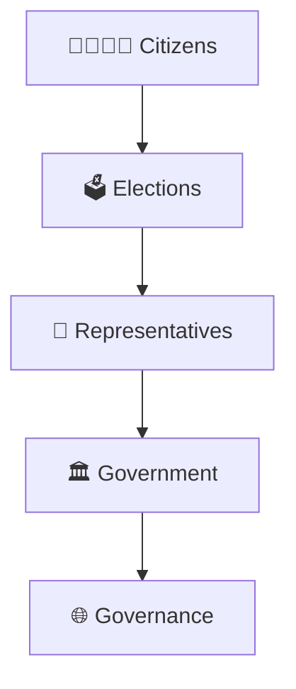
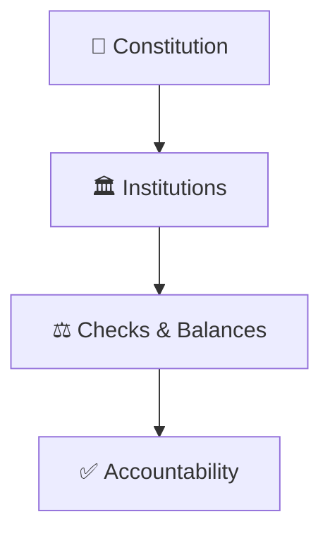
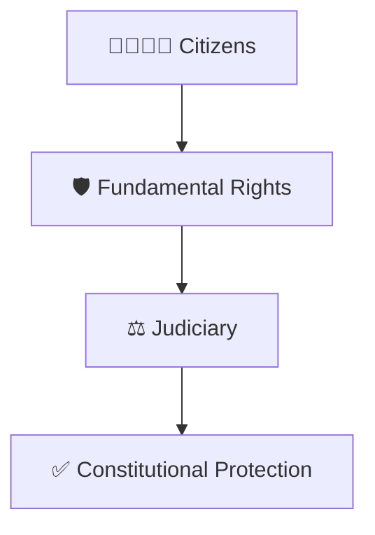
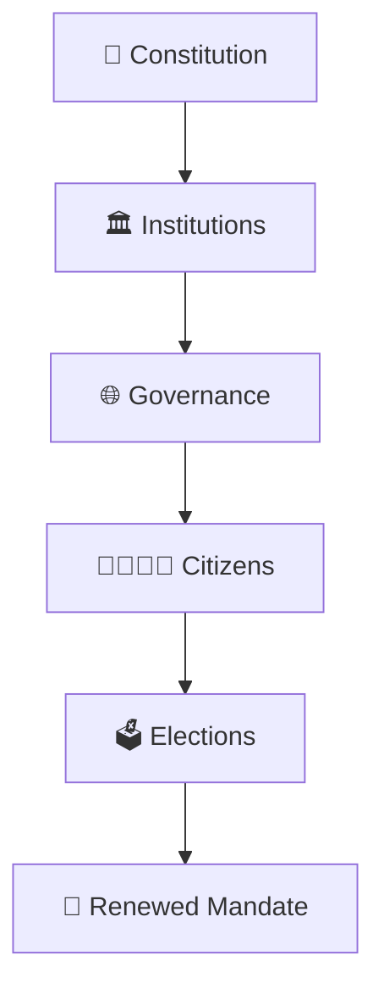

# Constitutional Governance Model

## Overview

This diagram explains how the Constitution serves as the foundation of governance in India.

It helps visualize how constitutional institutions interact, how powers are distributed, how accountability is maintained, and how citizens are connected to the governance system.

---

## Diagram Purpose

Understanding constitutional governance helps explain:

- How India is governed
- How power is distributed among institutions
- How checks and balances work
- How citizens participate in democracy
- How constitutional stability is maintained

---

## Constitutional Governance Model

---

## Constitutional Foundation

### Significance

- Source of governmental authority
- Defines institutional responsibilities
- Protects democratic order

---

## Separation of Powers Framework

### Purpose

- Prevent concentration of power
- Ensure accountability
- Maintain institutional balance

---

## Citizen Governance Connection

### Significance

- Democratic legitimacy
- Public participation
- Representative government

---

## Constitutional Accountability Model

### Purpose

- Prevent abuse of power
- Protect constitutional values
- Strengthen democratic governance

---

## Rights Protection Framework

### Significance

- Protection of liberties
- Rule of law
- Constitutional safeguards

---

## Governance Cycle

---

## Quick Revision

---

- fundamental-rights-framework.md
- constitution-amendment-process.md
- basic-structure-doctrine.md
- parliament-structure.md
- judicial-review-framework.md
- constitutional-development-timeline.md
