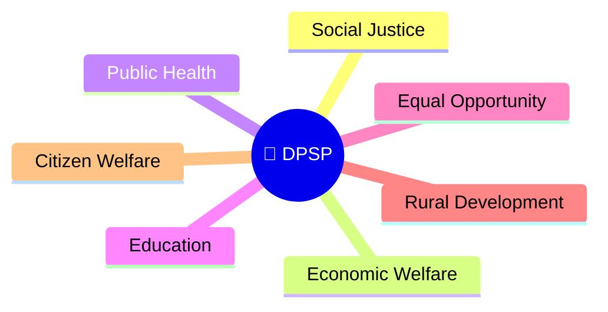
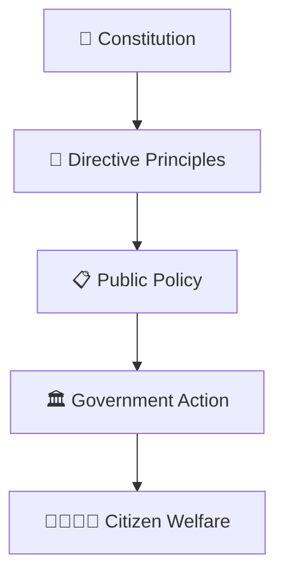
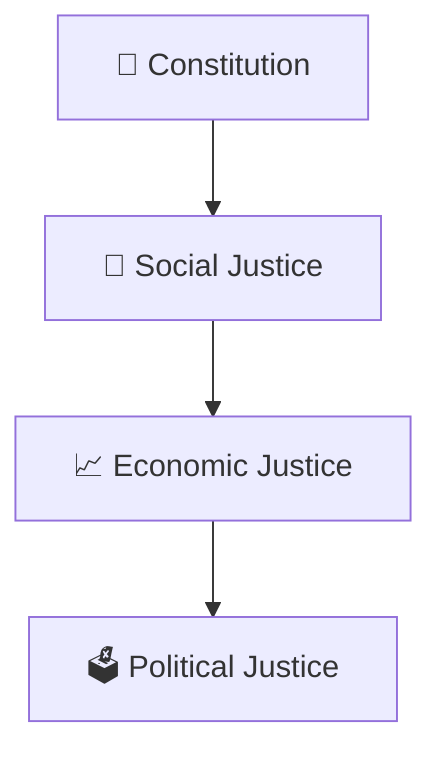
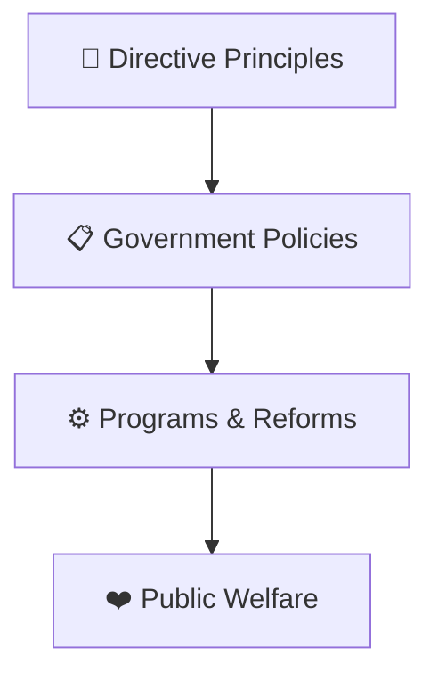
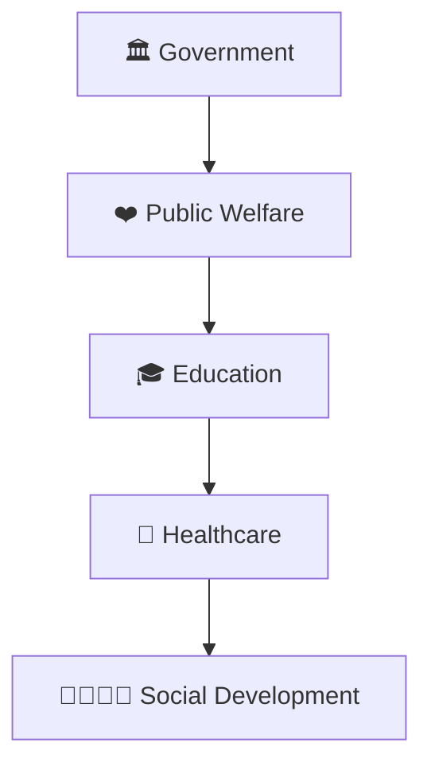
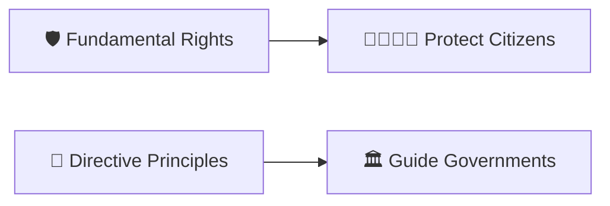
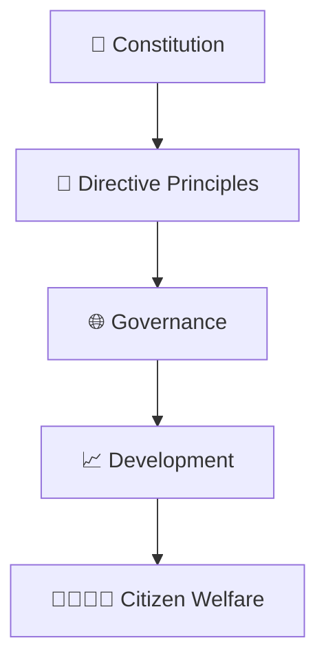

# Directive Principles Framework

## Overview

This diagram explains the Directive Principles of State Policy (DPSP), which provide guiding principles for governance and public policy in India.

It helps visualize how the Constitution directs governments to work toward social justice, economic welfare, equality, and national development.

---

## Diagram Purpose

Understanding Directive Principles helps explain:

- The long-term goals of governance
- How public policy is guided
- How welfare and development objectives are pursued
- The relationship between rights and governance goals
- The vision of a just and inclusive society

---

---

## Directive Principles Framework

---

## Governance Vision Model

### Purpose

- Promote inclusive development
- Reduce inequality
- Strengthen democratic governance

---

## Policy Guidance Framework

### Significance

- Guides policy decisions
- Shapes governance priorities
- Supports long-term development

---

## Welfare State Framework

### Purpose

- Improve quality of life
- Expand opportunities
- Promote social well-being

---

## Rights and Principles Relationship

### Significance

- Rights protect individuals
- Principles guide governance
- Both support constitutional democracy

---

## Constitutional Development Model

---

## Quick Revision

---

- fundamental-rights-framework.md
- constitutional-governance-model.md
- constitution-amendment-process.md
- governance-framework.md
- public-policy-lifecycle.md
- constitutional-development-timeline.md
