# Coalition Formation Workflow

## Overview

This diagram explains how coalition governments are formed when no single party or alliance secures a clear legislative majority after an election.

It helps visualize negotiations, alliance building, majority formation, and government creation within a parliamentary democracy.

---

## Diagram Purpose

Understanding coalition formation helps explain:

- How governments are formed without a clear majority
- How political parties cooperate
- How alliances influence governance
- How parliamentary majorities are built
- How coalition governments function

---

## Coalition Formation Workflow

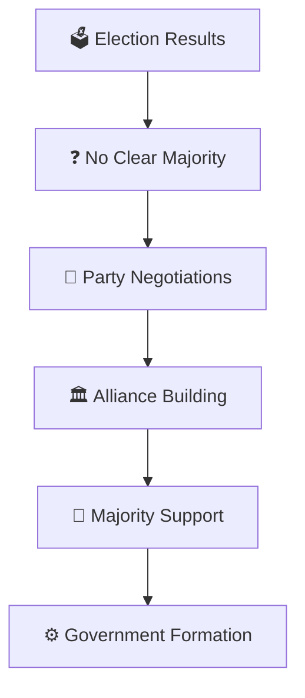

---

## Post-Election Scenario

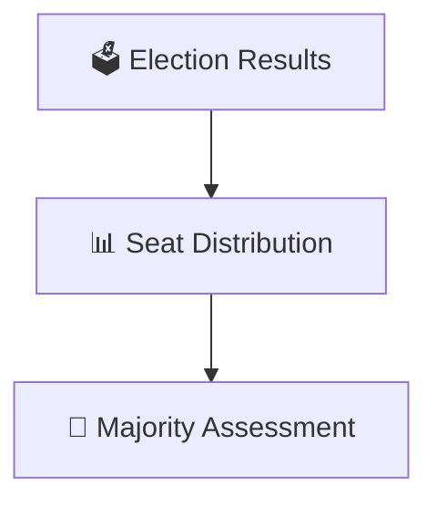

### Outcome

- Clear majority, or
- Coalition requirement

---

## Alliance Building Process

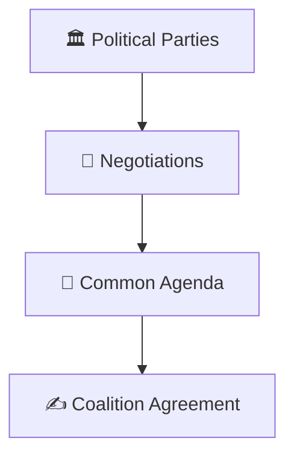

### Purpose

- Build majority support
- Define cooperation terms
- Establish governance priorities

---

## Majority Formation Model

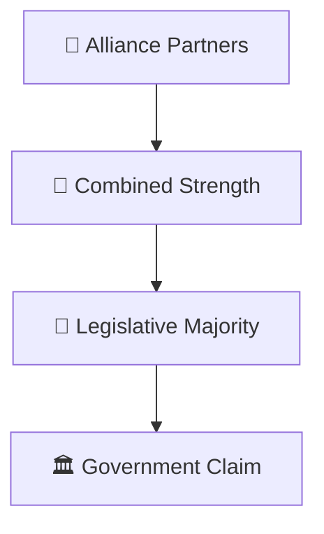

---

## Government Formation Stage

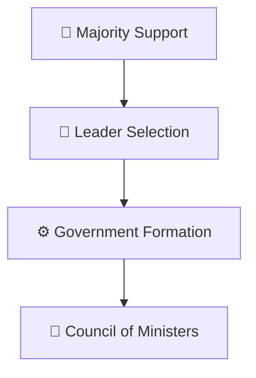

### Outcome

- Executive authority established
- Governance begins

---

## Coalition Governance Framework

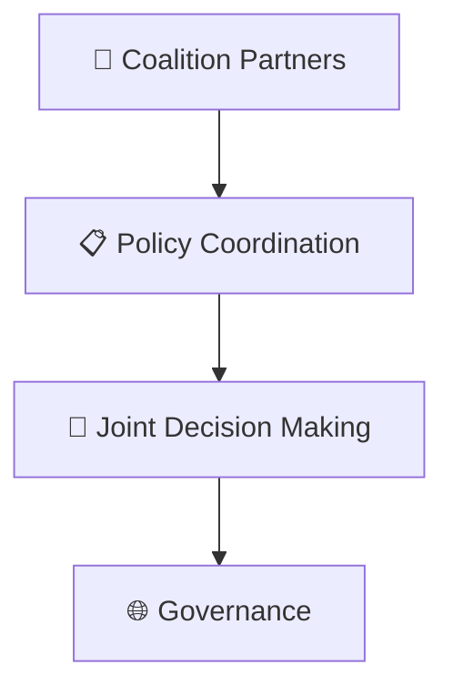

---

## Stability and Accountability

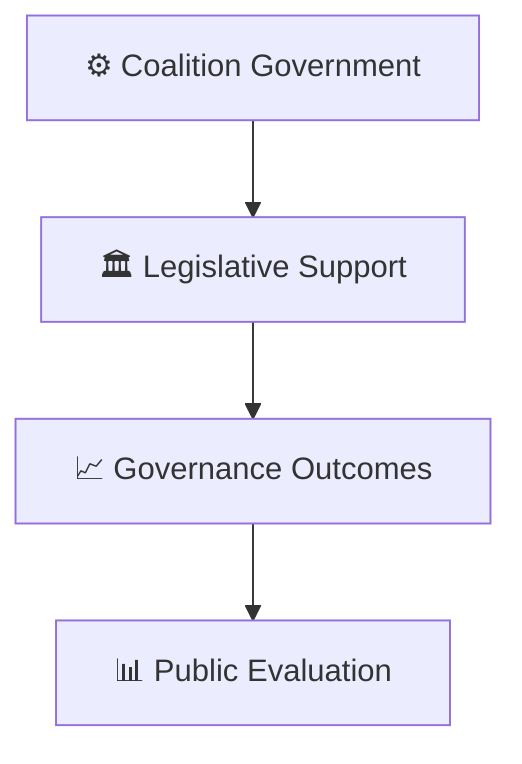

---

## Quick Revision

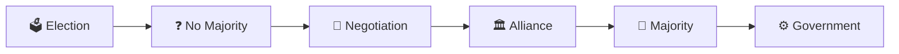

---

- election-result-analysis-framework.md
- government-formation-process.md
- voter-to-government-journey.md
- political-party-ecosystem.md
- coalition-formation-model.md
- elections-and-democracy.md

# Election Diagrams

## Overview

This section contains visual diagrams explaining India's electoral system, election processes, democratic institutions, voting mechanisms, representation framework, government formation, and parliamentary elections.

The goal is to simplify complex election concepts through visual learning and quick revision.

---

## Why Use Diagrams?

Election diagrams help:

- Understand election workflows
- Visualize democratic processes
- Learn institutional relationships
- Improve revision speed
- Simplify complex topics

---

## Learning Priority Order

### P1 (Highest ROI)

- Election Process Flow ✓
- Voter to Government Journey ✓
- Election Commission Structure ✓
- Government Formation Process ✓
- Constituency Representation Model ✓

### P2

- Election Result Analysis Framework ✓
- Coalition Formation Workflow ✓
- Lok Sabha Election Workflow ✓
- Rajya Sabha Election Workflow ✓

### P3

- By-Election Process
- Electoral Roll Management
- Candidate Nomination Workflow
- Campaign to Result Journey

---

## Progress Status

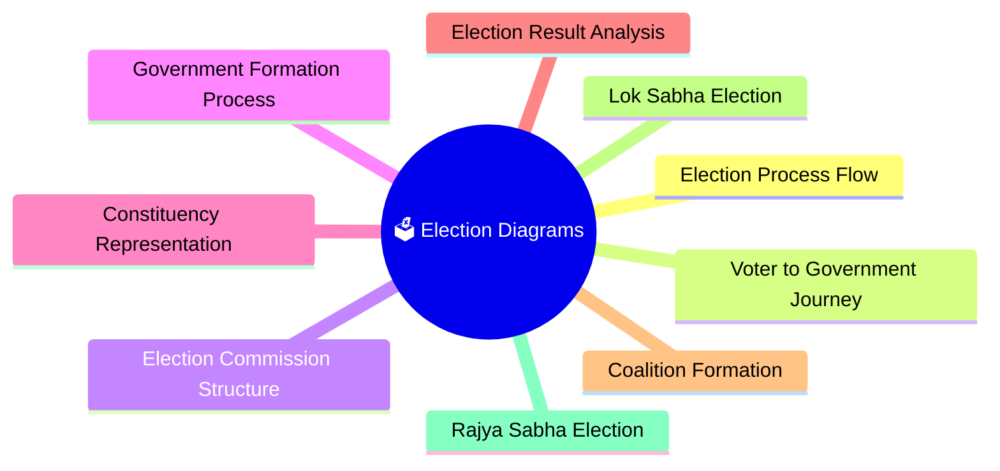

---

## Recommended Diagram Structure

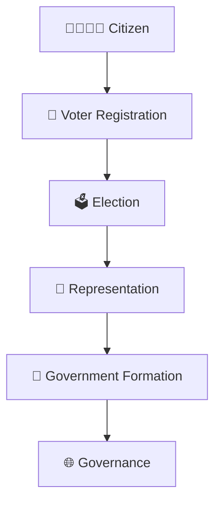

---

## Diagram Categories

### Election Process

- Election lifecycle
- Voting workflow
- Counting workflow
- Result declaration process
- Candidate nomination workflow
- Government formation workflow

### Representation

- Constituency model
- MP and MLA representation
- Parliament composition
- Representation accountability cycle
- Voter to government journey

### Governance

- Election to government journey
- Accountability cycle
- Citizen participation framework
- Coalition formation model
- Electoral legitimacy framework

---

## Quick Revision

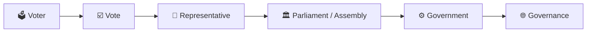

---

## Related Sections

- Elections & Democracy
- Political Parties
- Parliament & Law Making
- Political Terminology
- Election Terminology
- Contemporary Governance
