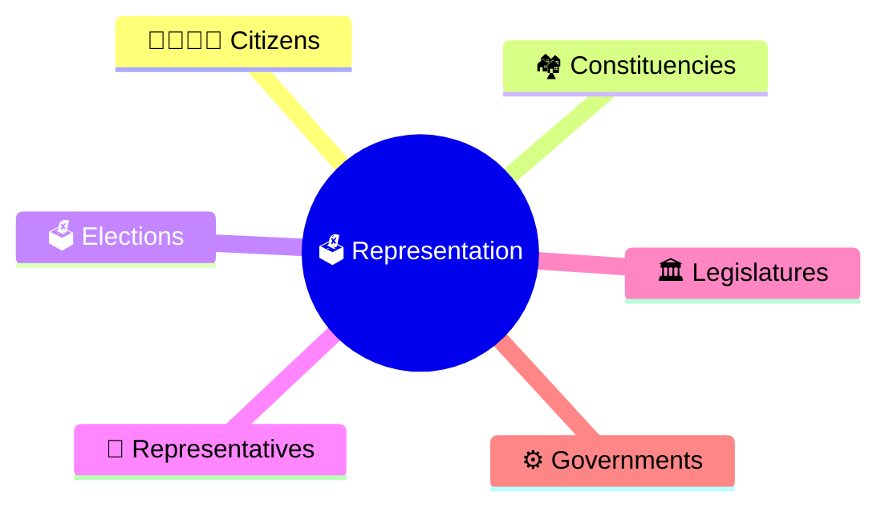
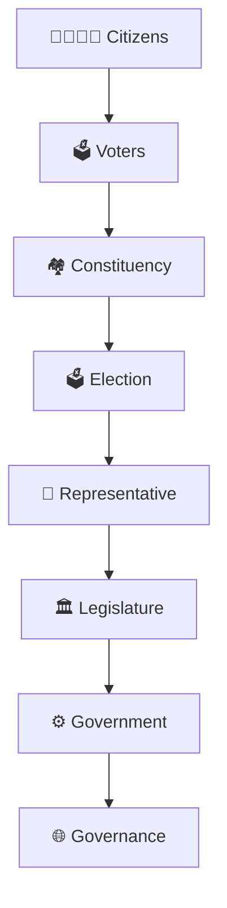
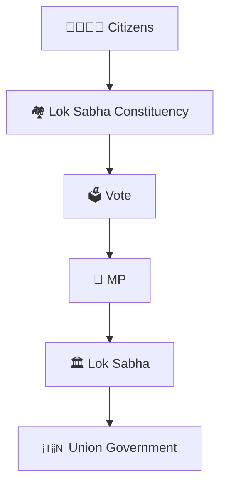
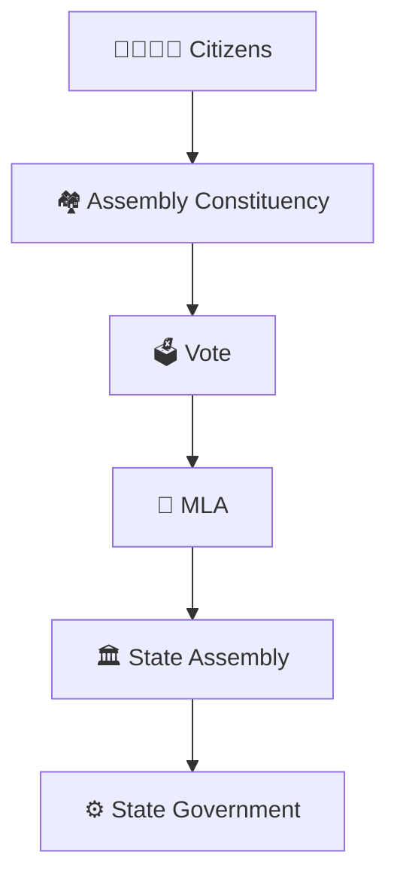
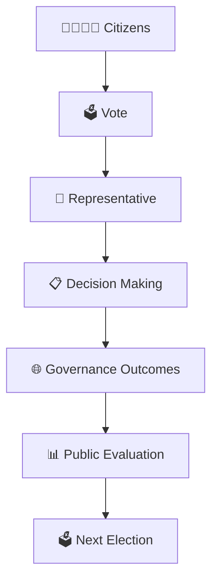
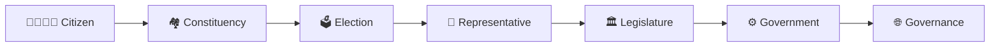

# Constituency Representation Model

## Overview

This diagram explains how citizens are represented in India's democratic system through constituencies, elected representatives, legislatures, and government institutions.

It helps visualize the connection between voters and governance.

---

## Diagram Purpose

Understanding constituency representation helps explain:

- How citizens participate in democracy
- How representatives are elected
- How Parliament and State Assemblies are formed
- How public issues reach government institutions
- How accountability works in representative democracy

---

---

## Representation Framework

---

## Lok Sabha Representation Model

### Key Points

- Each Lok Sabha constituency elects one MP.
- MPs represent citizens in Parliament.
- MPs raise local and national issues.
- MPs participate in law-making and accountability.

---

## State Assembly Representation Model

### Key Points

- Each Assembly constituency elects one MLA.
- MLAs represent citizens at the State level.
- MLAs participate in State legislation and governance.

---

## Accountability Cycle

---

## Quick Revision

---

- election-process-flow.md
- voter-to-government-journey.md
- government-formation-process.md
- elections-and-democracy.md
- election-terminology.md
- parliamentary-terminology.md
