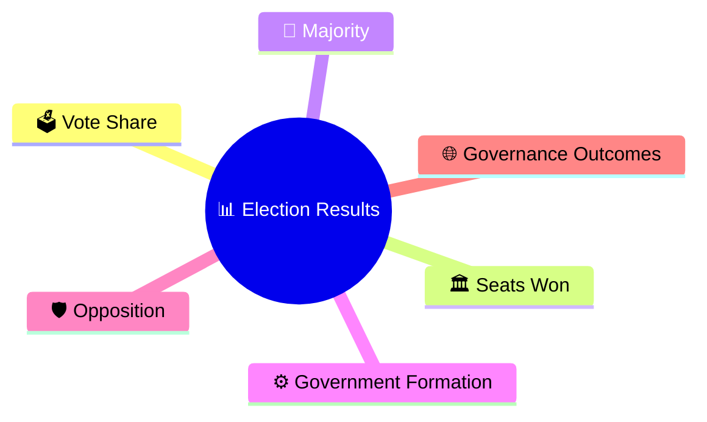
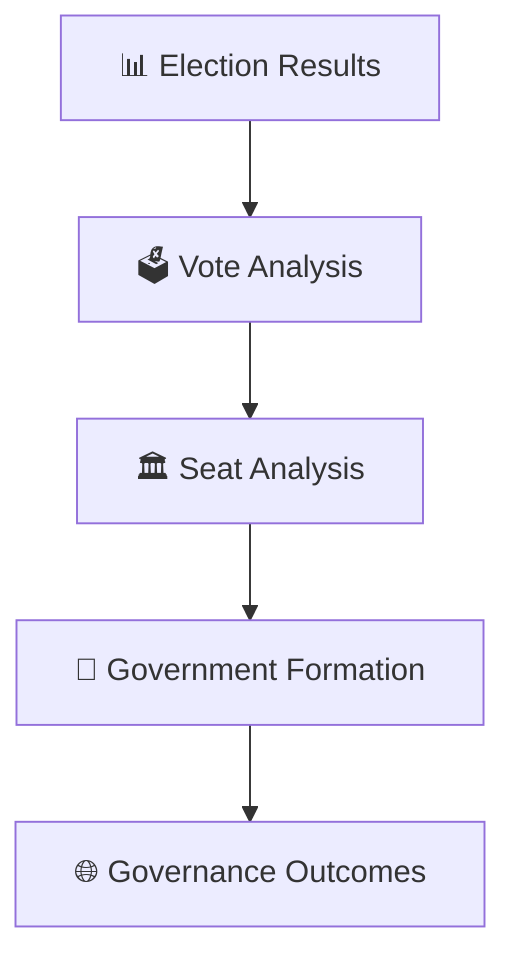
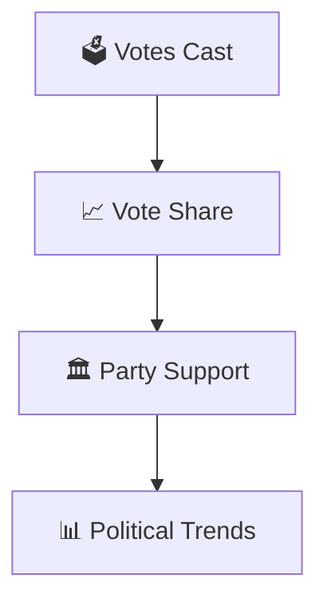
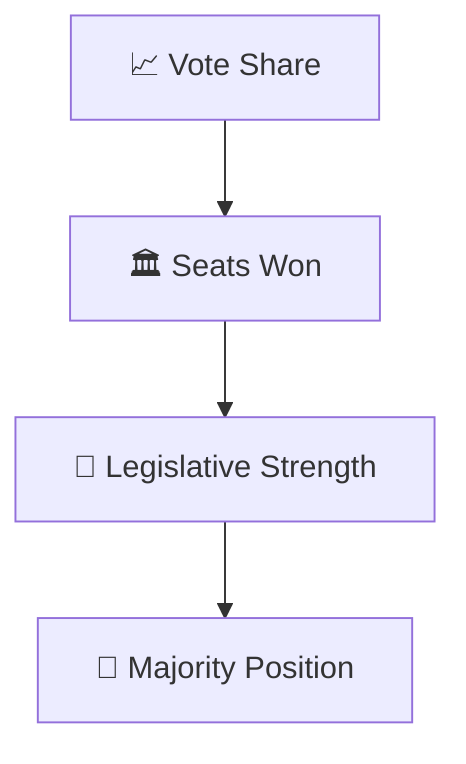
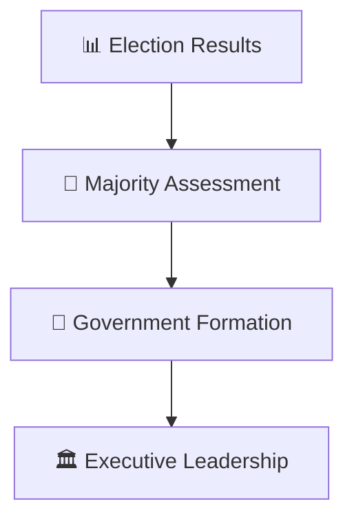
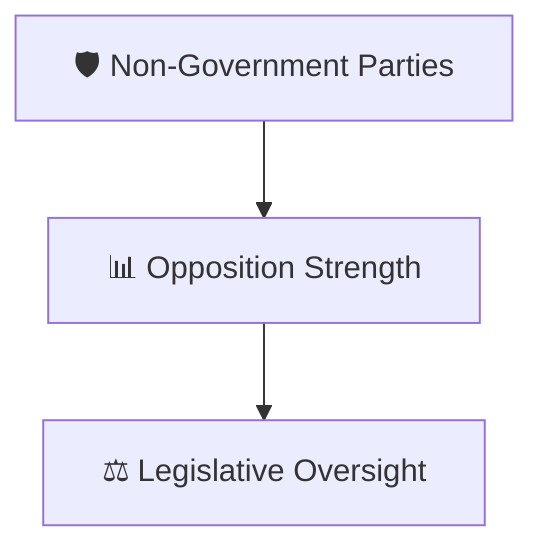
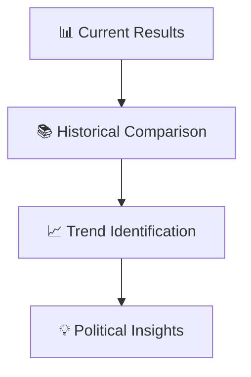
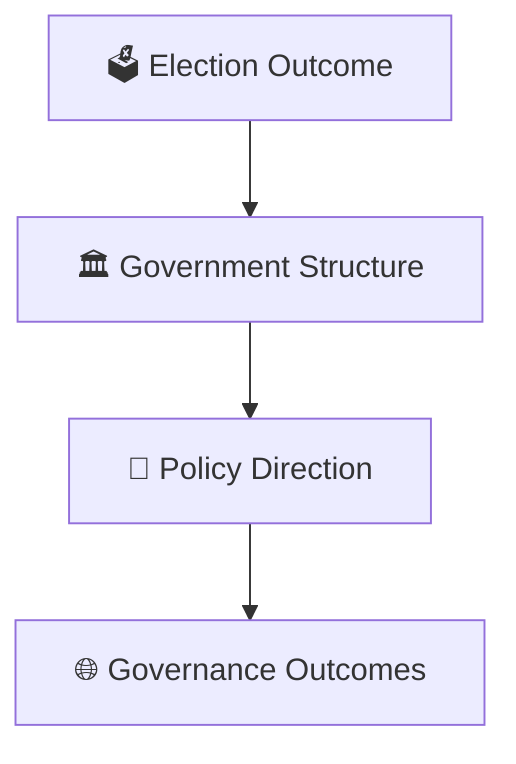

# Election Result Analysis Framework

## Overview

This diagram explains how election results are analyzed to understand voter behavior, seat distribution, government formation, opposition strength, and governance implications.

It provides a structured framework for interpreting election outcomes beyond simple winner-loser narratives.

---

## Diagram Purpose

Understanding election result analysis helps explain:

- How voters influence governance
- How legislative strength is determined
- How governments are formed
- How opposition effectiveness is assessed
- How political trends evolve over time

---

---

## Election Result Analysis Framework

---

## Vote Analysis Model

### Purpose

- Measure voter preferences
- Identify political shifts
- Understand electoral support

---

## Seat Analysis Model

### Purpose

- Determine representation
- Measure parliamentary strength
- Assess government viability

---

## Government Formation Framework

### Outcome

- Majority government or coalition
- Formation of executive authority

---

## Opposition Analysis

### Purpose

- Evaluate accountability mechanisms
- Assess parliamentary balance

---

## Electoral Trend Analysis

---

## Governance Impact Framework

---

## Quick Revision

---

- election-process-flow.md
- government-formation-process.md
- coalition-formation-workflow.md
- voter-to-government-journey.md
- constituency-representation-model.md
- elections-and-democracy.md
