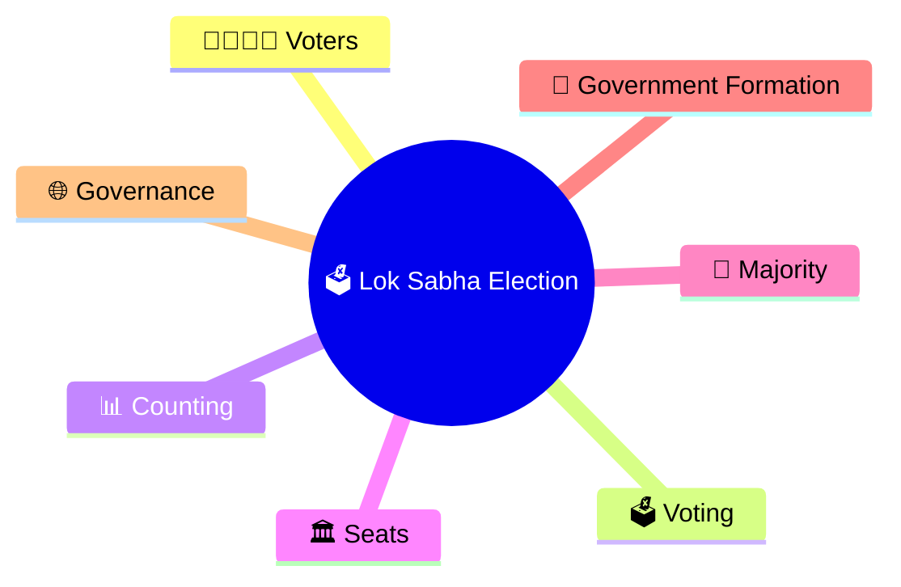
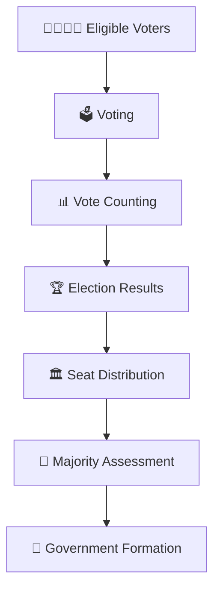
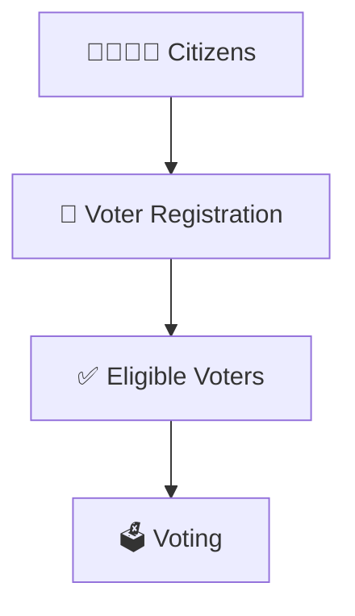
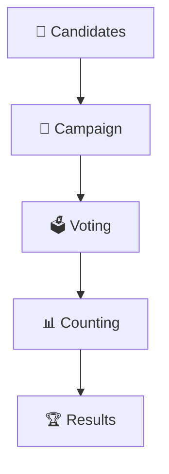
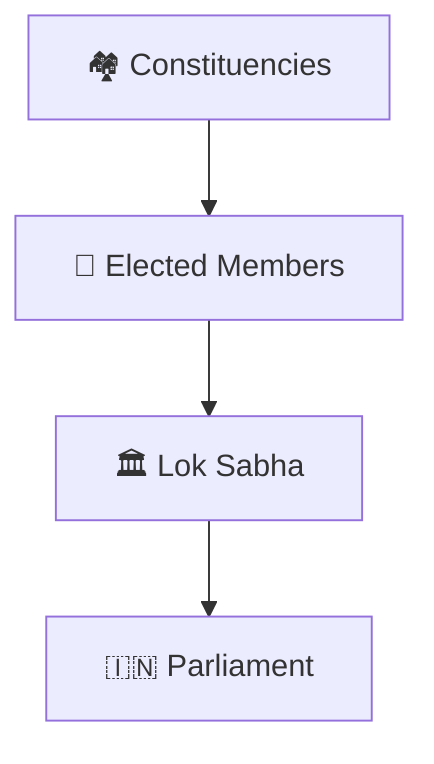
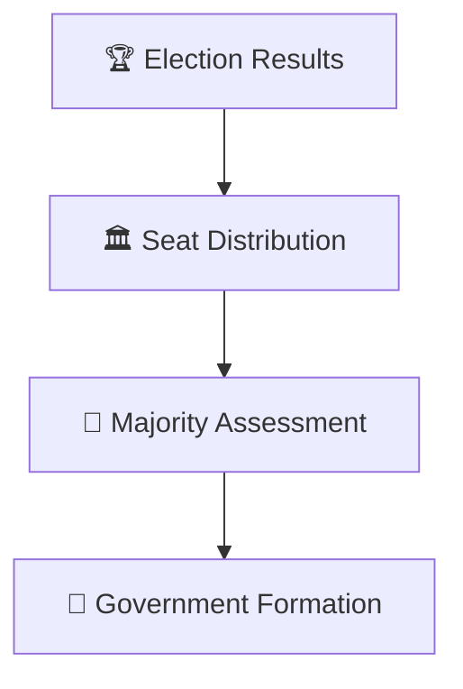
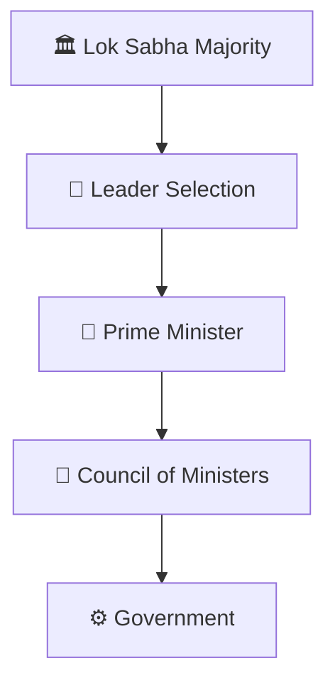
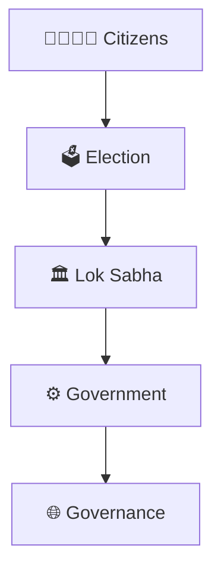
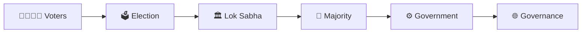

# Lok Sabha Election Workflow

## Overview

This diagram explains how members of the Lok Sabha are elected and how election results lead to government formation in India's parliamentary democracy.

It helps visualize the complete journey from voters casting ballots to the formation of the Union Government.

---

## Diagram Purpose

Understanding Lok Sabha elections helps explain:

- How citizens elect representatives
- How governments are formed
- How democratic representation works
- How parliamentary majorities are created
- How governance derives democratic legitimacy

---

## Lok Sabha Election Workflow

---

## Voter Participation Framework

### Purpose

- Democratic participation
- Representative governance
- Public accountability

---

## Election Process

### Outcome

- Representatives elected
- Constituencies represented
- Legislative composition determined

---

## Representation Model

### Significance

- Direct representation
- National legislature formation
- Democratic legitimacy

---

## Majority Formation Framework

### Outcome

- Majority government, or
- Coalition government

---

## Government Formation Connection

---

## Governance Flow

---

## Quick Revision

---

- rajya-sabha-election-workflow.md
- election-process-flow.md
- election-result-analysis-framework.md
- government-formation-process.md
- voter-to-government-journey.md
- elections-and-democracy.md
