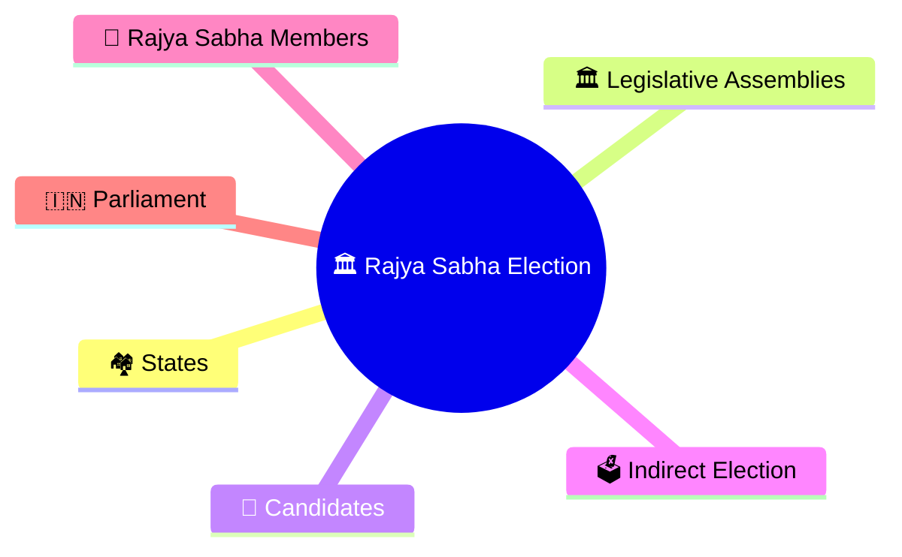
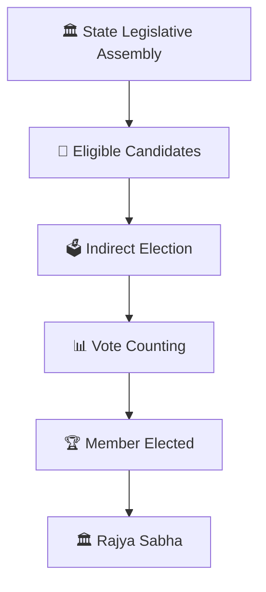
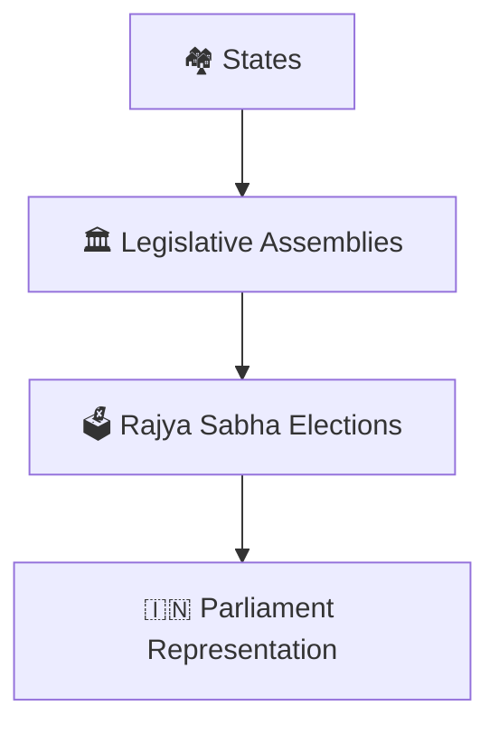
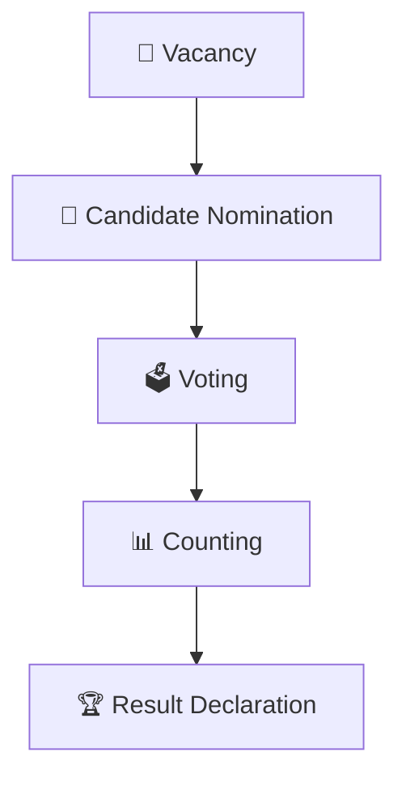
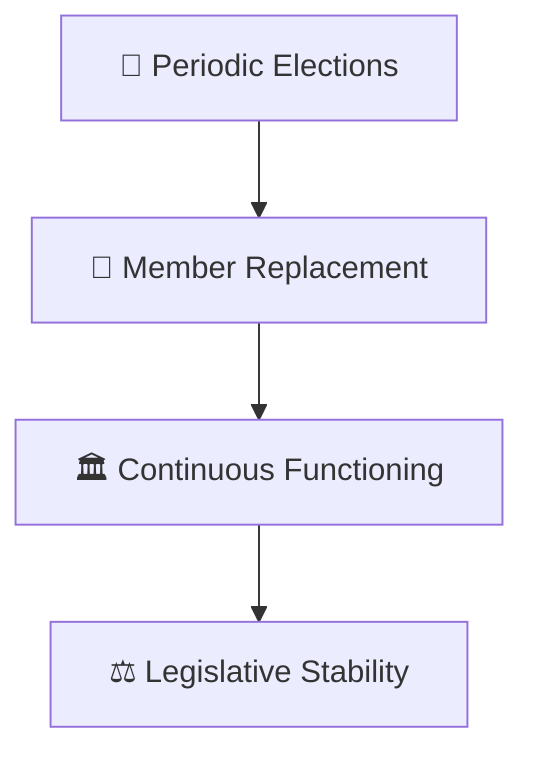
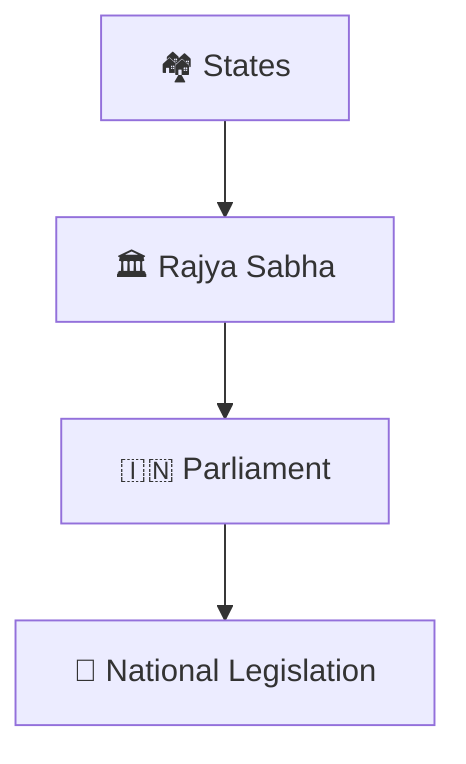
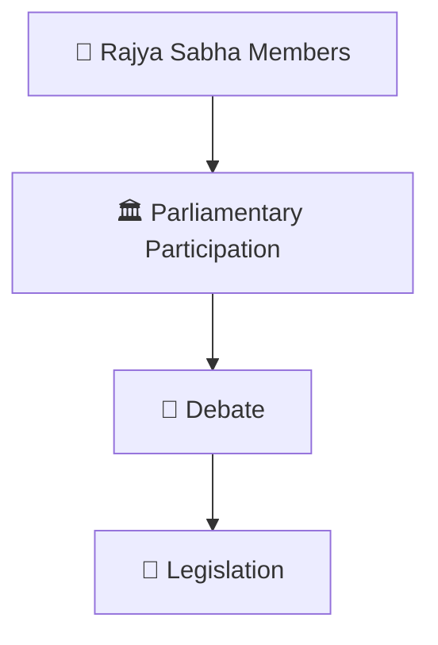
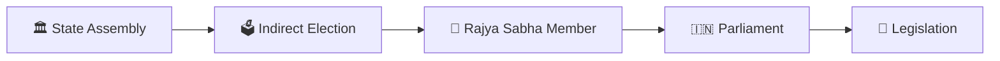

# Rajya Sabha Election Workflow

## Overview

This diagram explains how members of the Rajya Sabha are elected and how representation in the Upper House of Parliament is maintained.

It helps visualize the indirect election process, the role of State Legislative Assemblies, and the federal nature of parliamentary representation.

---

## Diagram Purpose

Understanding Rajya Sabha elections helps explain:

- How the Upper House is constituted
- How states are represented at the Union level
- How indirect elections work
- How parliamentary continuity is maintained
- How India's federal structure operates

---

## Rajya Sabha Election Workflow

---

## Representation Framework

### Purpose

- Represent states in Parliament
- Strengthen federal governance
- Provide legislative continuity

---

## Election Process

### Outcome

- New members elected
- Vacancies filled
- Representation maintained

---

## Parliamentary Continuity Model

### Significance

- Ensures continuity
- Avoids complete dissolution
- Maintains institutional stability

---

## Federal Governance Connection

### Purpose

- Integrate state perspectives
- Strengthen cooperative federalism
- Improve legislative review

---

## Legislative Workflow

---

## Quick Revision

---

- lok-sabha-election-workflow.md
- election-process-flow.md
- election-result-analysis-framework.md
- parliament-and-law-making.md
- centre-state-relations-framework.md
- elections-and-democracy.md
