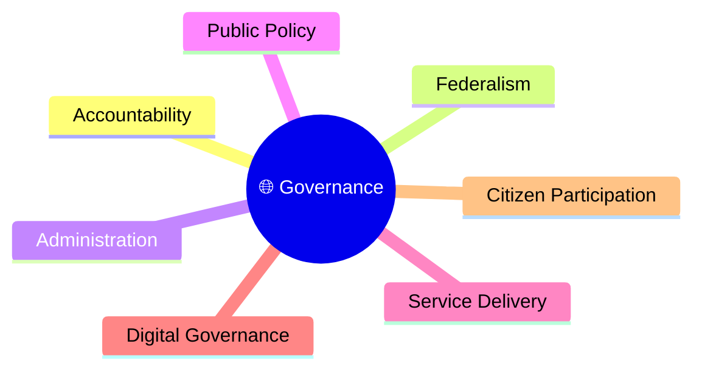
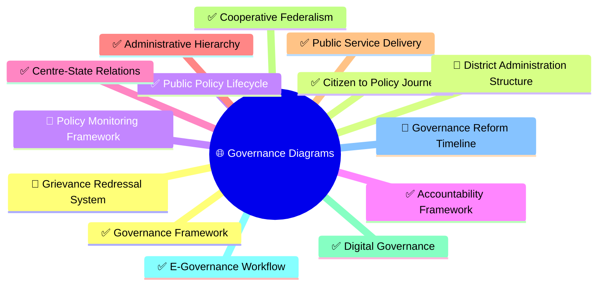
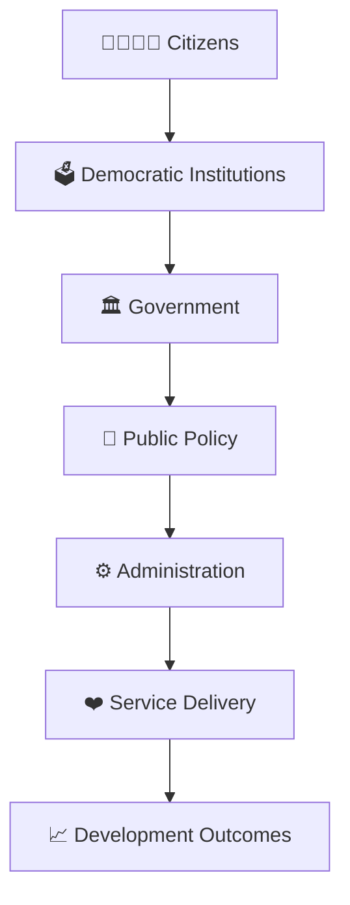

# Governance Diagrams

## Overview

This section contains visual diagrams explaining governance systems, public administration, policy implementation, accountability mechanisms, federalism, and institutional relationships in India.

The goal is to simplify governance concepts through visual learning, system thinking, and quick revision.

---

## Why Use Diagrams?

Governance diagrams help:

- Understand institutional relationships
- Visualize policy implementation
- Learn administrative structures
- Understand accountability systems
- Improve revision efficiency

---

## Learning Priority Order

### P1 (Highest ROI)

- Governance Framework ✓
- Citizen to Policy Journey ✓
- Public Policy Lifecycle ✓
- Accountability Framework ✓
- Centre-State Relations Framework ✓

### P2

- Administrative Hierarchy ✓
- Public Service Delivery Workflow ✓
- Cooperative Federalism Model ✓
- Digital Governance Framework ✓
- E-Governance Workflow ✓

## Progress Status

### P3

- Governance Reform Timeline
- Grievance Redressal System
- District Administration Structure
- Policy Monitoring Framework

---

## Recommended Diagram Structure

---

## Diagram Categories

### Governance

- Governance framework
- Accountability framework
- Decision-making workflow
- Institutional interaction model
- Centre-State relations framework
- Federal governance model

### Public Administration

- Administrative hierarchy
- Service delivery workflow
- District administration structure
- Public grievance process
- Administrative coordination model
- Governance execution framework
- E-governance service workflow
- Citizen service delivery ecosystem

### Public Policy

- Policy lifecycle
- Policy implementation model
- Monitoring and evaluation framework
- Policy monitoring framework
- Governance improvement cycle

---

## Quick Revision

---

## Related Sections

- Public Administration & Governance
- Contemporary Governance
- Contemporary Public Policy
- Government Structure
- Governance Terminology
- Administrative Terminology
