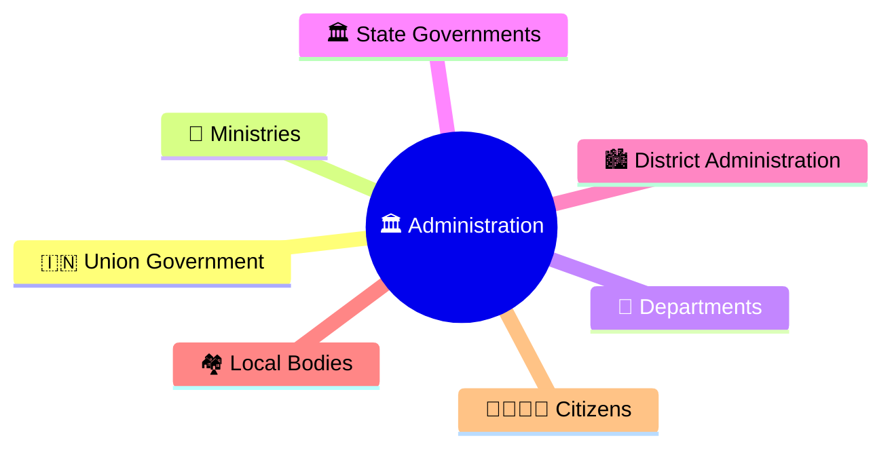
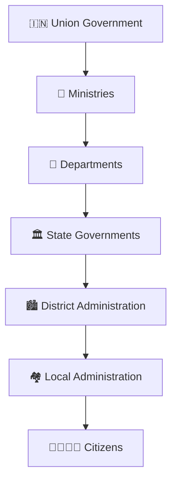
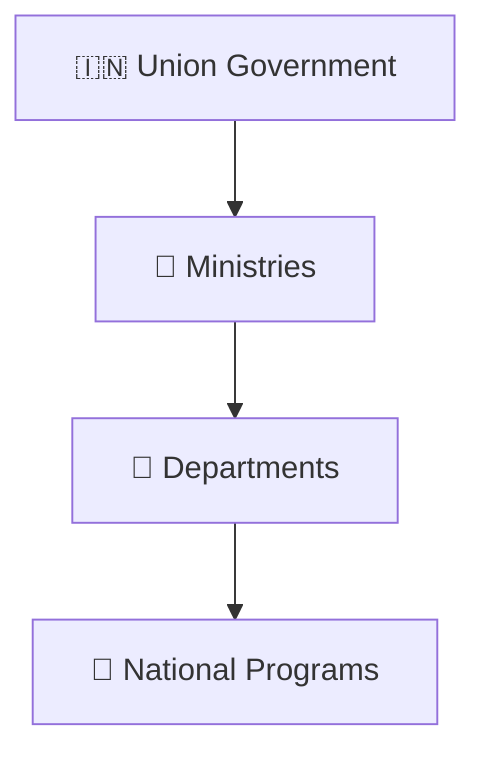
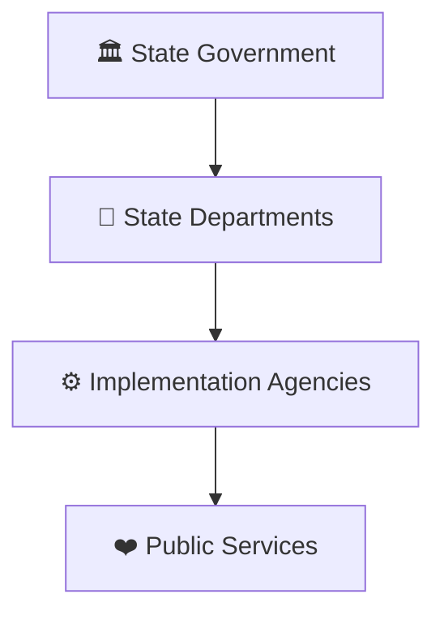
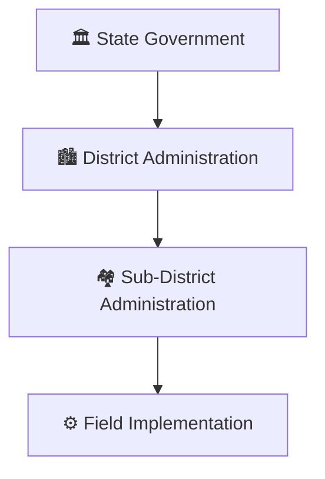
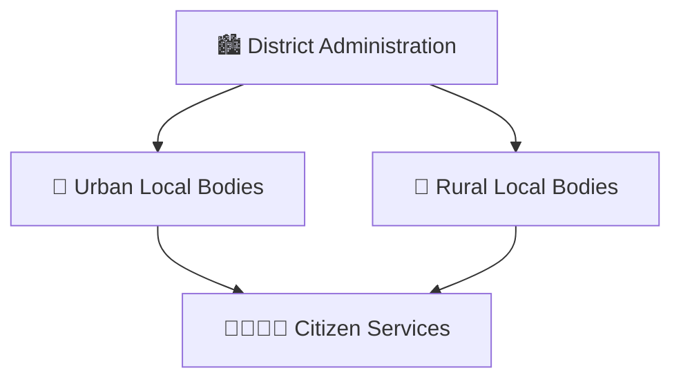
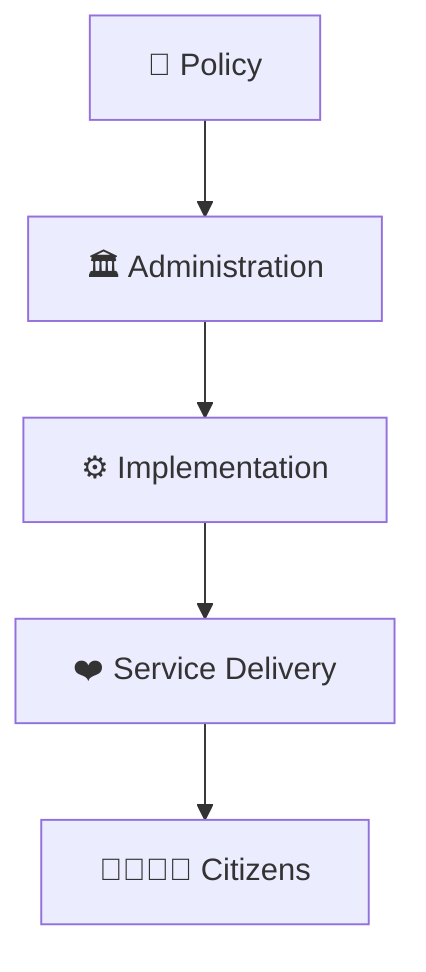
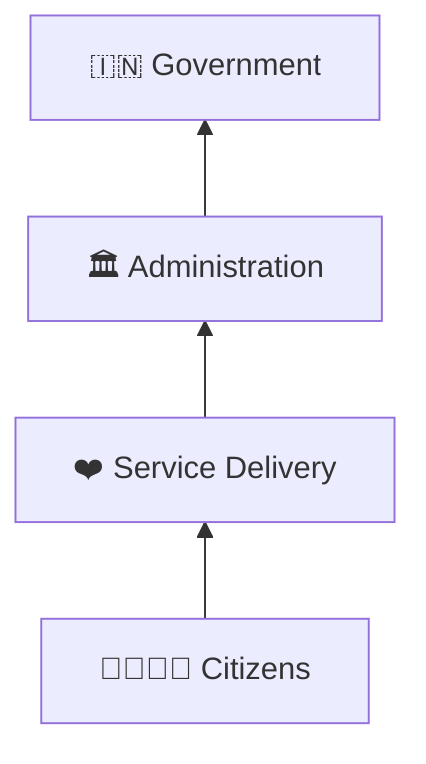

# Administrative Hierarchy

## Overview

This diagram explains the administrative structure through which government policies are implemented and public services are delivered across India.

It helps visualize how authority, responsibility, coordination, and execution flow from national institutions to citizens.

---

## Diagram Purpose

Understanding the administrative hierarchy helps explain:

- How governance functions on the ground
- How policies are implemented
- How public services reach citizens
- How different administrative levels coordinate
- How accountability is maintained

---

## Administrative Hierarchy Framework

---

## National Administration

### Responsibilities

- Policy formulation
- National planning
- Resource allocation
- Strategic governance

---

## State Administration

### Responsibilities

- State-level policy execution
- Administrative coordination
- Service delivery management

---

## District Administration

### Responsibilities

- Program implementation
- Local coordination
- Public grievance handling
- Field-level governance

---

## Local Administration

### Responsibilities

- Local governance
- Civic services
- Community development

---

## Governance Execution Model

---

## Accountability Flow

---

## Quick Revision

---

- governance-framework.md
- public-service-delivery-workflow.md
- cooperative-federalism-model.md
- centre-state-relations-framework.md
- public-administration-and-governance.md
- governance-terminology.md
