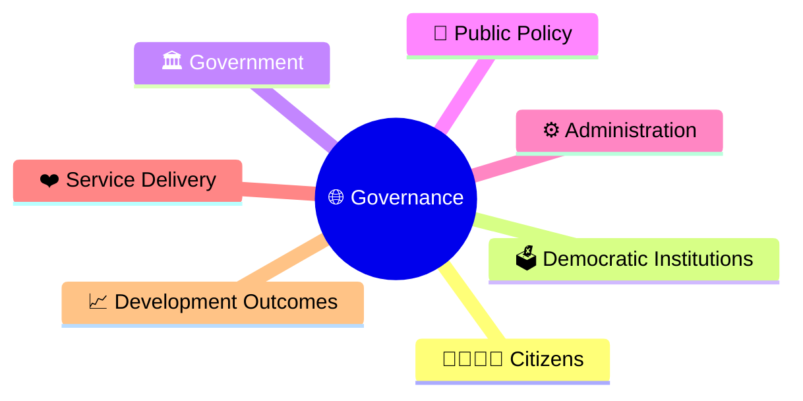
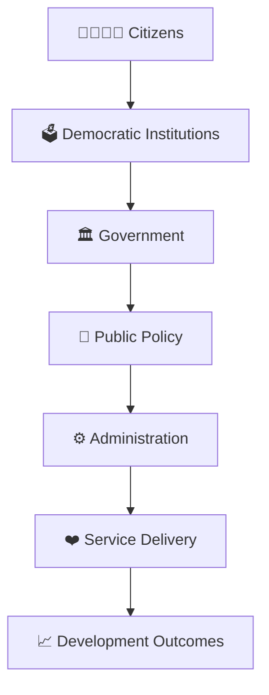
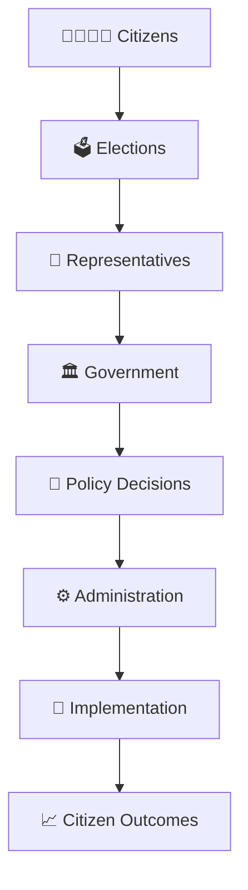
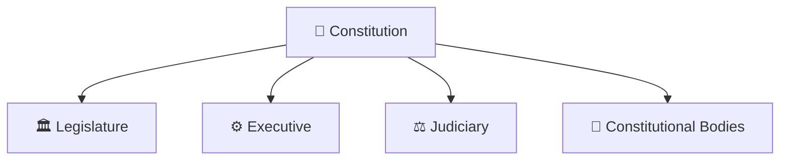
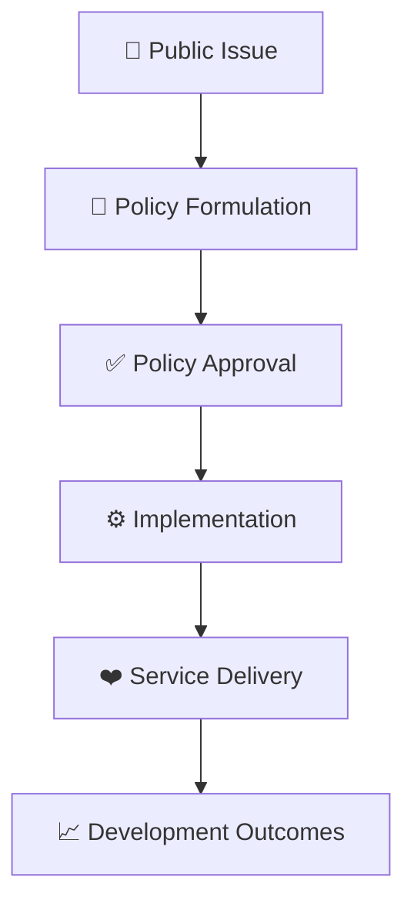
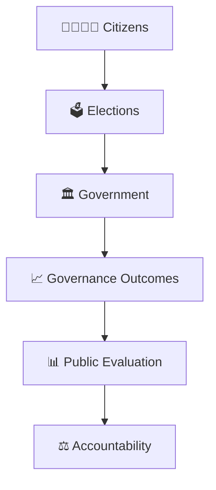
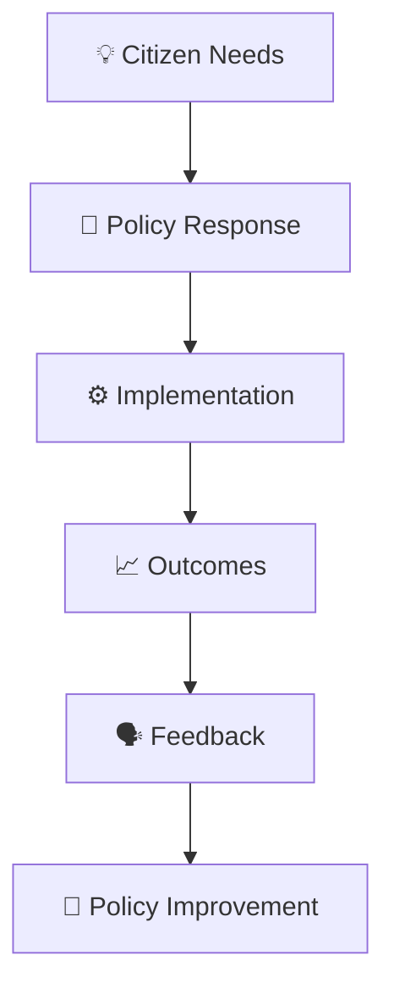

# Governance Framework

## Overview

This diagram explains the overall governance system in India and how citizens, institutions, government, public policy, administration, and service delivery interact to produce development outcomes.

It serves as the foundation diagram for understanding governance across the repository.

---

## Diagram Purpose

Understanding the governance framework helps explain:

- How government functions
- How policies are created and implemented
- How public institutions interact
- How services reach citizens
- How development outcomes are achieved

---

---

## Core Governance Framework

---

## Governance Ecosystem

---

## Institutional Governance Structure

### Purpose

- Distribute powers.
- Maintain accountability.
- Protect democratic governance.

---

## Policy to Outcome Framework

---

## Accountability Framework

---

## Continuous Governance Cycle

---

## Quick Revision

---

- citizen-to-policy-journey.md
- public-policy-lifecycle.md
- accountability-framework.md
- centre-state-relations-framework.md
- contemporary-governance.md
- governance-terminology.md
