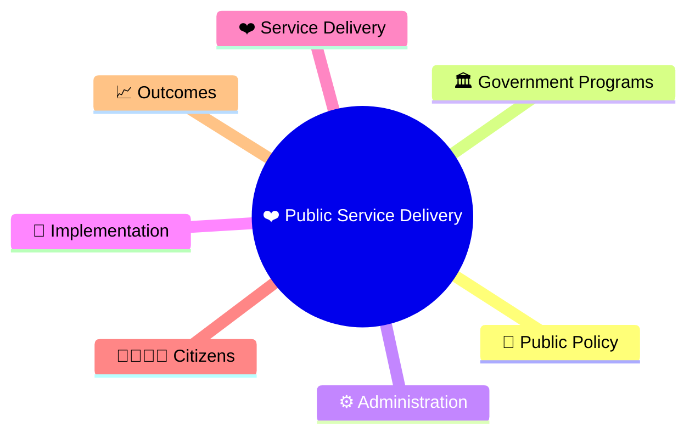
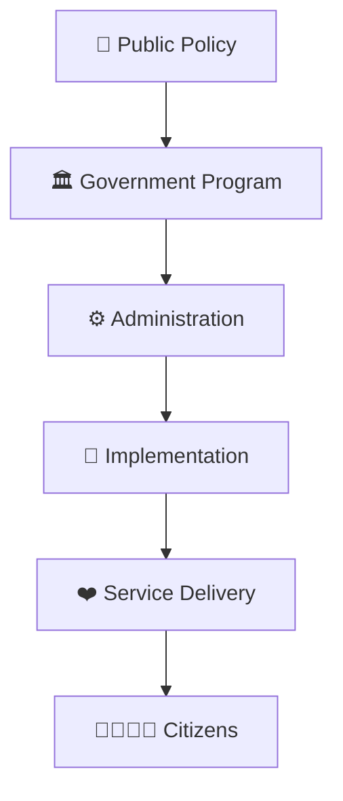
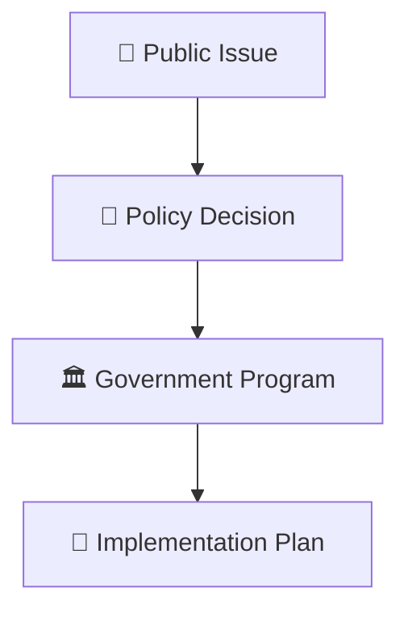
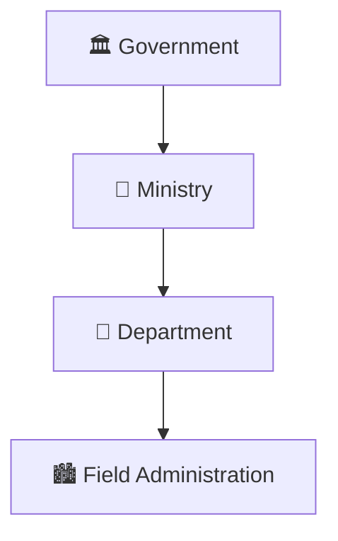
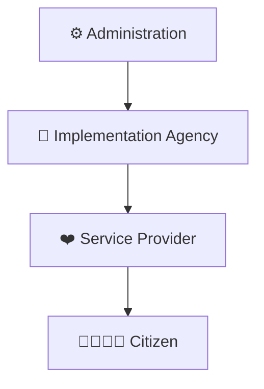
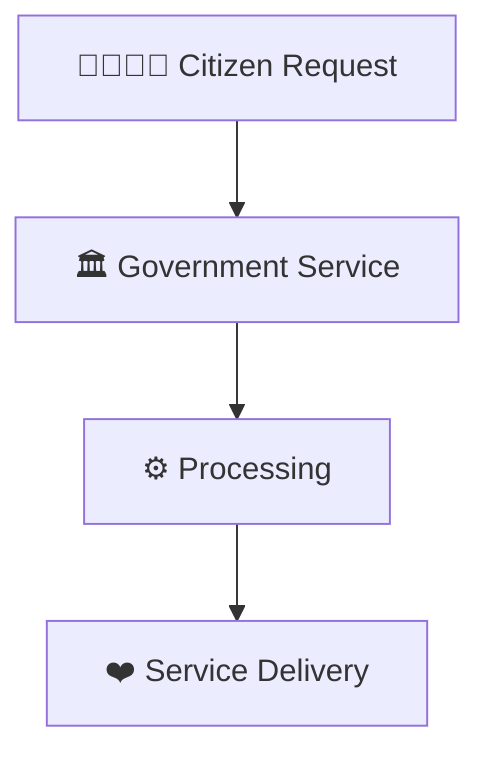
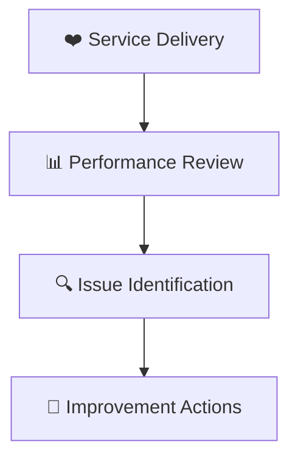
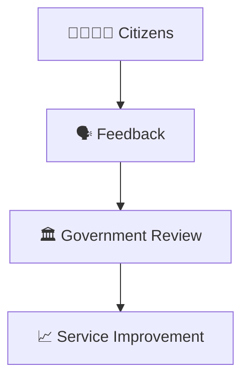
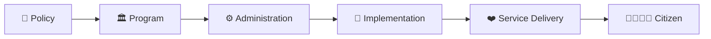

# Public Service Delivery Workflow

## Overview

This diagram explains how public services move from policy decisions to actual delivery for citizens through administrative institutions and implementation mechanisms.

It helps visualize the complete governance chain from government decisions to citizen outcomes.

---

## Diagram Purpose

Understanding public service delivery helps explain:

- How policies reach citizens
- How government programs are implemented
- How administration supports governance
- How citizen services are delivered
- How governance outcomes are measured

---

---

## Public Service Delivery Workflow

---

## Policy to Program Flow

### Purpose

- Convert policy into action.
- Define implementation responsibilities.
- Establish service objectives.

---

## Administrative Execution Model

### Responsibilities

- Resource allocation
- Administrative coordination
- Program supervision
- Monitoring and review

---

## Service Delivery Chain

### Outcome

- Public services reach beneficiaries.
- Government objectives are executed.

---

## Citizen Interaction Model

### Purpose

- Address citizen needs.
- Improve accessibility.
- Increase satisfaction.

---

## Monitoring Framework

---

## Feedback Loop

### Outcome

- Better service quality
- Increased accountability
- Improved governance outcomes

---

## Quick Revision

---

- governance-framework.md
- administrative-hierarchy.md
- digital-governance-framework.md
- e-governance-workflow.md
- cooperative-federalism-model.md
- governance-terminology.md
