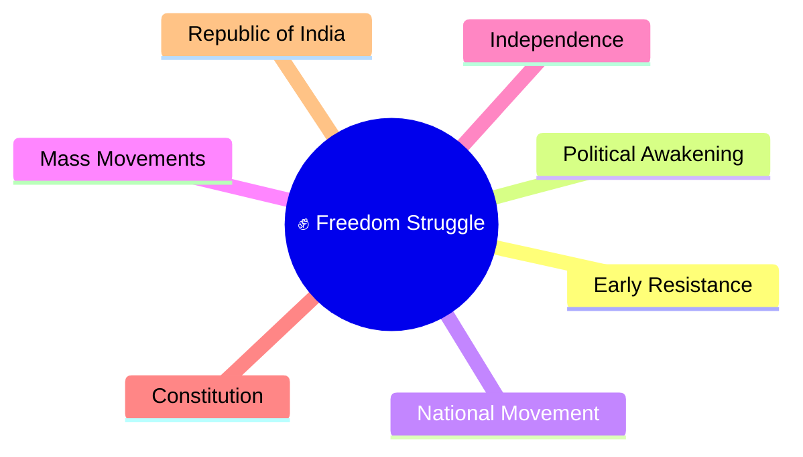
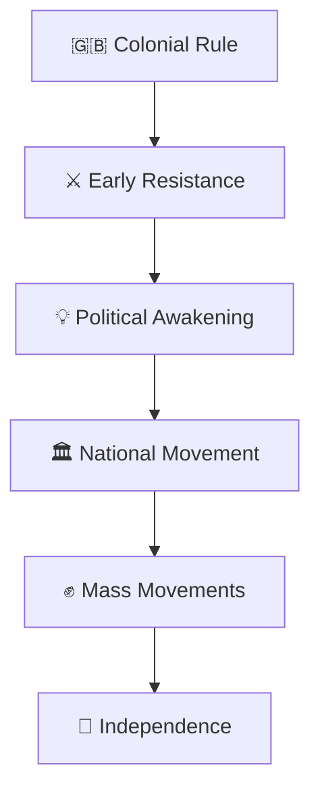
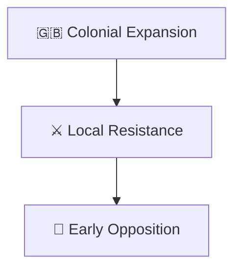
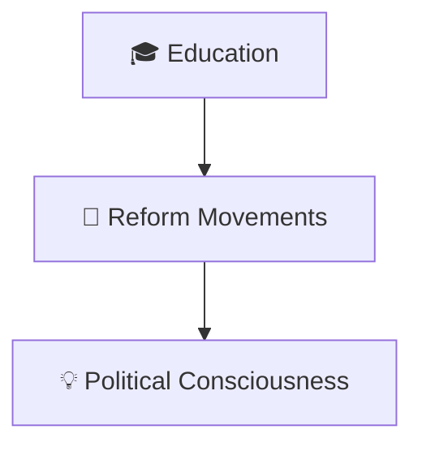
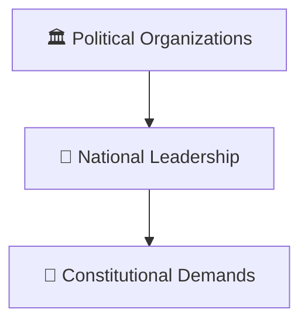
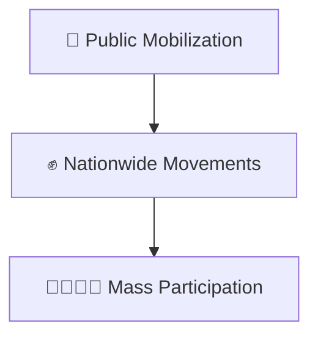
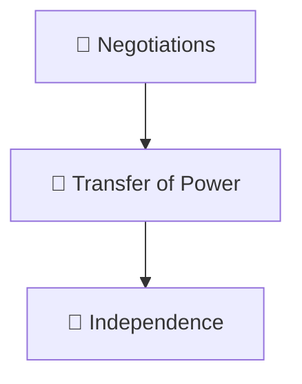
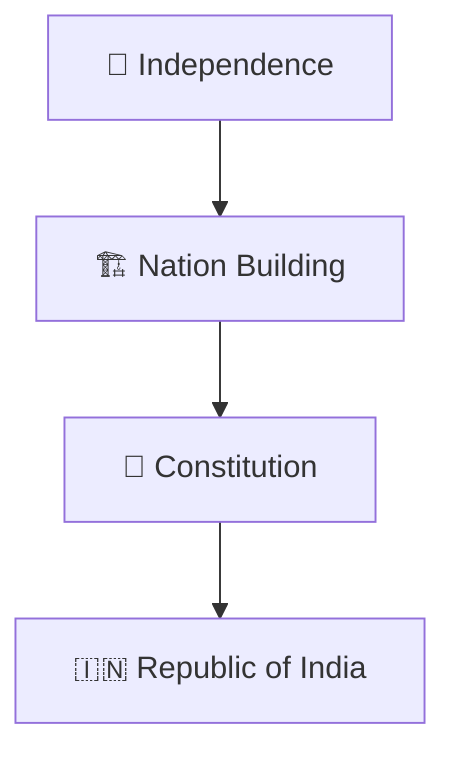

# Freedom Struggle Timeline

## Overview

This diagram explains the major phases of India's freedom struggle from early resistance against colonial rule to independence in 1947.

It provides a high-level timeline for understanding how political awareness, reform movements, mass participation, and national leadership contributed to India's independence.

---

## Diagram Purpose

Understanding the freedom struggle helps explain:

- How nationalism developed
- How resistance movements evolved
- How democratic participation expanded
- How independence was achieved
- How modern India was shaped

---

---

## Freedom Struggle Timeline

---

## Phase 1: Early Resistance

### Significance

- Initial resistance to colonial authority
- Growth of political awareness

---

## Phase 2: Political Awakening

### Significance

- Rise of modern political thought
- Expansion of public participation

---

## Phase 3: Organized National Movement

### Significance

- Development of organized nationalism
- Growth of representative politics

---

## Phase 4: Mass Movements

### Significance

- Broad public involvement
- Strengthening of national unity

---

## Phase 5: Towards Independence

### Significance

- End of colonial rule
- Beginning of self-governance

---

## From Independence to Republic

---

## Quick Revision

---

- india-through-time-timeline.md
- ancient-to-contemporary-india-journey.md
- nation-building-timeline.md
- major-empires-timeline.md
- civilization-and-history.md
- constitution-and-nation-building.md
