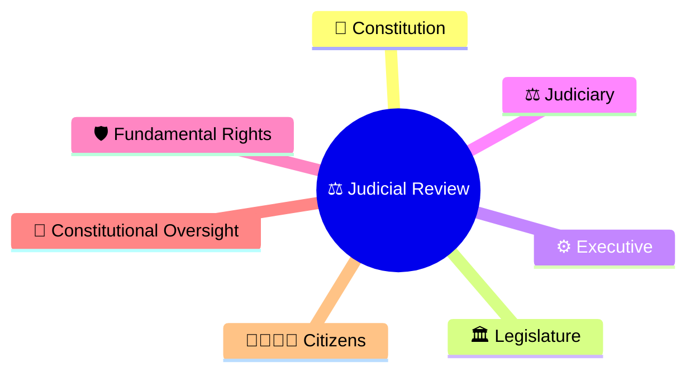
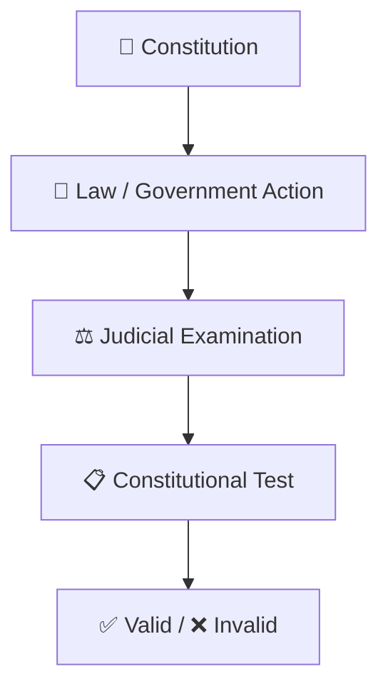
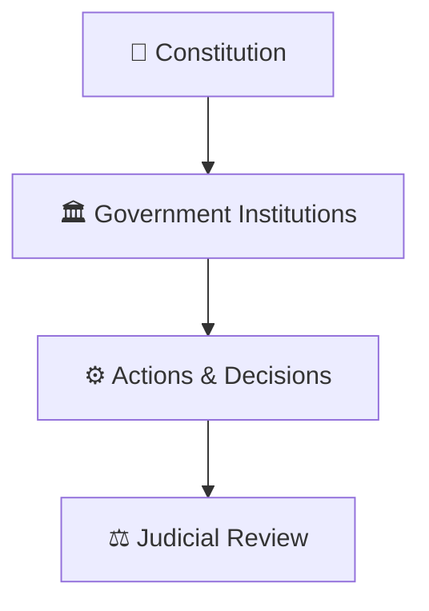
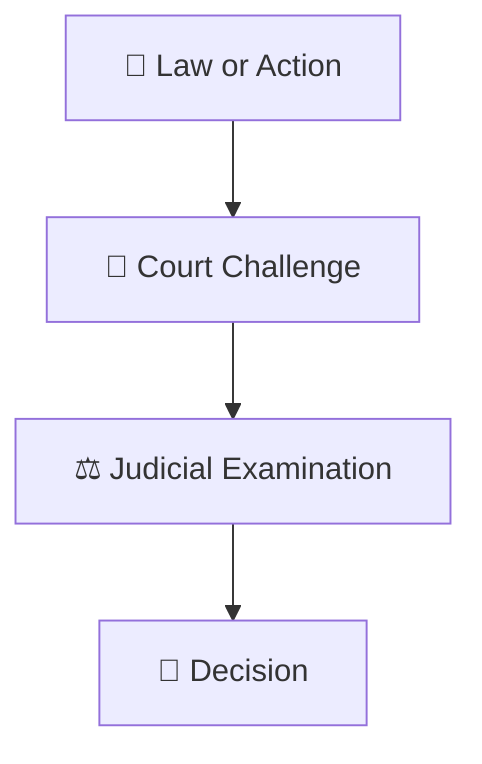
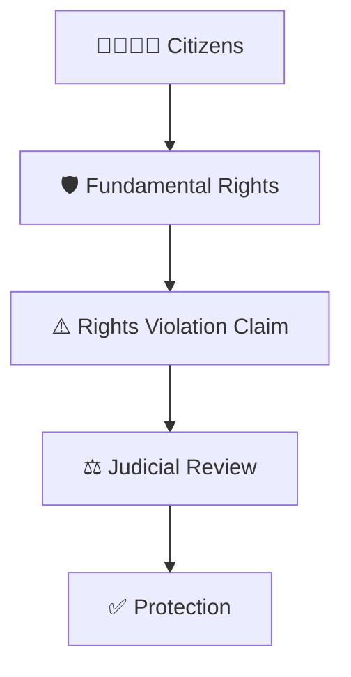
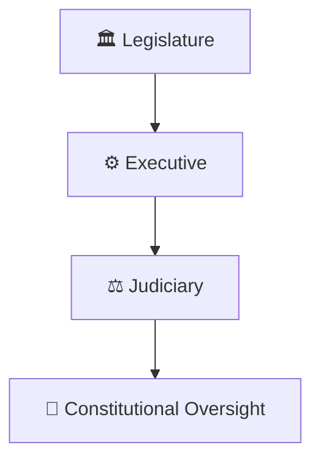
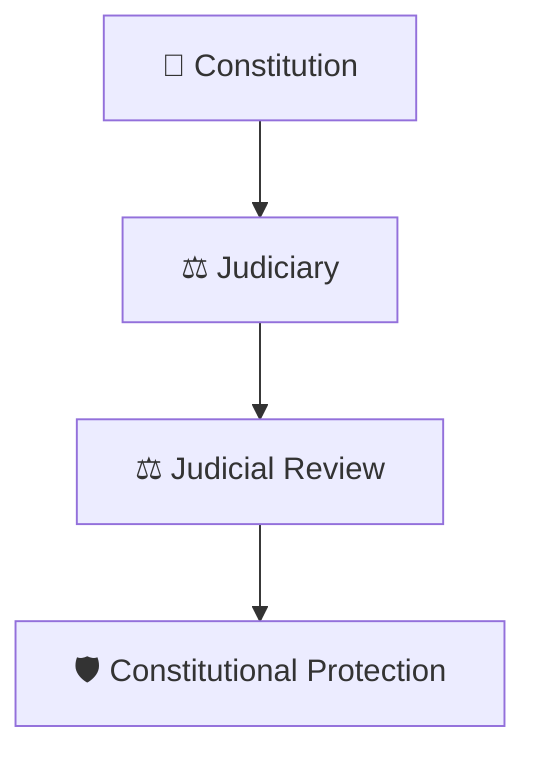

# Judicial Review Framework

## Overview

This diagram explains the concept of Judicial Review, one of the most important powers of the Indian judiciary.

It helps visualize how courts examine laws, executive actions, and governmental decisions to ensure compliance with the Constitution.

---

## Diagram Purpose

Understanding Judicial Review helps explain:

- How the Constitution is protected
- How unconstitutional actions can be challenged
- How courts maintain checks and balances
- How citizens' rights are safeguarded
- How democratic accountability is strengthened

---

---

## Judicial Review Framework

---

## Constitutional Supremacy Model

### Significance

- Constitution remains supreme
- Limits misuse of power
- Preserves democratic governance

---

## Review Process Framework

### Purpose

- Ensure legality
- Protect constitutional values
- Maintain accountability

---

## Rights Protection Model

### Significance

- Protects liberties
- Enforces constitutional guarantees
- Provides remedies to citizens

---

## Checks and Balances Framework

### Purpose

- Prevent concentration of power
- Maintain institutional balance
- Strengthen accountability

---

## Constitutional Safeguard Framework

### Significance

- Protects constitutional identity
- Supports rule of law
- Preserves democratic institutions

---

## Quick Revision

---

- judicial-hierarchy.md
- case-journey-through-courts.md
- public-interest-litigation-workflow.md
- fundamental-rights-framework.md
- basic-structure-doctrine.md
- constitutional-governance-model.md
