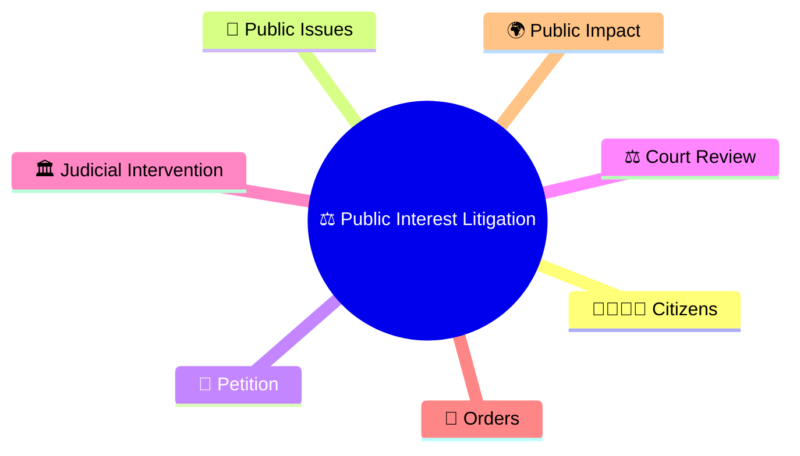
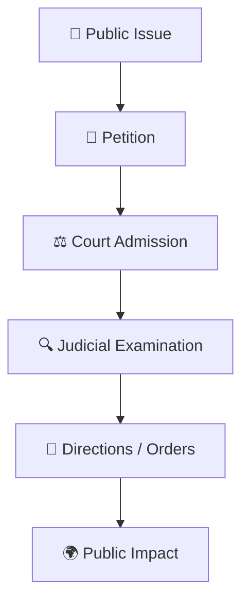
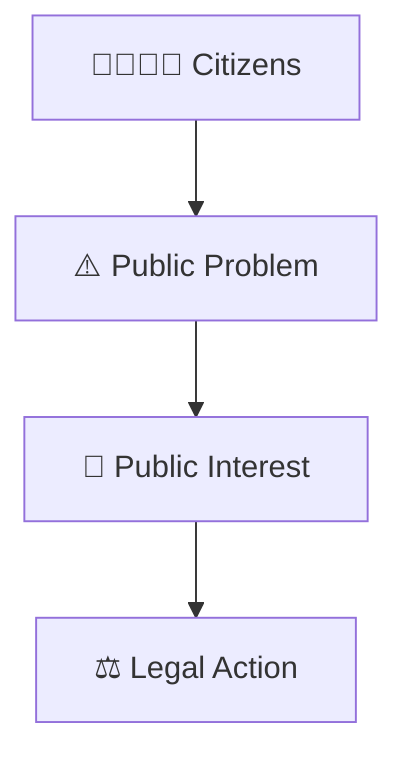
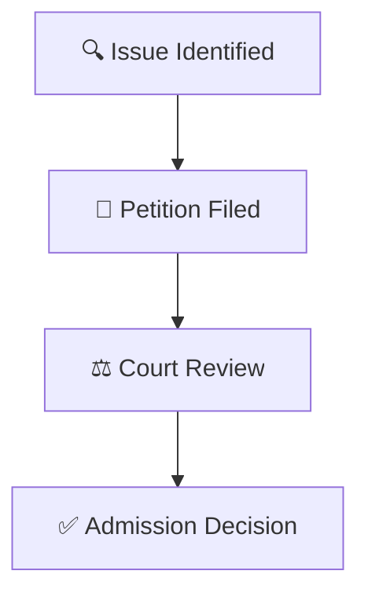
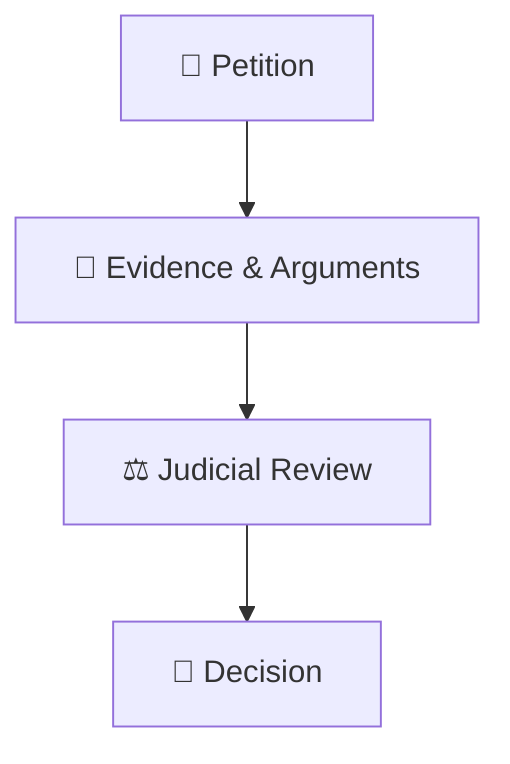
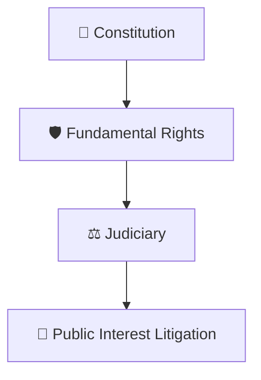
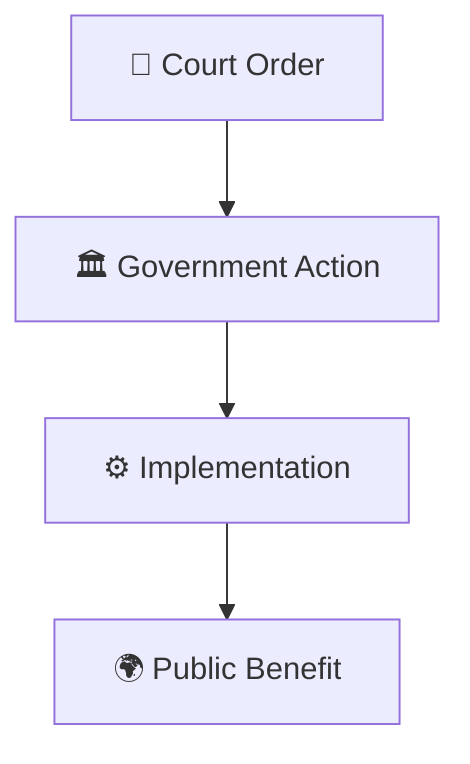
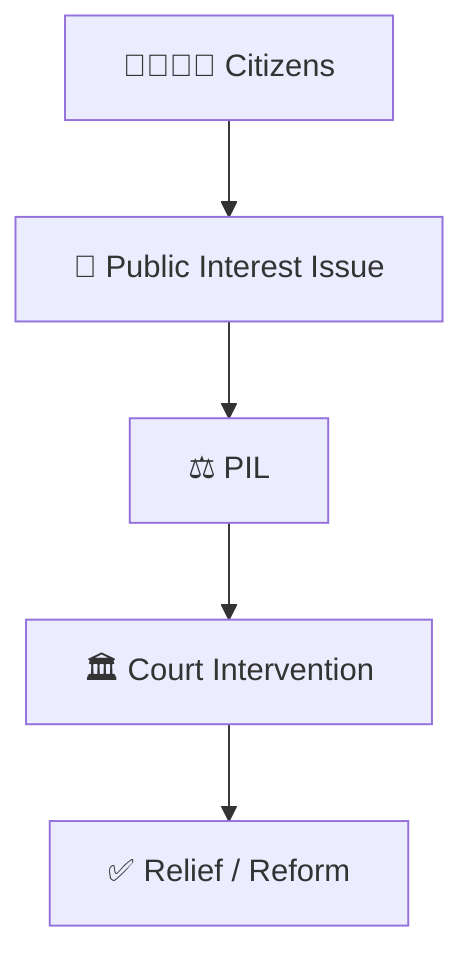

# Public Interest Litigation Workflow

## Overview

This diagram explains how Public Interest Litigation (PIL) works in India and how courts can be approached to address issues affecting the public at large.

It helps visualize the relationship between citizens, public concerns, constitutional rights, and judicial intervention.

---

## Diagram Purpose

Understanding PIL helps explain:

- How public issues can reach courts
- How constitutional rights can be protected
- How vulnerable groups can seek justice
- How judicial intervention can address public concerns
- How citizens participate in constitutional governance

---

---

## Public Interest Litigation Workflow

---

## Public Concern Framework

### Purpose

- Address public grievances
- Protect constitutional values
- Promote accountability

---

## PIL Filing Process

### Significance

- Expands access to justice
- Enables public participation
- Protects public interests

---

## Judicial Examination Framework

### Purpose

- Examine legality
- Protect rights
- Ensure accountability

---

## Constitutional Protection Model

### Significance

- Strengthens constitutional protections
- Supports social justice
- Expands access to remedies

---

## Public Impact Framework

### Purpose

- Improve governance
- Address public concerns
- Strengthen accountability

---

## Citizen Justice Framework

---

## Quick Revision

---

- judicial-review-framework.md
- judicial-hierarchy.md
- case-journey-through-courts.md
- fundamental-rights-framework.md
- constitutional-governance-model.md
- basic-structure-doctrine.md
