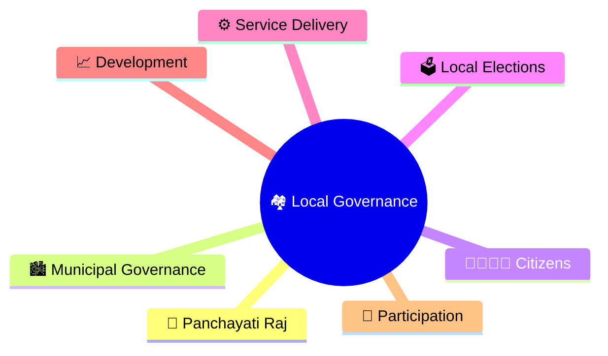
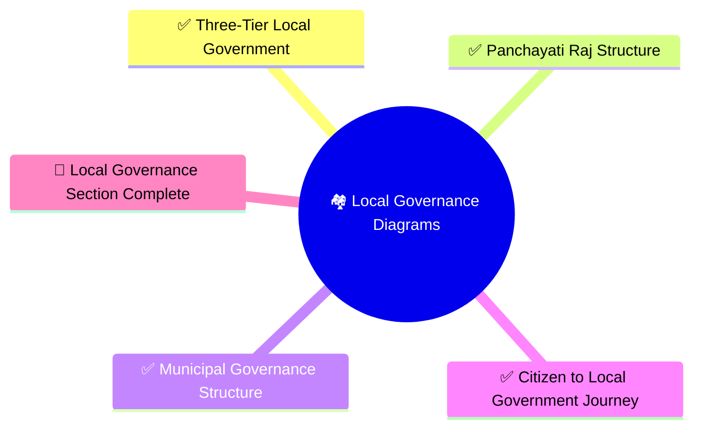
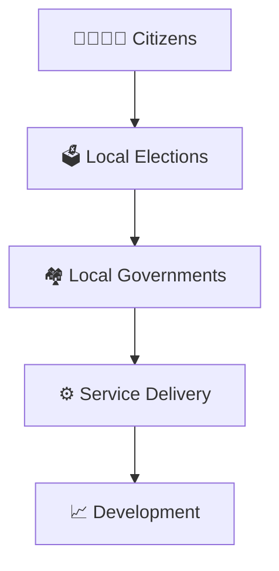
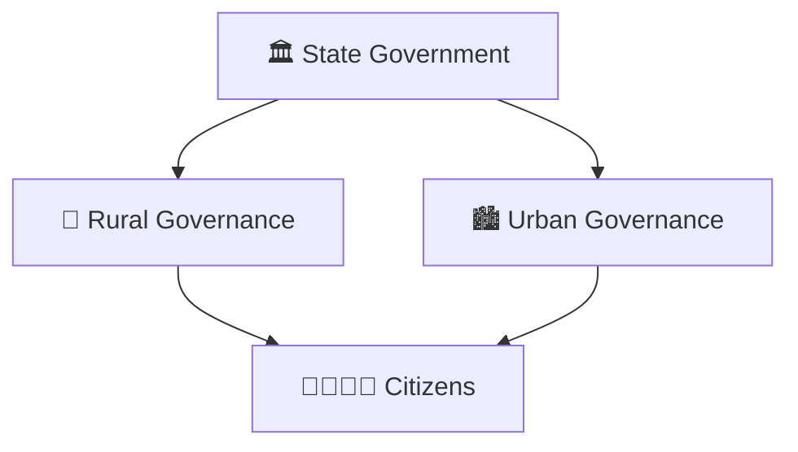
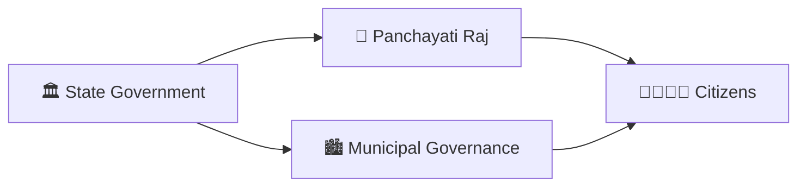

# Local Governance

## Importance

Local governance brings government closest to citizens. It is responsible for delivering essential services, implementing development programs, addressing local issues, and enabling grassroots democracy.

## Visual Overview

## Learning Priority

| Priority | Topic | Why It Matters |
|----------|--------|---------------|
| P0 | Three-Tier Local Government | Foundation of local administration |
| P0 | Panchayati Raj Structure | Rural governance system |
| P0 | Municipal Governance Structure | Urban governance system |
| P1 | Citizen to Local Government Journey | Citizen participation and services |

## Progress Status

## Citizen Learning Path

## Governance Structure

## Diagram Coverage

| Diagram | Focus |
|----------|--------|
| three-tier-local-government.md | Overall local governance hierarchy |
| panchayati-raj-structure.md | Rural governance framework |
| municipal-governance-structure.md | Urban governance framework |
| citizen-to-local-government-journey.md | Citizen interaction with local institutions |

## Quick Revision

