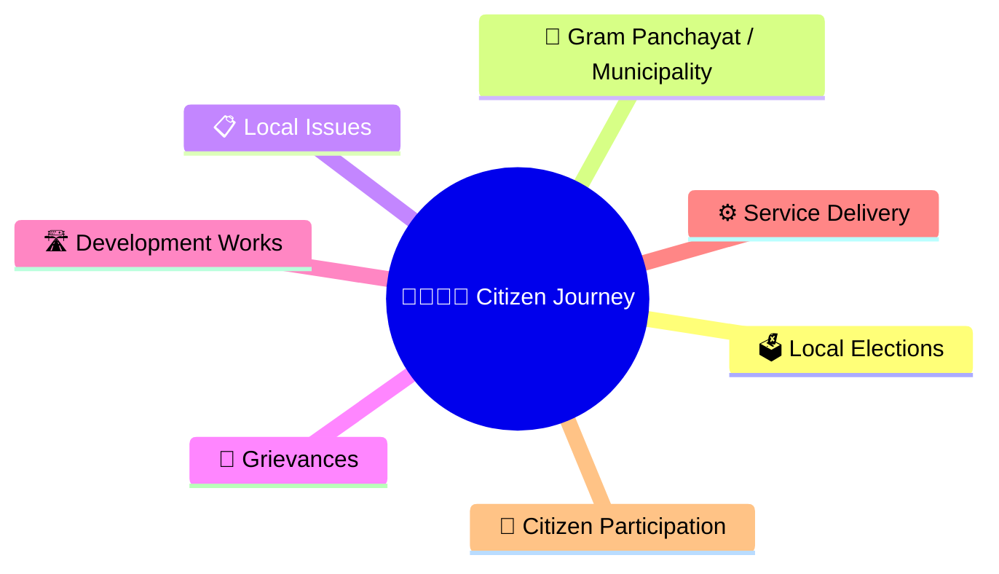
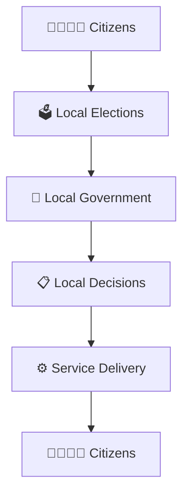
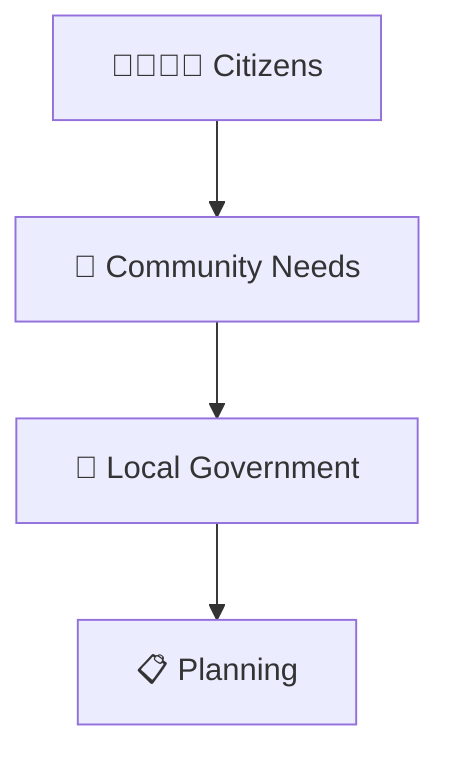
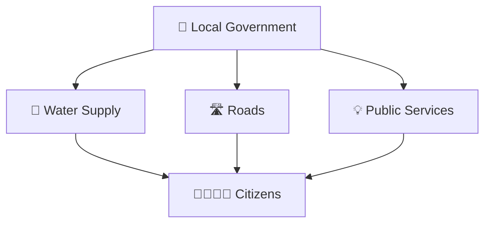
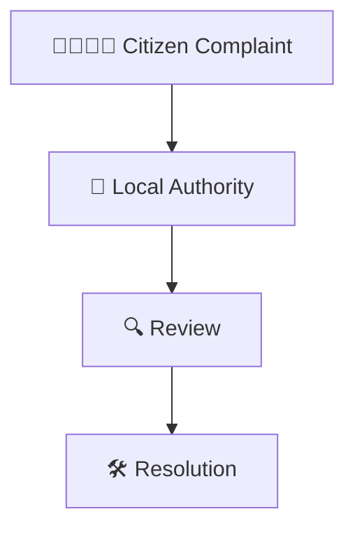
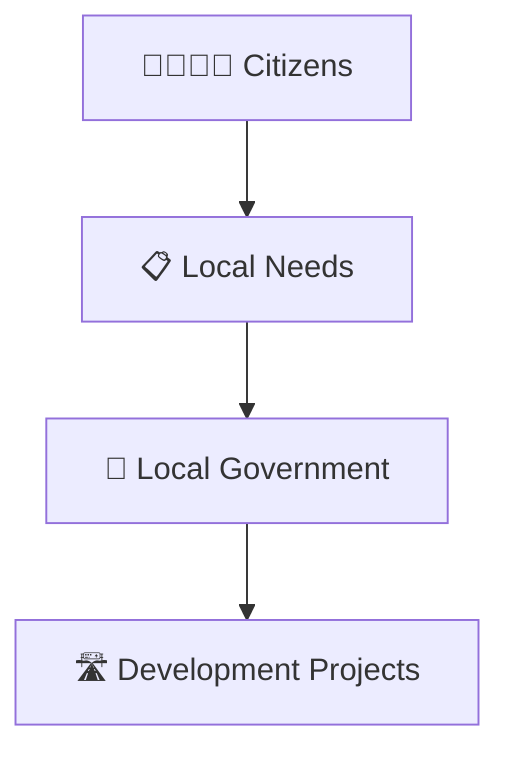
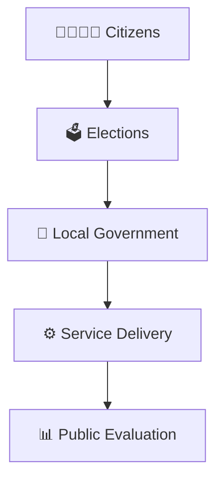
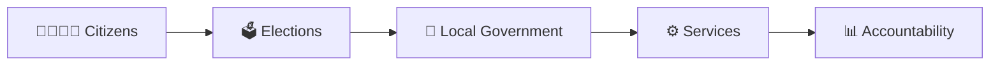

# Citizen to Local Government Journey

## Diagram Purpose

Local government is the closest level of government to citizens. Understanding how citizens interact with local institutions helps explain how public services, grievances, development projects, and community participation work in everyday life.

## Visual Overview

## Citizen to Local Government Journey

## Participation Framework

## Public Service Delivery Model

## Grievance Redressal Process

## Development Planning Framework

## Democratic Accountability Cycle

## Quick Revision

