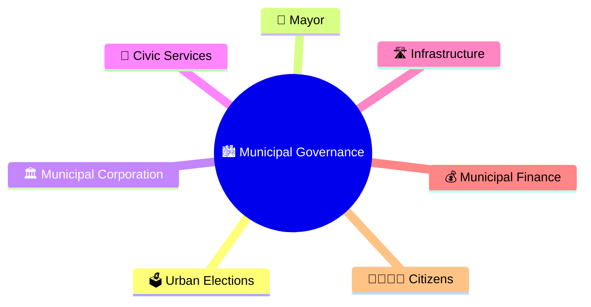
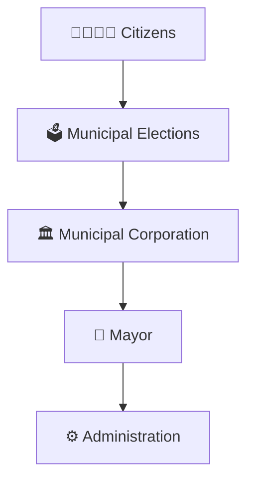
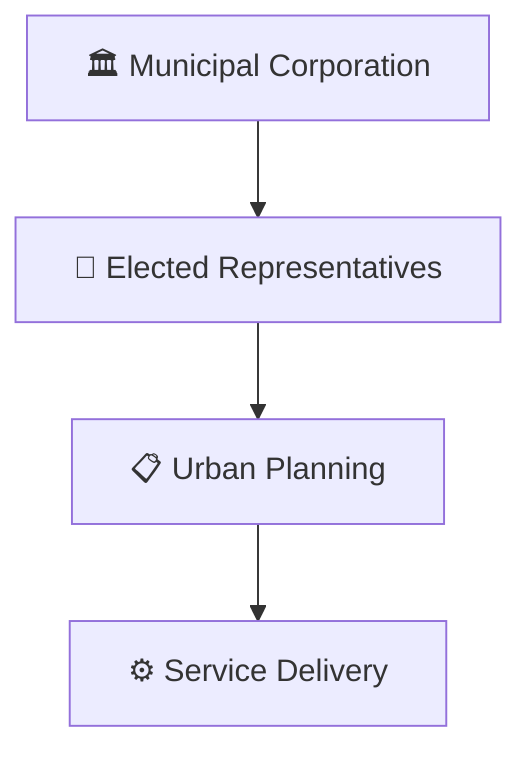
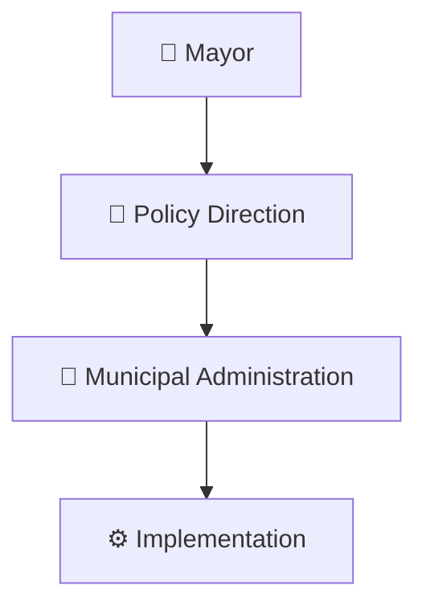
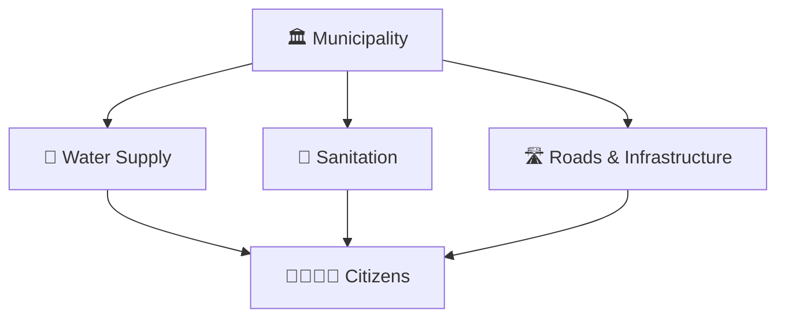
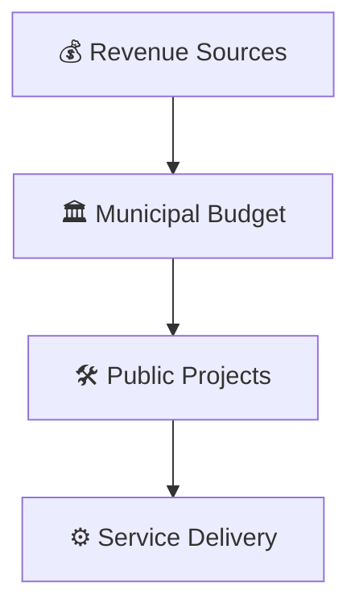
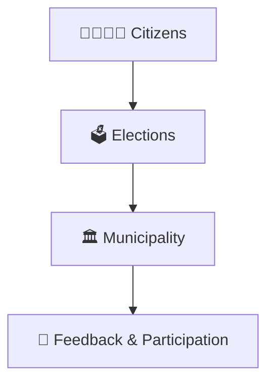
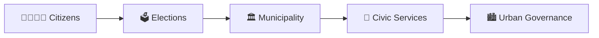

# Municipal Governance Structure

## Diagram Purpose

Municipal governments manage urban areas and are responsible for essential civic services such as roads, sanitation, water supply, public health, urban planning, and local infrastructure. Understanding municipal governance helps citizens know how cities are administered.

## Visual Overview

## Municipal Governance Structure

## Municipal Corporation Framework

## Mayor and Administration Model

## Urban Service Delivery Framework

## Municipal Finance Framework

## Citizen Participation Model

## Quick Revision

