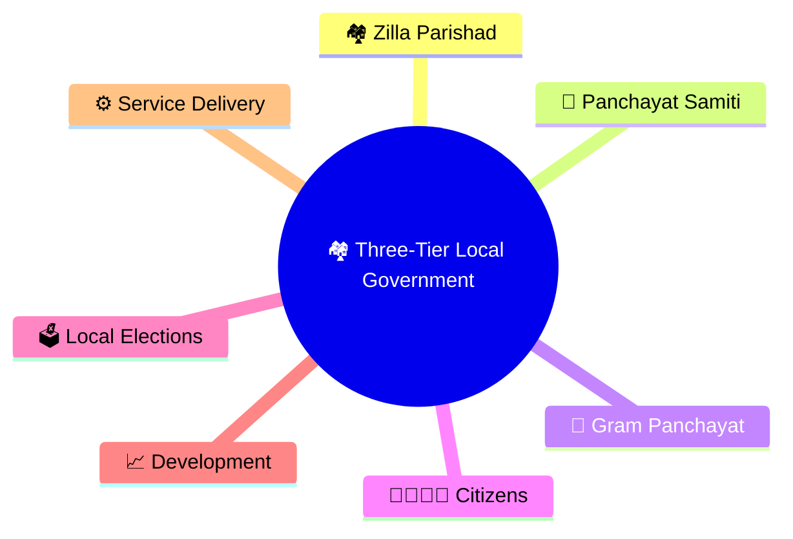
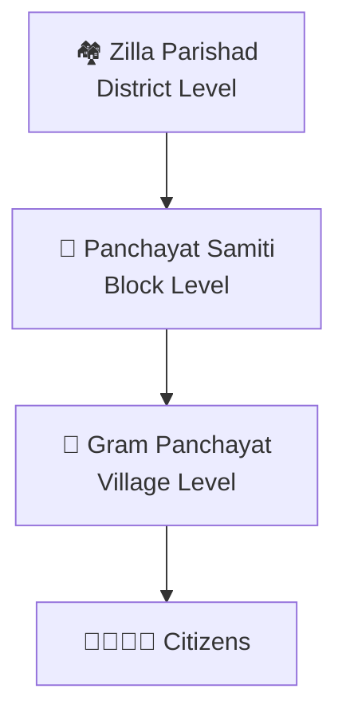
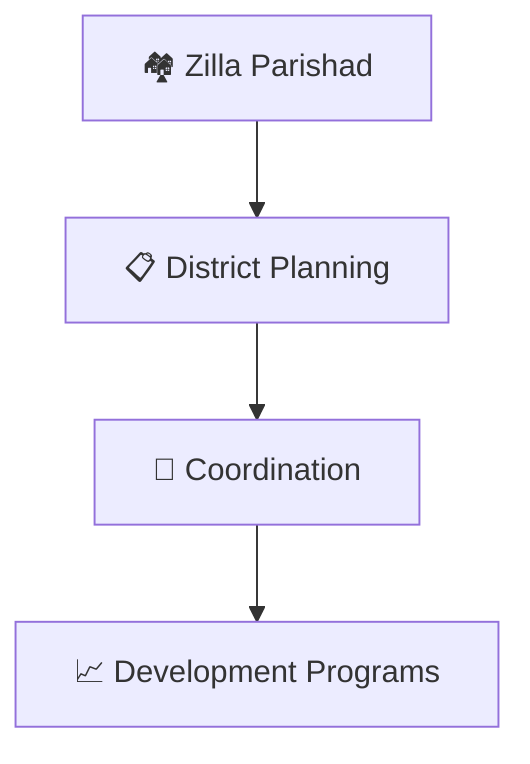
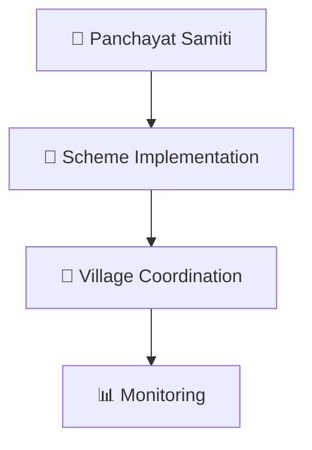
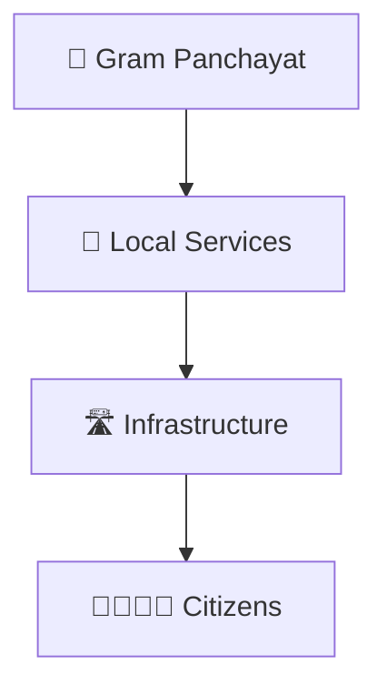
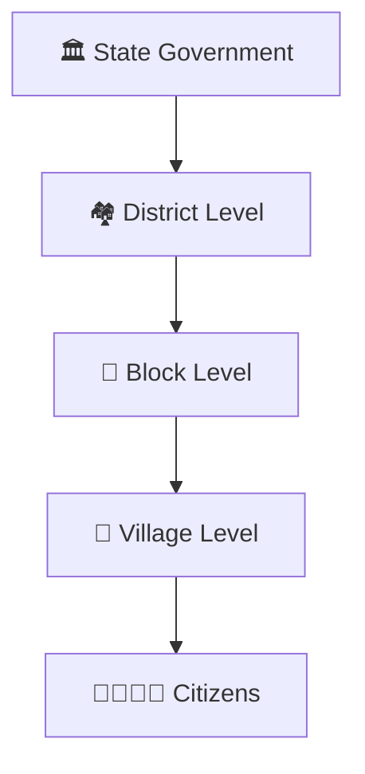
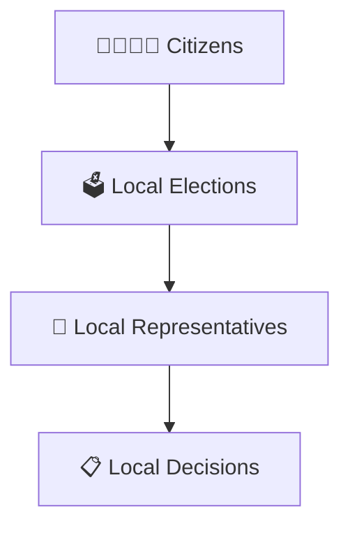

# Three-Tier Local Government

## Diagram Purpose

The three-tier local government system brings governance closer to citizens. It distributes responsibilities across district, block, and village levels to improve administration, participation, and development outcomes.

## Visual Overview

## Three-Tier Structure

## District Level Governance

## Block Level Governance

## Village Level Governance

## Governance Delivery Framework

## Democratic Participation Model

## Quick Revision

