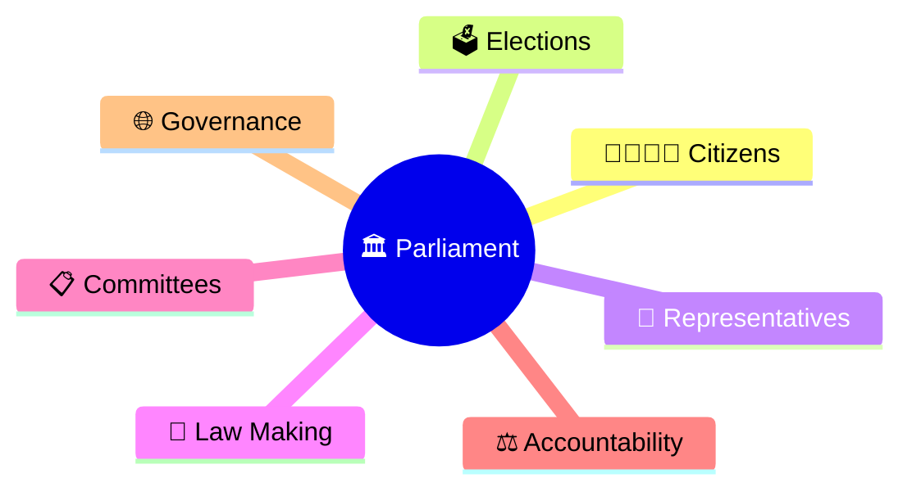
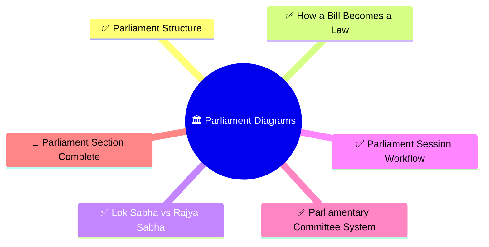
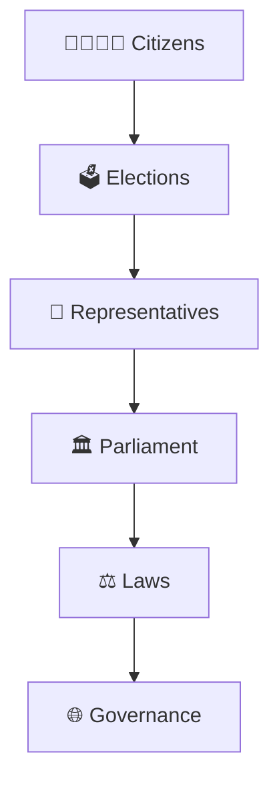

# Parliament Diagrams

## Overview

This section contains visual diagrams explaining the structure, powers, processes, and responsibilities of the Parliament of India.

The objective is to help citizens understand how laws are made, how representatives function, how governments are held accountable, and how parliamentary democracy operates.

---

## Importance

Parliament is the central law-making institution of India.

It serves as:

- The national legislature
- The voice of citizens and states
- The forum for democratic debate
- A mechanism for government accountability
- A pillar of constitutional governance

Understanding Parliament helps explain how public policy, laws, and governance decisions are created.

---

## Learning Priority

### P0 (Must Know For Every Citizen)

- Parliament Structure ✓
- How a Bill Becomes a Law ✓
- Lok Sabha vs Rajya Sabha ✓

### P1 (Important)

- Parliament Session Workflow ✓
- Parliamentary Committee System ✓

---

## Progress Status

---

## Citizen Learning Path

---

## Diagram Categories

### Parliamentary Structure

- Parliament structure
- Lok Sabha
- Rajya Sabha
- Representation framework

### Law Making

- Bill to law process
- Legislative scrutiny
- Parliamentary approval

### Accountability & Oversight

- Parliament sessions
- Questions and debates
- Government accountability

### Committee System

- Parliamentary committees
- Detailed legislative review
- Financial oversight

---

## Repository Philosophy

This section focuses on helping citizens understand how Parliament works in practice.

The goal is not to memorize parliamentary procedures.

The goal is to understand:

- How laws are created
- How representatives function
- How governments are questioned
- How democratic oversight works
- How Parliament influences governance

---

## Quick Revision

---

## Related Sections

- Constitution
- Elections
- Government Structure
- Governance
- Judiciary
- Major Laws Timeline
