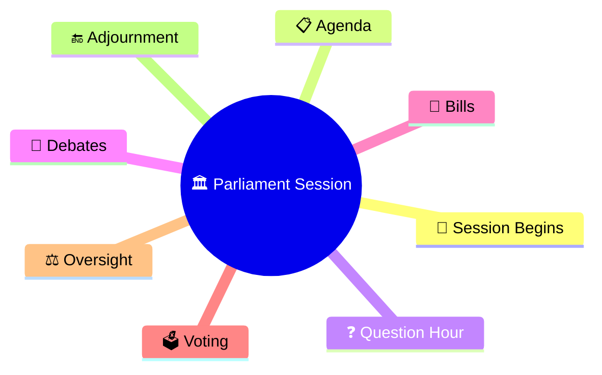
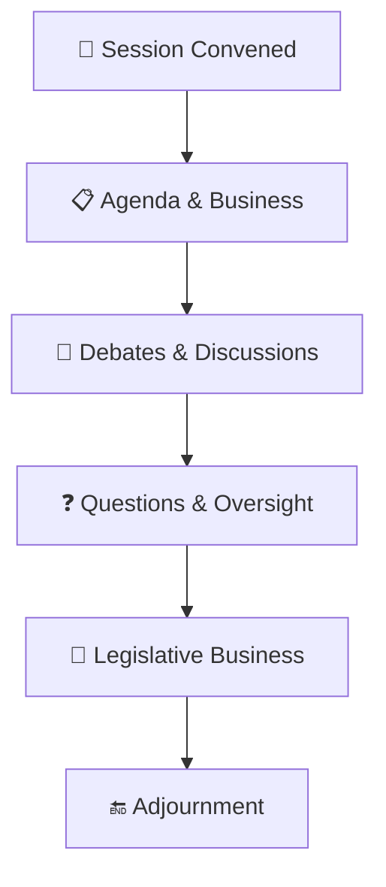
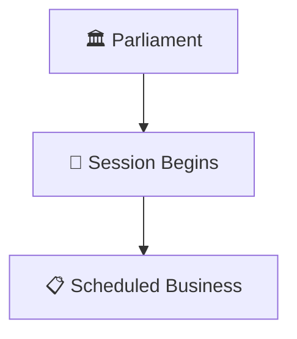
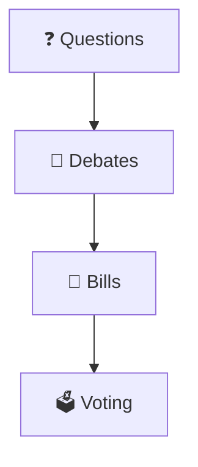
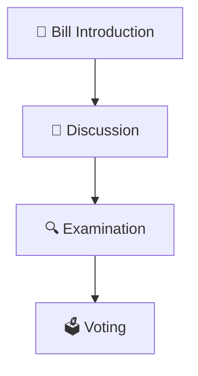
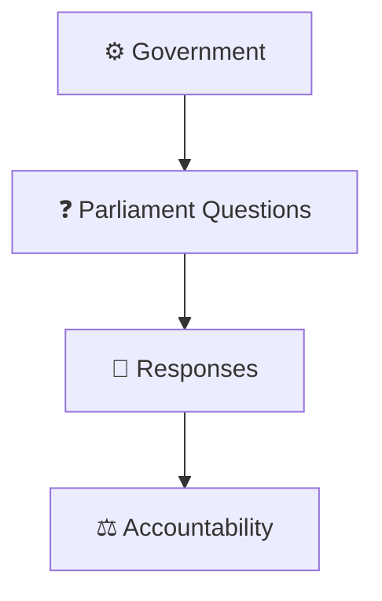
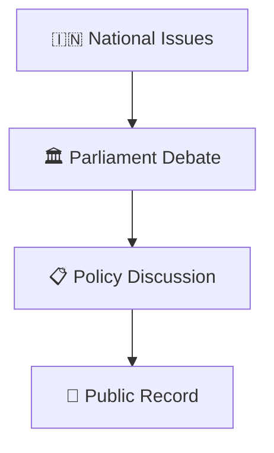
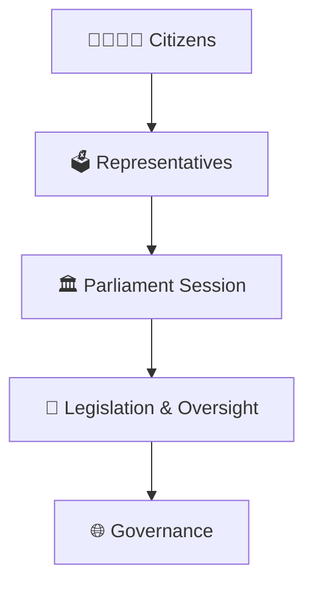
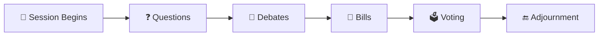

# Parliament Session Workflow

## Overview

This diagram explains how Parliament functions during a session and how legislative, oversight, and governance activities are conducted.

It helps visualize the flow of parliamentary business from session commencement to adjournment.

---

## Diagram Purpose

Understanding Parliament sessions helps explain:

- How Parliament conducts business
- How laws are discussed and passed
- How the government is held accountable
- How national issues are debated
- How democratic oversight operates

---

## Parliament Session Workflow

---

## Session Commencement Framework

### Purpose

- Conduct legislative work
- Review government actions
- Discuss national issues

---

## Parliamentary Business Model

### Significance

- Democratic deliberation
- Legislative scrutiny
- Accountability mechanisms

---

## Legislative Workflow

### Purpose

- Create laws
- Improve legislation
- Ensure public representation

---

## Government Accountability Framework

### Significance

- Oversight of executive actions
- Transparency
- Responsible government

---

## Debate and Deliberation Model

### Purpose

- Represent citizen concerns
- Examine policy choices
- Encourage informed decision making

---

## Democratic Governance Framework

---

## Quick Revision

---

- parliament-structure.md
- how-a-bill-becomes-law.md
- lok-sabha-vs-rajya-sabha.md
- parliamentary-committee-system.md
- government-formation-process.md
- constitutional-governance-model.md
