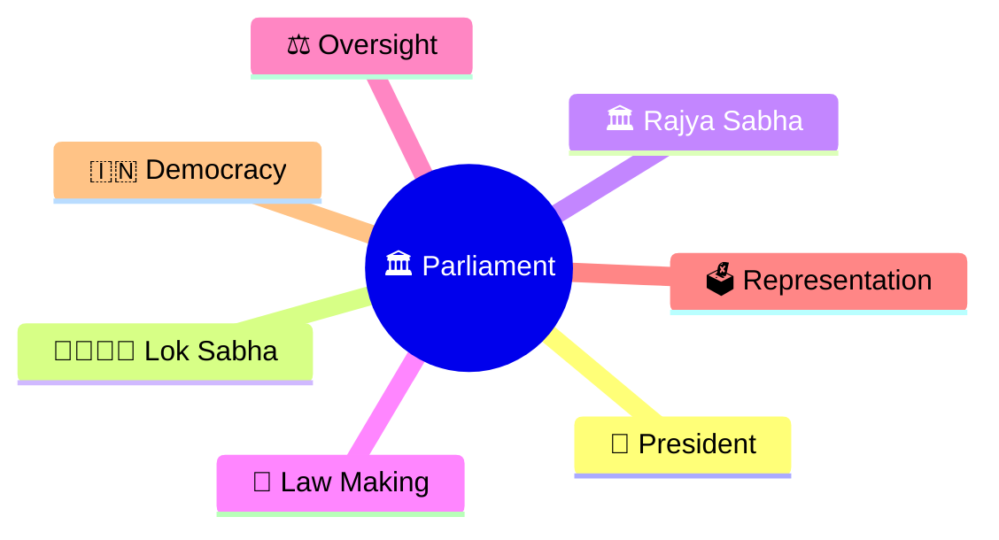
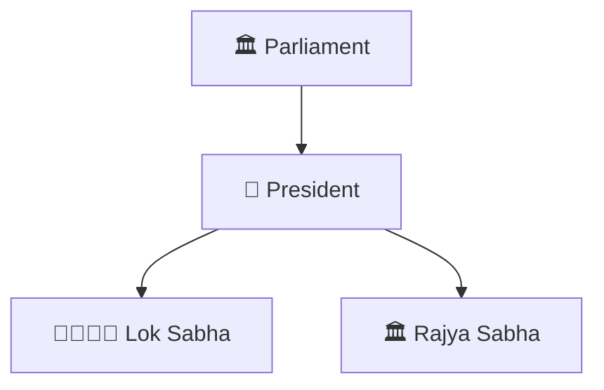
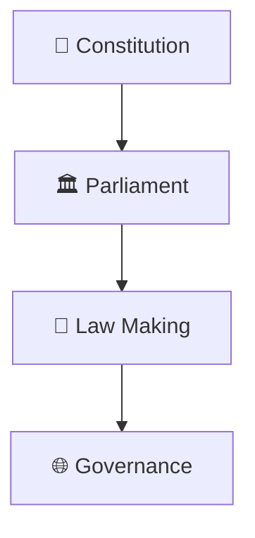
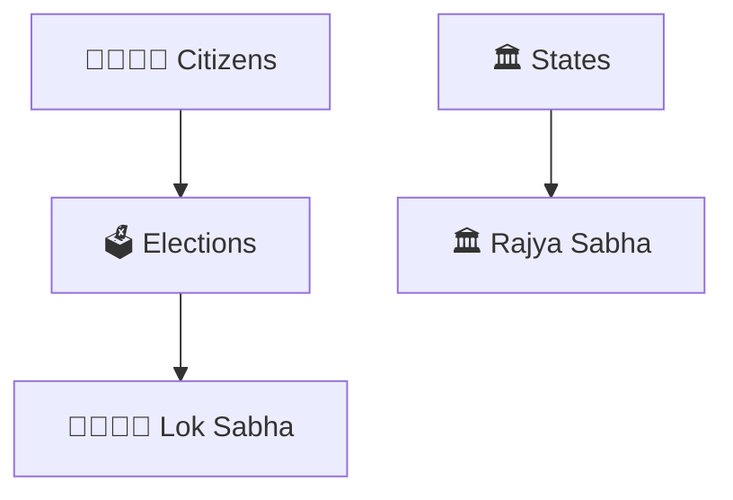
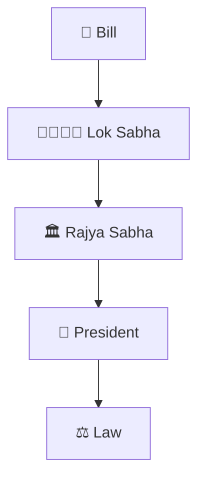
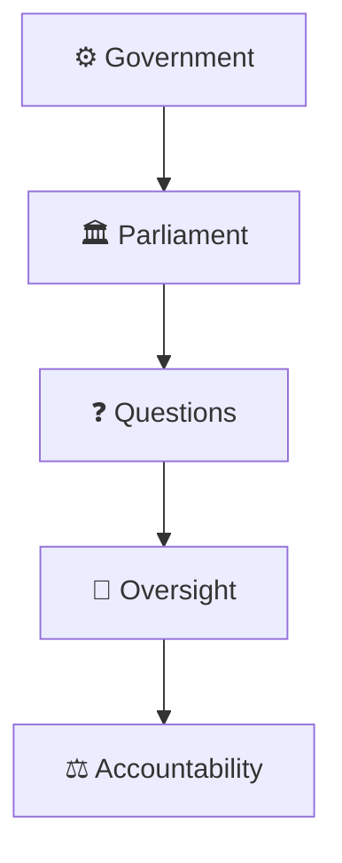
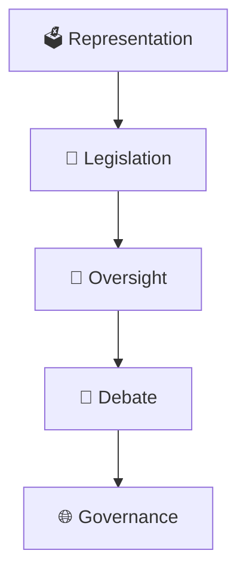
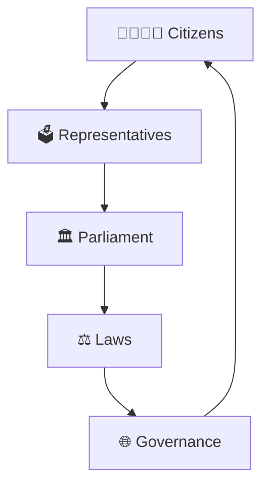

# Parliament Structure

## Overview

This diagram explains the structure of the Parliament of India and how its institutions work together to create laws, represent citizens, oversee the government, and support democratic governance.

It helps visualize the relationship between the President, Lok Sabha, Rajya Sabha, and the legislative process.

---

## Diagram Purpose

Understanding Parliament helps explain:

- How national laws are made
- How citizens are represented
- How the government is held accountable
- How democratic debates take place
- How constitutional governance functions

---

## Parliament Structure

---

## Constitutional Framework

### Significance

- National legislature
- Democratic representation
- Constitutional authority

---

## Representation Framework

### Purpose

- Represent people
- Represent states
- Support federal democracy

---

## Legislative Structure

### Significance

- Legislative scrutiny
- Democratic debate
- Constitutional process

---

## Government Accountability Framework

### Purpose

- Monitor executive actions
- Ensure transparency
- Strengthen democracy

---

## Parliamentary Functions Model

### Significance

- Law making
- Public representation
- Democratic accountability

---

## Democratic Governance Cycle

---

## Quick Revision

---

- how-a-bill-becomes-law.md
- lok-sabha-vs-rajya-sabha.md
- parliament-session-workflow.md
- parliamentary-committee-system.md
- constitutional-governance-model.md
- government-formation-process.md
