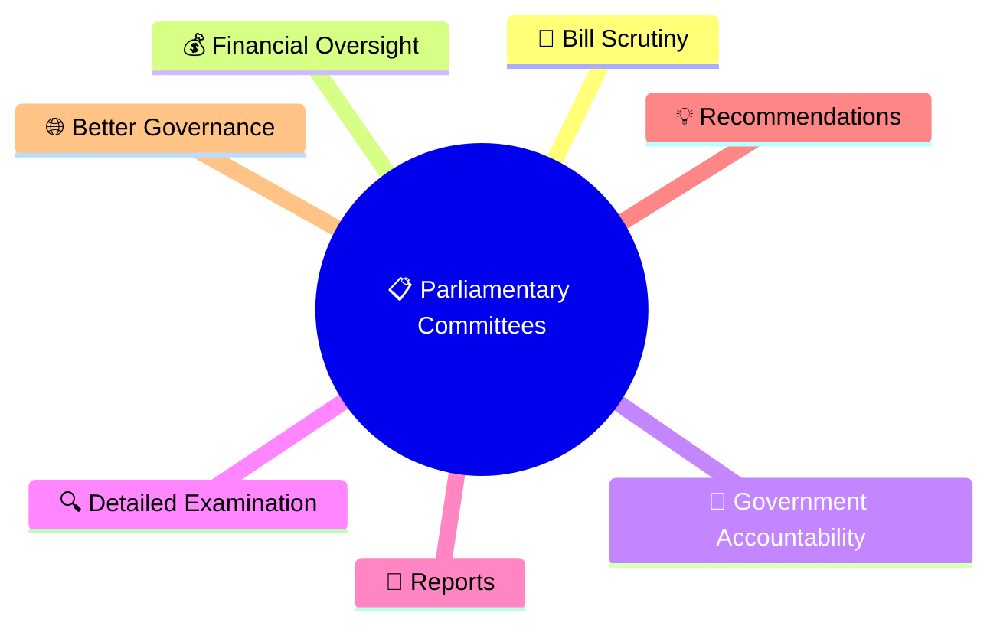
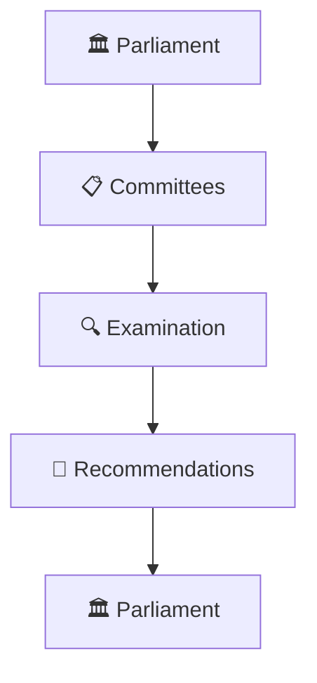
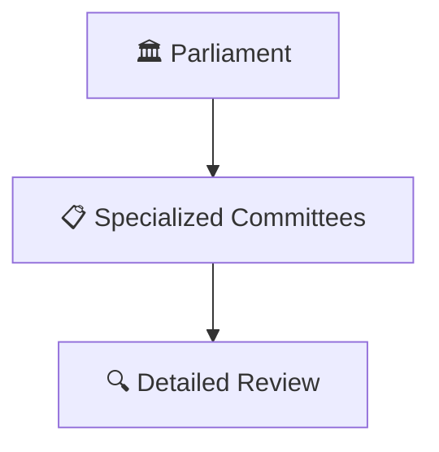
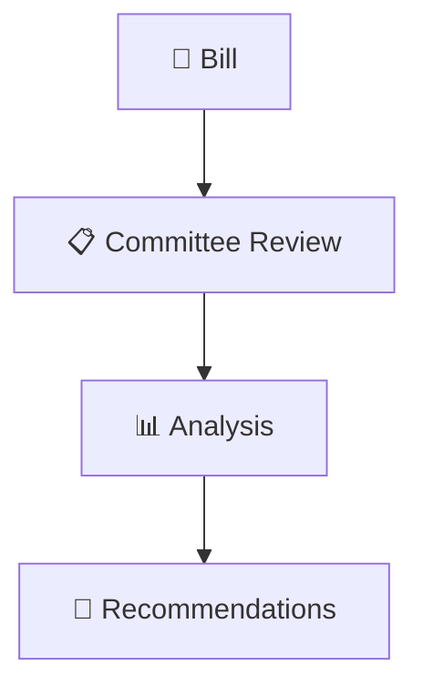
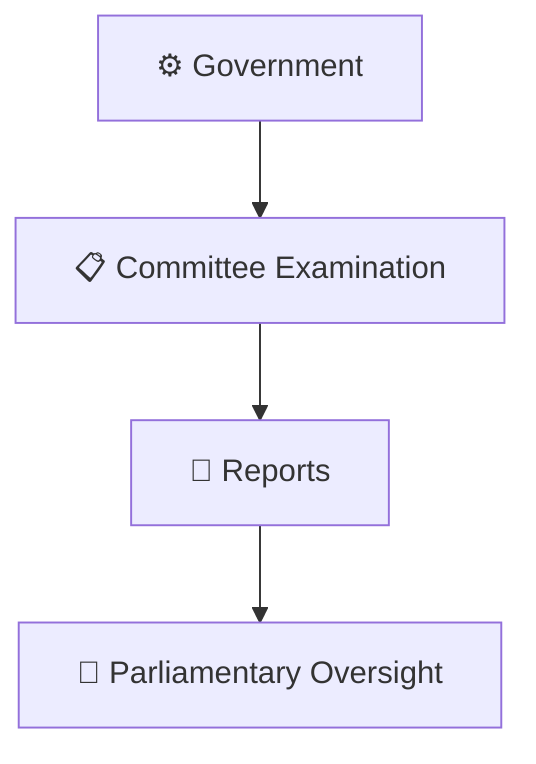
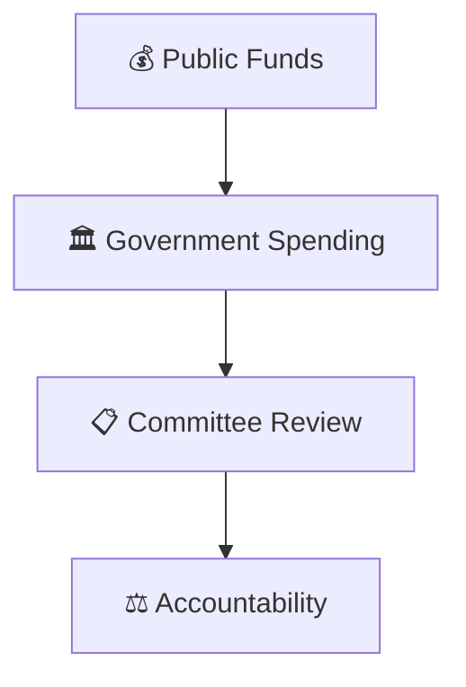
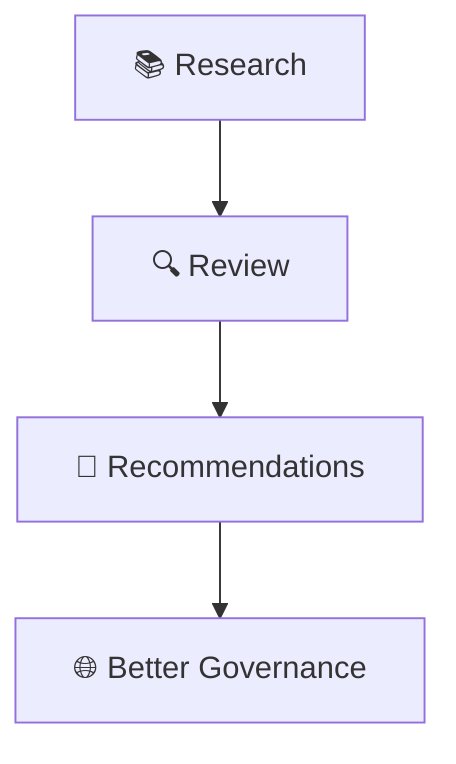
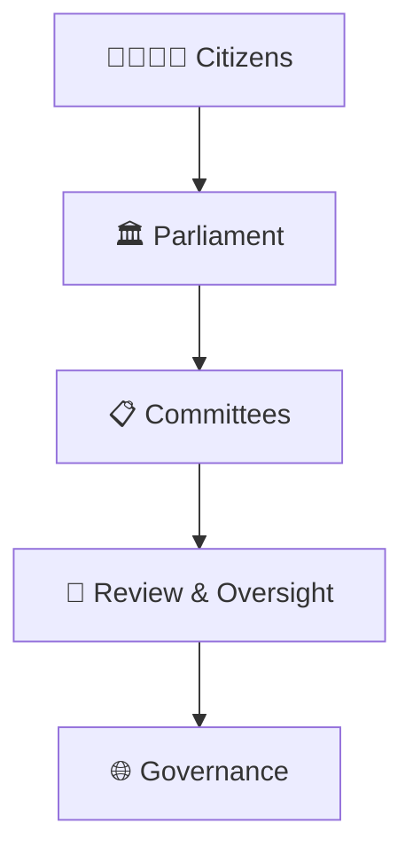

# Parliamentary Committee System

## Overview

This diagram explains the Parliamentary Committee System and how committees help Parliament examine legislation, government functioning, public expenditure, and policy implementation in greater detail.

It helps visualize how detailed scrutiny occurs beyond debates in the main Houses of Parliament.

---

## Diagram Purpose

Understanding Parliamentary Committees helps explain:

- How Parliament examines complex issues
- How bills receive detailed scrutiny
- How government spending is reviewed
- How accountability is strengthened
- How legislative quality is improved

---

---

## Parliamentary Committee System

---

## Committee Framework

### Purpose

- Improve legislative scrutiny
- Examine public issues
- Support informed decision making

---

## Legislative Examination Model

### Significance

- Detailed examination
- Expert inputs
- Better legislation

---

## Accountability Framework

### Purpose

- Strengthen accountability
- Improve transparency
- Monitor implementation

---

## Public Finance Oversight Model

### Significance

- Financial oversight
- Efficient use of resources
- Public accountability

---

## Committee Contribution Framework

### Purpose

- Support Parliament
- Improve policies
- Enhance governance quality

---

## Democratic Governance Framework

---

## Quick Revision

---

- parliament-structure.md
- how-a-bill-becomes-law.md
- lok-sabha-vs-rajya-sabha.md
- parliament-session-workflow.md
- constitutional-authorities-framework.md
- constitutional-governance-model.md
