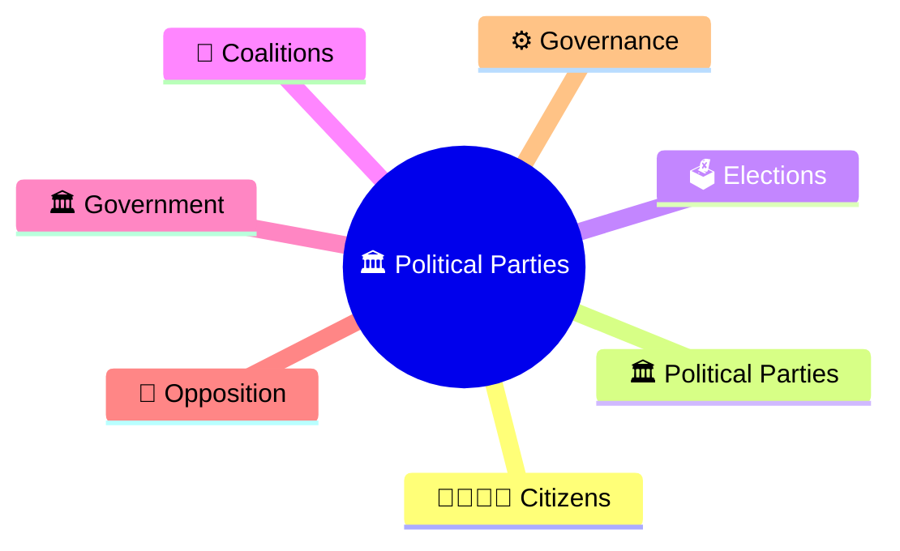
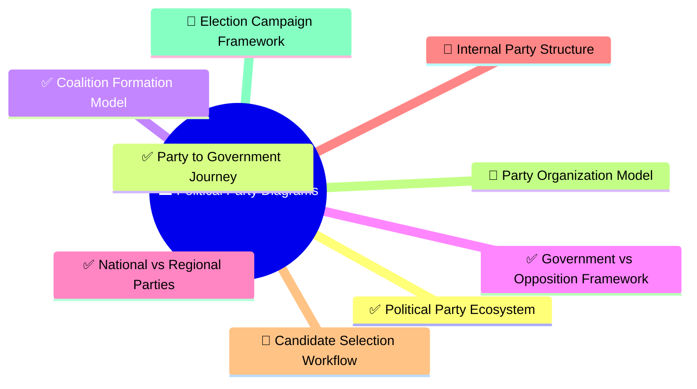
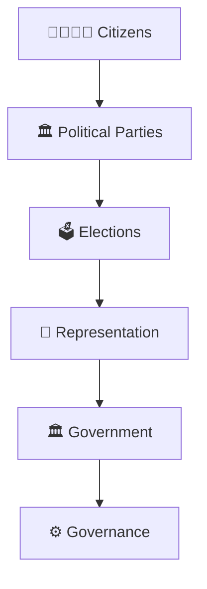

# Political Party Diagrams

## Overview

This section contains visual diagrams explaining India's political party system, party organization, electoral competition, coalition politics, governance participation, and democratic representation.

The goal is to simplify political processes through visual learning and quick revision.

---

## Why Use Diagrams?

Political party diagrams help:

- Understand party structures
- Visualize election competition
- Learn coalition formation
- Understand government-opposition dynamics
- Improve revision speed

---

## Learning Priority Order

### P1 (Highest ROI)

- Political Party Ecosystem ✓
- Party to Government Journey ✓
- Coalition Formation Model ✓
- Government vs Opposition Framework ✓
- National vs Regional Parties ✓

## Progress Status

### P2

- Internal Party Structure
- Candidate Selection Workflow
- Party Organization Model
- Election Campaign Framework

### P3

- Alliance Formation Process
- Legislative Party Structure
- Party Evolution Timeline
- Party Funding Framework

---

## Recommended Diagram Structure

---

## Diagram Categories

### Party System

- Political party ecosystem
- National vs regional parties
- Multi-party democracy model
- Party competition framework
- Party-to-government lifecycle
- Representation ecosystem model

### Elections

- Party to government journey
- Candidate selection workflow
- Campaign framework
- Electoral competition model
- Electoral mandate framework
- Representation formation model

### Governance

- Coalition formation model
- Government-opposition framework
- Legislative coordination model
- Governance participation model
- Coalition governance framework
- Accountability through opposition model

---

## Quick Revision

---

## Related Sections

- Political Parties
- Elections & Democracy
- Parliament & Law Making
- Contemporary Governance
- Political Terminology
- Election Terminology
