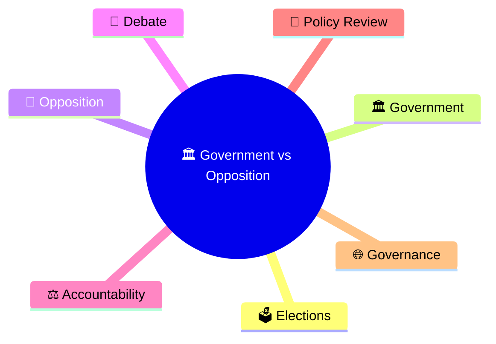
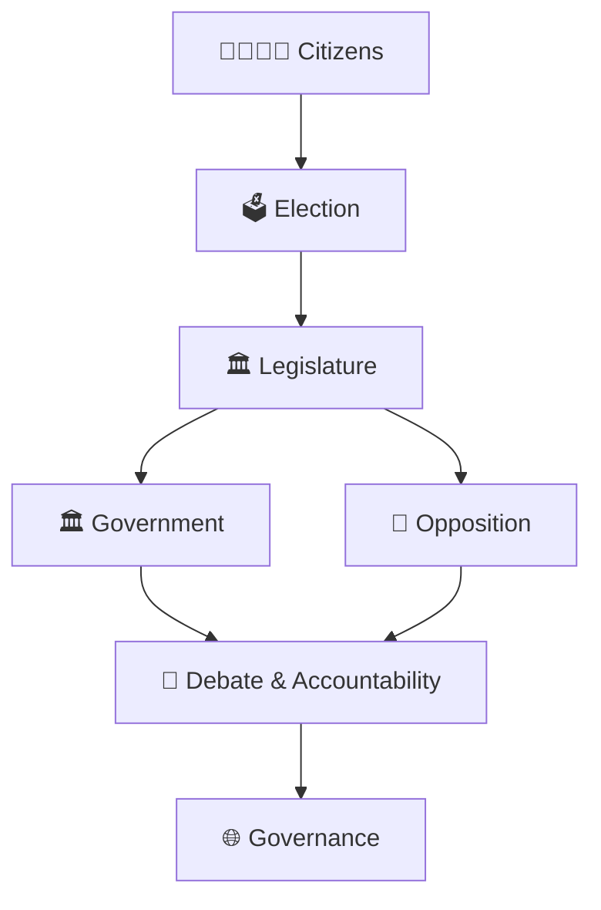
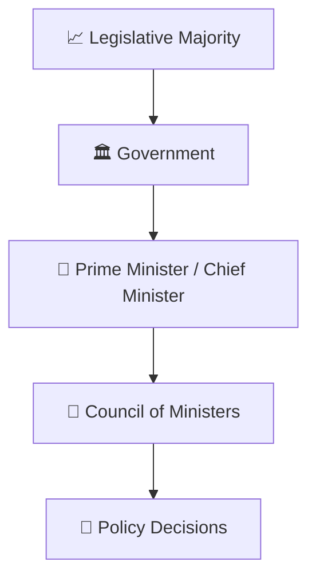
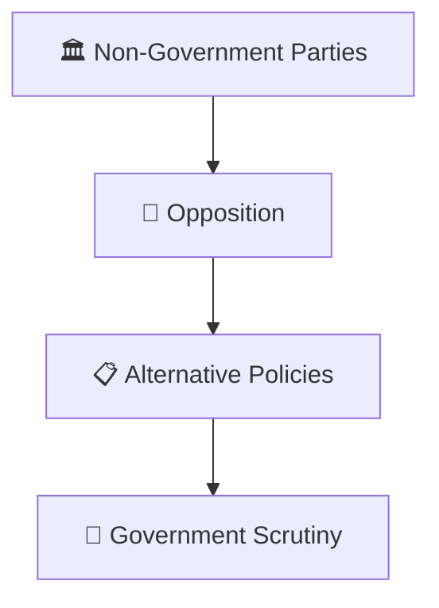
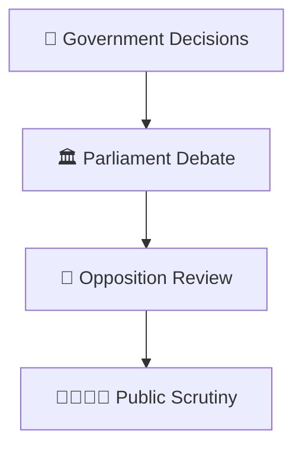
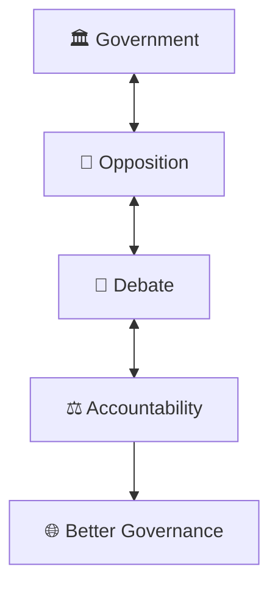
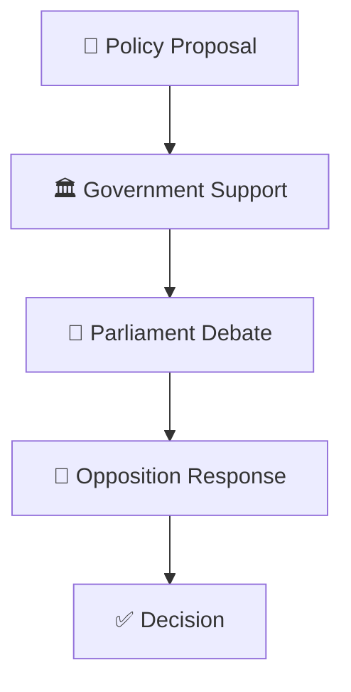
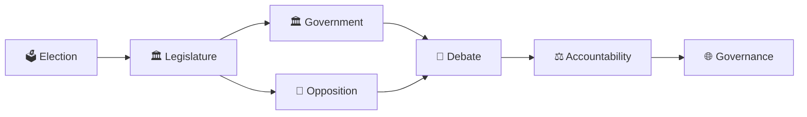

# Government vs Opposition Framework

## Overview

This diagram explains the relationship between the Government and the Opposition in a parliamentary democracy.

It helps visualize how both sides contribute to democratic governance, accountability, policy debates, and legislative decision-making.

---

## Diagram Purpose

Understanding the Government-Opposition framework helps explain:

- How parliamentary democracy functions
- How accountability is maintained
- How public policies are debated
- How alternative viewpoints are represented
- How democratic checks and balances operate

---

---

## Core Framework

---

## Government Structure

### Responsibilities

- Form government
- Implement policies
- Manage administration
- Deliver public services

---

## Opposition Structure

### Responsibilities

- Question government actions
- Present alternative viewpoints
- Represent public concerns
- Strengthen accountability

---

## Parliamentary Accountability Model

---

## Democratic Balance Framework

---

## Legislative Process Interaction

---

## Quick Revision

---

- political-party-ecosystem.md
- party-to-government-journey.md
- coalition-formation-model.md
- election-process-flow.md
- government-formation-process.md
- parliament-and-law-making.md
