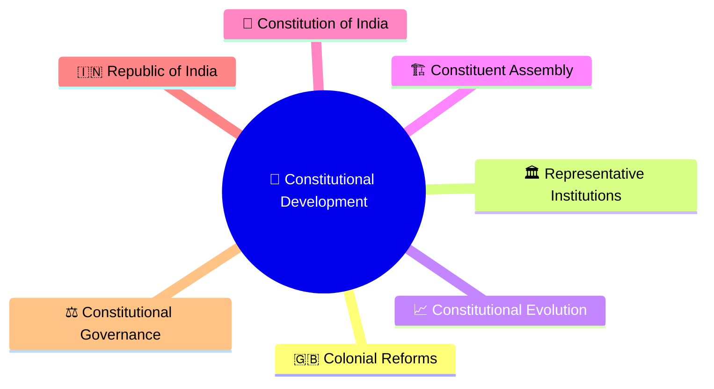
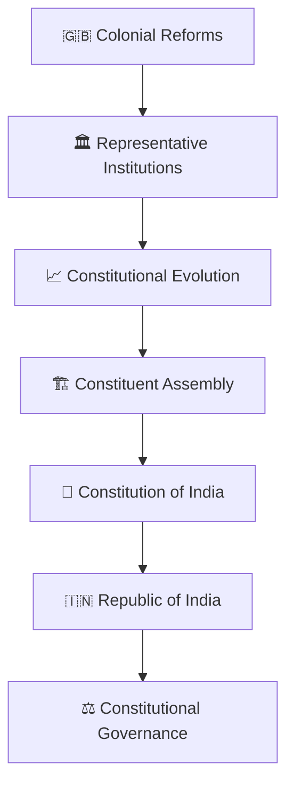
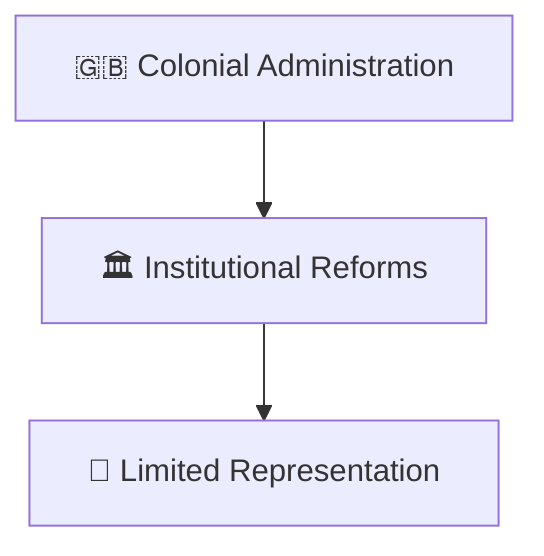
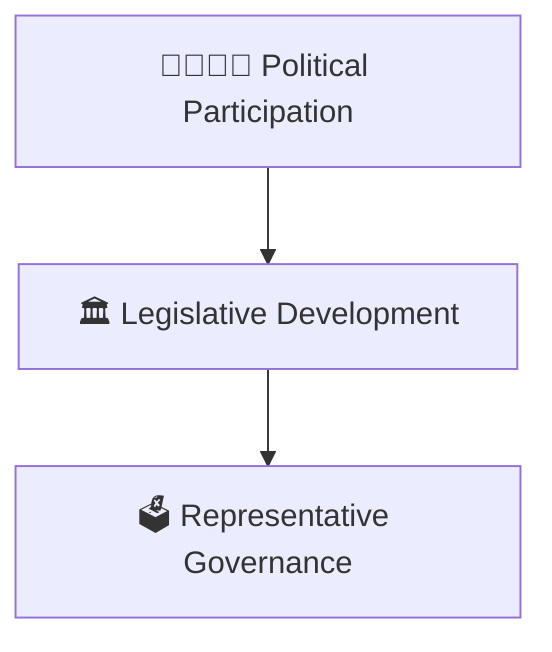
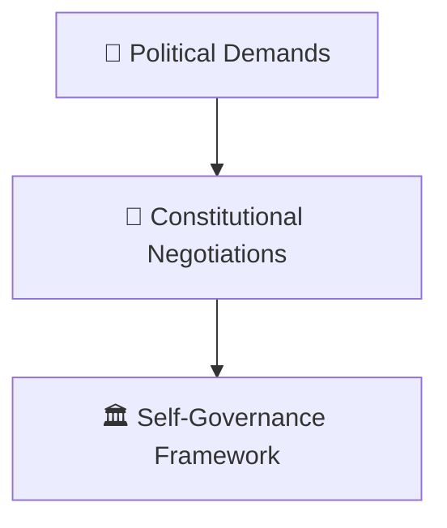
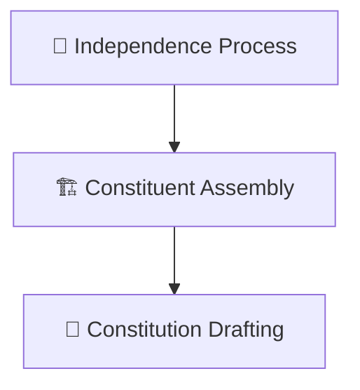
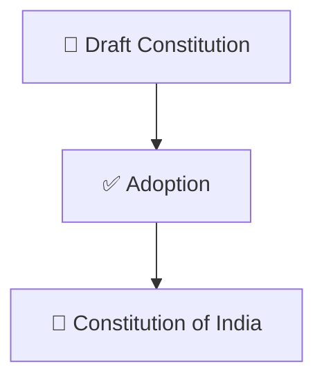
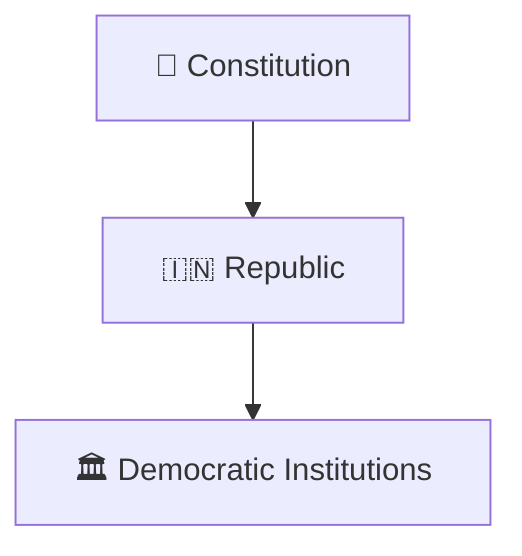
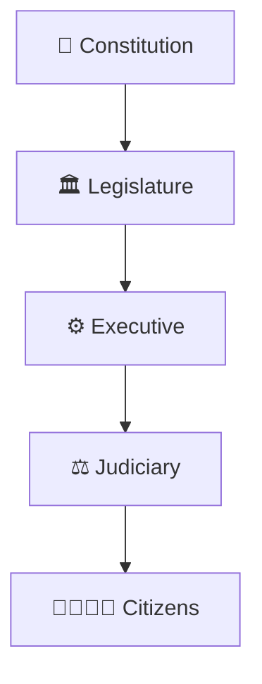

# Constitutional Development Timeline

## Overview

This timeline explains the evolution of constitutional governance in India from colonial constitutional reforms to the Constitution of India and its continuing development.

It provides a high-level view of how representative government, democratic institutions, and constitutional governance emerged.

---

## Diagram Purpose

Understanding constitutional development helps explain:

- How modern governance evolved
- How democratic institutions emerged
- How constitutional principles developed
- How representative government expanded
- How the Republic of India was established

---

## Constitutional Development Timeline

---

## Phase 1: Colonial Constitutional Reforms

### Significance

- Introduction of representative institutions
- Growth of legislative structures

---

## Phase 2: Expanding Representation

### Significance

- Increased public participation
- Expansion of political representation

---

## Phase 3: Constitutional Evolution

### Significance

- Movement toward self-rule
- Development of constitutional ideas

---

## Phase 4: Constituent Assembly

### Significance

- Creation of constitutional framework
- Foundation of democratic institutions

---

## Phase 5: Constitution of India

### Significance

- Rule of law
- Fundamental rights
- Democratic governance

---

## Phase 6: Republic of India

### Significance

- Constitutional government
- Parliamentary democracy
- Independent judiciary

---

## Constitutional Governance Framework

---

## Quick Revision

---

- nation-building-timeline.md
- india-through-time-timeline.md
- constitution-and-nation-building.md
- parliament-and-law-making.md
- judiciary.md
- constitutional-terminology.md
